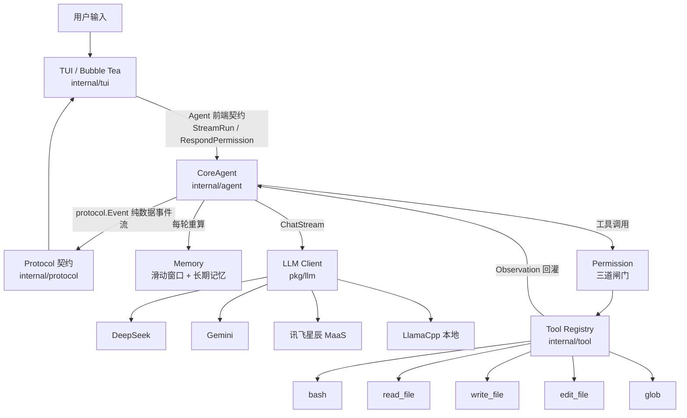

<div align="center">

# Tide

**一个运行在本地终端的通用 AI 个人助手**

ReAct 循环 · Harness 可插拔接缝 · 独立 LLM 驱动 · 三道闸门权限 · 沉浸思考看板

[](https://github.com/coustea/AI-Agent/releases)
[](https://go.dev/dl/)
[](./LICENSE)
[](#环境要求)
[](https://github.com/coustea/AI-Agent/actions)

[项目简介](#项目简介) · [快速开始](#快速开始) · [安装方式](#安装方式) · [配置说明](#配置说明) · [使用示例](#使用示例) · [架构总览](#架构总览) · [贡献指南](#贡献指南)

</div>

---

## 项目简介

tide 是一个用 Go 编写的终端 AI Agent。它不把工作流硬编码进代码，而是遵循 Harness 设计哲学——
**给模型提供工具、知识、上下文管理与权限边界，然后让开**。模型负责决策，代码只负责提供接缝。

| 维度 | 说明 |
|---|---|
| 运行形态 | 单机终端 TUI（[Bubble Tea](https://github.com/charmbracelet/bubbletea)），面向本地单用户 |
| 模型协议 | 所有厂商统一走 **OpenAI Chat Completions** 协议，无需为每家 SDK 单独适配 |
| 交互美学 | Tide Modern 沉浸视觉体系：呼吸卡片对话流、紫晶思考胶囊（`/think` / `Ctrl+T`）、DevTools Bento 工具卡、悬浮命令岛（Command Dock）、Glamour 语法高亮与 Token 统计 |
| 自主心智 | 拒绝被动拒答，遵循 ReAct 思考循环，面对实时信息与环境问题主动调用工具破局 |
| 安全模型 | 工作区沙箱 + 三道闸门权限管线：常规操作自主放行，高风险操作精准触发人工审批，永不静默执行 |
| 跨端契约 | `internal/protocol` 纯数据事件流与配置视图，TUI 与内核零 UI 耦合，可复用于桌面端与无头宿主 |

---

## 目录

- [项目简介](#项目简介)
- [核心特性](#核心特性)
- [快速开始](#快速开始)
- [安装方式](#安装方式)
- [环境要求](#环境要求)
- [配置说明](#配置说明)
- [使用示例](#使用示例)
- [架构总览](#架构总览)
- [内置工具](#内置工具)
- [长期记忆](#长期记忆)
- [权限模型](#权限模型)
- [常见问题](#常见问题)
- [开发与测试](#开发与测试)
- [贡献指南](#贡献指南)
- [安全说明](#安全说明)
- [相关文档](#相关文档)
- [许可证](#许可证)

---

## 核心特性

| 能力 | 说明 |
|---|---|
| **Harness 架构** | 一个 ReAct 循环 + 一圈可插拔接缝（工具、权限、记忆、大模型驱动），代码中不含"替模型做决策"的编排逻辑 |
| **纯数据契约** | `internal/protocol` 零依赖事件流、权限请求与配置视图，TUI 与内核零 UI 耦合，可平滑扩展桌面端与无头宿主 |
| **自主解题心智** | 打破大模型"我无法获取实时信息"的消极惯性，遇到实时数据（如天气、网络诊断、Git 状态）主动调用工具探查 |
| **轻量大模型驱动** | `pkg/llm` 纯净独立、零外部依赖的标准通信库，统一由 BaseURL/APIKey/Model 三要素驱动，原生支持任意 OpenAI 兼容端点与本地服务，支持运行时动态热装配且不丢上下文 |
| **深度思考独立看板** | 专属全屏沉浸式推理链看板（快捷键 `Ctrl+T` 或 `/think`），支持多轮导航、Markdown/Raw 双模式切换与流式增量刷新 |
| **ReAct 工具循环** | 单轮最多 10 步推理-行动迭代，工具结果以 Observation 形式回灌模型，支持错误自愈 |
| **三道闸门权限** | 硬拒绝表 → 风险规则精准匹配（删除 / 提权 / 越界写入等）→ 交互式审批（支持会话级信任），常规命令自主放行，高危操作永不静默执行 |
| **分层长期记忆** | 全局 + 项目两级 Markdown 记忆，每轮对话开始时重新读取，运行期沉淀即时生效 |
| **可观测性链路** | 淘汰 Markdown 拼接，全链路 100% 原生结构体收集，双轨落盘（`.tide/logs/latest.json` 和 `agent.jsonl`），支持终端交互式双栏 Master-Detail JSON 审计看板（`/log`、`/trace`、`Ctrl+L`） |
| **大结果安全落盘** | 工具结果超过阈值（8000 runes）自动全量落盘至 `.tide/tool-results/`，回灌「前缀预览 + 完整路径」，既保护上下文窗口又支持模型回读 |
| **Tide Modern 美学 TUI** | 现代深邃玄黑+潮汐蓝交互视觉、用户微边框容器、折叠沉浸式紫晶思考气泡、DevTools Bento 工具卡片、悬浮命令岛（Command Dock）与 Glamour 语法高亮 |
| **工作区沙箱** | 文件工具通过 `SafePath` 严格限制在工作区与 `~/.tide` 内，阻断 `../` 路径逃逸 |

---

## 快速开始

### 方式一：一键自动安装（推荐，全平台自动化）

**macOS / Linux 用户：**
```bash
curl -fsSL https://raw.githubusercontent.com/coustea/AI-Agent/my-agent/install.sh | bash
```

**Windows 用户（在 PowerShell 中运行）：**
```powershell
irm https://raw.githubusercontent.com/coustea/AI-Agent/my-agent/install.ps1 | iex
```

安装完成后，直接在终端中运行 `tide` 即可启动！首次启动后输入 `/model` 打开配置向导：三步完成 **BaseURL → API Key → ModelName** 快速配置，也可直接使用 `/model <模型名>` 极速切换模型。

---

## 安装方式

### 方式二：下载官方预编译包（免 Go 环境）

直接访问 [GitHub Releases 页面](https://github.com/coustea/AI-Agent/releases) 下载对应系统的预编译包，解压即用：

| 操作系统 / 架构 | 下载文件 | 解压与运行命令 |
|---|---|---|
| **macOS (Apple Silicon M1/M2/M3/M4)** | `tide-darwin-arm64.tar.gz` | `tar -xzf tide-darwin-arm64.tar.gz && ./tide` |
| **macOS (Intel x86_64)** | `tide-darwin-amd64.tar.gz` | `tar -xzf tide-darwin-amd64.tar.gz && ./tide` |
| **Linux (x86_64 / amd64)** | `tide-linux-amd64.tar.gz` | `tar -xzf tide-linux-amd64.tar.gz && ./tide` |
| **Linux (aarch64 / arm64)** | `tide-linux-arm64.tar.gz` | `tar -xzf tide-linux-arm64.tar.gz && ./tide` |
| **Windows (x64)** | `tide-windows-amd64.zip` | 解压后直接在终端运行 `tide.exe` |

---

### 方式三：使用 Go 工具链安装

若本地已安装 Go（1.24+）：
```bash
go install github.com/coustea/AI-Agent/cmd/tide@latest
```

---

### 方式四：源码编译与安装

```bash
# 1. 克隆仓库
git clone https://github.com/coustea/AI-Agent.git
cd AI-Agent

# 2. 编译并安装到 /usr/local/bin
make build
make install   # 或 sudo make install

# 3. 运行
tide
```

---

## 环境要求

| 依赖 | 版本 |
|---|---|
| Go（若从源码编译） | **1.24 或更高**（推荐 1.26.2+，见 [`go.mod`](./go.mod)） |
| 终端 | 支持 ANSI 转义的现代终端（iTerm2 / Windows Terminal / Alacritty 等） |
| 操作系统 | macOS / Linux / Windows |
| 模型服务 | 任意兼容 OpenAI 协议的模型服务端点（如 OpenAI、DeepSeek、Gemini、Ollama、llama.cpp、vLLM 等） |

第三方依赖仅四个直接依赖：`bubbles`、`bubbletea`、`lipgloss`、`glamour`，无 CGO 依赖，100% 静态编译。

---

## 配置说明

tide 全面基于**标准 OpenAI Chat Completions 协议**，不硬编码任何具体厂商。通过 `BaseURL`、`APIKey`、`ModelName` 三要素即可直连任意兼容端点与本地服务。

配置文件按以下**优先级**解析：

1. 代码中显式传入的路径（`LoadConfig(path)`）
2. **当前工作目录**下的 `config.json`（项目级配置优先）
3. 用户主目录的全局配置 `~/.tide/config.json`

若配置文件不存在，程序会**从环境变量自动补全**配置。

### 方式 A：TUI 分步向导（推荐）

在对话界面中直接输入 `/model` 即可调出三步配置向导：
1. **Base URL**：输入服务端点（如 `https://api.openai.com/v1`、`https://api.deepseek.com/v1`，或本地 `http://127.0.0.1:11434/v1`）
2. **API Key**：输入访问密钥（本地服务免密可直接回车跳过；已有密钥直接回车沿用）
3. **Model Name**：输入模型名称（如 `gpt-4o`、`deepseek-chat`、`qwen2.5-coder:7b`）

向导完成后即刻热装配生效并落盘保存。若仅需切换模型名称，可在对话中直接键入：`/model <模型名>`（例如 `/model deepseek-reasoner`、`/model gpt-4o`）。

### 方式 B：手写 `config.json`

```json
{
  "base_url": "https://api.deepseek.com/v1",
  "api_key": "sk-xxxxxxxxxxxxxxxx",
  "model_name": "deepseek-chat"
}
```

> 本地端点（包含 `127.0.0.1`、`localhost` 或 `::1`）无需配置 `api_key`。

### 方式 C：环境变量

```bash
export OPENAI_BASE_URL="https://api.deepseek.com/v1"
export OPENAI_API_KEY="sk-xxxxxxxxxxxxxxxx"
export OPENAI_MODEL="deepseek-chat"
```

### 本地模型（Ollama / llama.cpp）准备

```bash
# 方式 1：使用 Ollama（自带 OpenAI 兼容接口）
ollama run qwen2.5-coder:7b
# 端点为: http://127.0.0.1:11434/v1

# 方式 2：使用 llama.cpp
llama-server -m /path/to/model.gguf --port 8080
# 端点为: http://127.0.0.1:8080/v1
```

本地服务无需 API Key，是离线开发与隐私敏感场景的理想选择。

---

## 使用示例

### 启动

```bash
make run            # 等价于 go run ./cmd/tide
# 或使用已编译的二进制
./tide
```

### 一次典型会话与 Claude Code 美学界面

```text
╭──────────────────────────────────────────────────────────────────────────╮
│ ❯ You                                                                    │
│ 帮我查看 internal/agent/agent.go 里 ReAct 循环的设计，分析为什么这样实现 │
╰──────────────────────────────────────────────────────────────────────────╯
╭──────────────────────────────────────────────────────────────────────────╮
│ 💭 思考过程 (Thinking Process)                                            │
│ 1. 分析需求：用户需要了解 CoreAgent 的 ReAct 循环机制与最大迭代设计      │
│ 2. 计划行动：调用 read_file 工具读取 agent.go 源码定位核心逻辑           │
╰──────────────────────────────────────────────────────────────────────────╯
╭──────────────────────────────────────────────────────────────────────────╮
│ ✔ 工具执行完成: read_file                                                │
│   ↳ 参数: {"path": "internal/agent/agent.go"}                            │
│ ──────────────────────────────────────────────────────────────────────── │
│   ↳ 结果: package agent ... (共 542 行，其余已折叠)                      │
╰──────────────────────────────────────────────────────────────────────────╯
╭──────────────────────────────────────────────────────────────────────────╮
│ ● tide                                                                │
│ 默认最大迭代次数是 10 步，由 NewAgent 中的 maxSteps 字段设定，可通过     │
│ WithMaxSteps 选项覆盖。这种设计的核心目的是……                            │
│ ──────────────────────────────────────────────────────────────────────── │
│ ↳ Token 用量: 4,821 (输入 4,310 / 输出 511)                              │
╰──────────────────────────────────────────────────────────────────────────╯
```

模型会自动决定是否调用工具、调用哪个工具，并把结果作为 Observation 继续推理，直到得出最终回答。输出期间伴随打字机光标推进，生成完成后自动呈现 Glamour 富文本 Markdown 高亮。

### 快捷键

| 按键 | 行为 |
|---|---|
| `Enter` | 发送消息 |
| `PgUp` / `PgDn` | 滚动聊天历史 |
| `Ctrl+C` | 生成中 → 中断当前生成；空闲时 → 退出应用 |
| `Esc` | 生成中 → 中断当前生成；权限审批时 → 拒绝本次 |
| `Ctrl+L` | 呼出全系统执行链路与详细 JSON 追踪看板（双栏 Master-Detail 审计） |
| `Ctrl+D` | 退出应用（输入框为空或位于配置向导时） |
| `y` / `Y` | 权限审批拦截时 → 允许本次执行 |
| `a` / `A` | 权限审批拦截时 → 本会话始终信任并放行 |
| `n` / `N` | 权限审批拦截时 → 拒绝本次执行 |
| `Enter` | 确认当前输入并进入下一步 / 提交生效 |
| `Esc` | 在配置向导或 JSON 追踪看板中取消并返回对话 |

### 斜杠命令

| 命令 | 说明 |
|---|---|
| `/model`、`/config` | 打开三步配置向导（分步配置 BaseURL、API Key 与 Model） |
| `/model <模型名>` | 一键极速切换当前模型名称（如 `/model gpt-4o`、`/model deepseek-chat`） |
| `/think` | 呼出深度思考过程沉浸看板（查看思维链 CoT） |
| `/log`、`/trace` | 呼出全系统执行链路与详细 JSON 追踪看板（查看 100% 原始报文） |
| `/clear` | 清空当前会话上下文与消息列表 |
| `/update` | 查看最新版本升级指引 |
| `/exit`、`/quit`、`/q` | 退出应用 |

### 权限审批示例

仅当调用命中风险规则（如破坏性删除、越界路径）时，界面才会弹出高亮警示卡片；常规只读命令与工作区内文件操作直接放行。

```text
╭──────────────────────────────────────────────────────────────────────────╮
│ 🛡️ [权限审批 Gate 3] · 安全防护拦截                                       │
│                                                                          │
│   工具名称: bash                                                         │
│   调用参数: {"command": "rm -rf build/"}                                 │
│   拦截原因: potentially destructive shell command: file deletion: rm ... │
│                                                                          │
│ ──────────────────────────────────────────────────────────────────────── │
│   [y] 允许本次 (单次执行)   [a] 本会话始终允许 (信任同类)   [n/Esc] 拒绝本次     │
╰──────────────────────────────────────────────────────────────────────────╯
```

| 决策 | 行为 |
|---|---|
| `y` | 仅放行本次调用 |
| `a` | 本会话内对相同 `工具:签名` 始终放行（bash 按完整命令、文件工具按路径记忆） |
| `n` / `Esc` | 拒绝；拒绝原因以 Observation 形式回灌模型，模型可自行调整策略 |

---

## 架构总览

调用链：**LLM (pkg/llm) → Agent → Protocol → TUI**。协议层为纯数据契约（事件流与配置视图），内核零 UI 依赖，同一内核可直接复用于桌面端与无头宿主。



### 分层职责

| 包 | 职责 |
|---|---|
| `internal/config` | 配置加载与持久化，全局/本地配置发现，环境变量自动补全，多厂商配置历史 |
| `pkg/llm` | 纯净独立、零外部依赖的大模型传输层与 OpenAI wire 协议实现，预置 DeepSeek、Gemini、Spark、LlamaCpp，支持通过 `Config.BaseURL` 覆盖端点 |
| `internal/agent` | Harness 核心：ReAct 循环、Persona 与长期记忆合成、纯数据事件分发、工具流水线与权限审查 |
| `internal/protocol` | 零依赖纯数据契约：流式事件、权限请求（RequestID 异步关联）、配置视图与 Token 统计，原生支持跨端序列化 |
| `internal/tool` | 工具接口、线程安全注册表、执行前钩子（`PreToolUse`）、参数校验 |
| `internal/tool/builtin` | 五个内置工具实现与 `SafePath` 沙箱 |
| `internal/permission` | 三道闸门权限管线与审批回调 |
| `internal/memory` | 会话滑动窗口记忆 + 两级长期记忆文件系统 |
| `internal/tui` | Bubble Tea 终端界面、状态机、流式渲染（chat / command / model 分层协作） |

### 项目结构

```text
AI-Agent/
├── cmd/tide/main.go        # 可执行入口：组装 LLM→Agent→Protocol→TUI 调用链
├── pkg/
│   └── llm/                   # 独立大模型传输层与 OpenAI wire 协议实现（零外部依赖）
├── internal/
│   ├── agent/                 # Harness 核心：ReAct 循环、装配、审批桥、事件分发
│   ├── config/                # 配置加载、持久化与环境变量补全
│   ├── fsutil/                # 工作区边界判定的唯一实现（含符号链接解析）
│   ├── memory/                # 滑动窗口记忆与两级长期记忆
│   ├── middleware/            # 横切关注点：链路日志、大结果落盘
│   ├── permission/            # 三道闸门权限管线与命令规范化
│   ├── protocol/              # 纯数据契约：事件流、权限请求、配置视图
│   ├── textutil/              # 文本工具（UTF-8 安全截断）
│   ├── tool/                  # 工具接口、注册表、PreToolUse 钩子
│   │   └── builtin/           # 内置工具、WorkDirRef 沙箱与 SafePath
│   └── tui/                   # Bubble Tea 终端界面
├── outputs/                   # 设计文档
├── Makefile
├── LICENSE
└── go.mod
```

---

## 内置工具

模型可自主调用的六个内置工具（全部受权限管线约束）：

| 工具 | 参数 | 用途 |
|---|---|---|
| `bash` | `command` | 执行非交互式 Shell 命令：CLI 工具、构建/测试、git 操作、`curl` 查询远程 API |
| `read_file` | `path`、`limit`（可选） | 读取工作区内文件内容，支持限制行数 |
| `write_file` | `path`、`content` | 写入完整文件内容，自动创建缺失的父目录 |
| `edit_file` | `path`、`old_text`、`new_text` | 对现有文件做精确的单次文本替换，避免破坏周边代码 |
| `glob` | `pattern` | 递归匹配文件路径（支持 `**`），用于探索仓库结构；默认忽略 `.git`，最多返回 200 条匹配 |
| `grep` | `pattern`、`path`（可选）、`include`（可选）、`max_results`（可选） | 在工作区内按正则全文检索代码与文本，返回带行号的匹配内容，自动过滤二进制文件 |

**安全边界**：文件与检索类工具统一经 `SafePath` 校验，仅允许访问当前工作区与 `~/.tide`；`bash` 配置独立的进程组隔离（PGID），中断时整组杀死派生子进程杜绝孤儿残留；输出上限为 50,000 字节，超出部分自动截断。

### 扩展自定义工具

实现 `tool.Tool` 接口并通过装配选项 `WithTools(registry)` 注册即可：

```go
type Tool interface {
    Name() string
    Description() string
    Schema() json.RawMessage
    Execute(ctx context.Context, args json.RawMessage) (string, error)
}
```

工具本身是**纯执行器，不含任何安全策略**：调用先经 Agent 的三道闸门权限审查，放行后进入注册表执行流水线（`PreToolUse` 钩子链 → 参数校验 → 工具执行）。是否放行始终由权限管线统一裁决。

---

## 长期记忆

tide 在**两级目录**中维护 Markdown 记忆，并在每轮对话开始时重新读取注入系统提示词：

| 层级 | 路径 | 文件 |
|---|---|---|
| 全局 | `~/.tide/memory/` | `preferences.md`（个人偏好）、`learnings.md`（经验沉淀） |
| 项目 | `<工作目录>/.tide/memory/` | `project.md`（工作区背景）、`preferences.md`、`learnings.md` |

- 首次运行会在缺失时**播种模板**（全局 `preferences.md`、项目 `project.md`），已存在的文件不会被覆盖。
- 模型可通过内置文件工具主动读写这些记忆文件；运行期写入的内容**下一轮立即生效**，无需重启。
- 记忆是背景参考而非硬性指令——与用户当前明确要求冲突时，以当前要求为准。
- `.tide/` 已加入 `.gitignore`，不会被提交。

TUI 顶部状态栏会实时显示当前生效的记忆篇数（`🧠 N 篇记忆生效`）。

---

## 权限模型

所有工具调用都会穿过三道闸门（`internal/permission`）裁决：

| 闸门 | 机制 | 行为 |
|---|---|---|
| **Gate 1 — 硬拒绝表** | 字面量黑名单（`rm -rf /`、`sudo `、`shutdown`、`reboot`、`mkfs`、`dd if=`、fork 炸弹等） | 命中即**永久拒绝**，不触发人工审批 |
| **Gate 2 — 风险规则** | 破坏性命令正则（`rm`/`del`/`rmdir`、`git reset --hard`/强制推送、`chmod`/`chown`/`chgrp`、`kill`、`curl \| sh`、系统目录写入、磁盘工具等）与文件工具越界路径（工作区与 `~/.tide` 之外） | 命中才标记"需审批"并进入 Gate 3；**未命中的常规命令直接放行** |
| **Gate 3 — 交互审批** | TUI 审批卡片："允许本次 / 本会话始终允许（按 `工具:签名` 记授信）/ 拒绝" | 无审批通道时**默认拒绝**（安全默认值） |

**精准拦截**：只有命中风险规则的操作才需要人工确认——日常只读查询（`git status`、`go test`、`curl` 探测等）与工作区内文件读写自主放行，不再逐条打断。会话内可按 `a` 对相同签名持续授信；自动化场景可通过 `WithAutoApprove(true)` 全自动放行非硬拒绝操作——请确保仅在可信环境中使用。

---

## 常见问题

<details>
<summary><b>启动后提示「未配置可用模型」怎么办？</b></summary>

输入 `/model` 调出配置向导完成端点与密钥配置；或设置 `OPENAI_API_KEY`（以及可选的 `OPENAI_BASE_URL`、`OPENAI_MODEL`）环境变量后重启。
若使用本地模型（如 Ollama / llama.cpp），端点设置为本地地址即可免密使用。
</details>

<details>
<summary><b>哪些操作会触发权限审批？</b></summary>

只有命中风险规则（Gate 2）的操作才会弹出审批卡片：破坏性文件删除、`git reset --hard` / 强制推送、`chmod` / `chown`、`kill`、`curl | sh`、系统目录写入、工作区外文件访问等。
日常只读命令（如 `git status`、`go test`）与工作区内文件读写会直接放行。会话内可按 `a` 对相同 `工具:签名` 持续授信；
自动化场景可用 `WithAutoApprove(true)` 关闭交互审批——请确保仅在可信环境中使用。
</details>

<details>
<summary><b>切换模型平台后，之前的对话上下文会丢失吗？</b></summary>

不会。配置保存后内核会热装新大模型驱动客户端（`UpdateConfig`），**完整保留当前记忆与已注册工具**。
若需清空上下文，请显式执行 `/clear`。
</details>

<details>
<summary><b>配置文件应该放在哪里？会被提交到仓库吗？</b></summary>

项目级配置放在工作目录的 `config.json`（优先级更高），全局配置放在 `~/.tide/config.json`。
两者以及 `*.local.json` 均已在 `.gitignore` 中排除，不会被提交。
</details>

<details>
<summary><b>如何在不消耗 API 额度的情况下跑测试？</b></summary>

所有测试均使用 `httptest` 服务器或轻量 fake 模拟 Provider 行为，**不需要真实凭据**。
直接执行 `make test` 或 `go test ./...` 即可。
</details>

<details>
<summary><b>支持哪些模型？能接入其他 OpenAI 兼容服务吗？</b></summary>

系统全面基于标准 OpenAI Chat Completions 协议，不硬编码任何具体厂商。通过 `BaseURL`、`APIKey`、`ModelName` 三要素即可直连任意兼容端点（如 OpenAI 官方、DeepSeek、Moonshot、通义千问、Ollama、vLLM、LocalAI 等），本地免密服务（`127.0.0.1` / `localhost`）可直接跳过密钥。
</details>

<details>
<summary><b>问实时信息（如天气、网络状态、git 状态）时，模型为什么能自主调用命令行解决？</b></summary>

系统提示词赋予了模型**自主解题心智（Autonomous Problem-Solving）**：当用户询问外部实时数据或环境状态时，模型不会消极推脱「我无法连接互联网」，而是会主动构思解决方案并通过 `bash` 工具执行只读 CLI 指令（例如 `curl -s "wttr.in/城市?format=3"` 获取天气、`git status` 查看分支状态、`ping` 或 `curl` 探测网络连通性）。只读命令直接执行，高风险命令才会触发 Gate 3 审批，用户确认后即刻将终端结果作为 Observation 回灌模型，形成完整的感知-行动闭环。
</details>

<details>
<summary><b>为什么输出时看到的是打字机光标，结束后才变成富文本高亮？</b></summary>

这是专为终端体验设计的**双模式流式渲染机制**：
- **生成期间（动态低延迟）**：大模型逐 token 流式吐字时，文本尚处于未闭合的语法片段状态（例如未配对的代码块反引号、列表、表格）。若每来一个 chunk 就调用全量 Markdown 解析器，极易引起终端光标跳跃、剧烈闪烁和严重卡顿。因此流式期间采用原生的打字机光标 ` ▊` 流畅跟打，保障极致帧率。
- **完成瞬间（富文本定稿）**：一旦模型输出完成，TUI 立即调用 Charmbracelet 官方的 `glamour` 渲染引擎，将 Markdown 解析为色彩鲜明的圆角卡片、语法高亮代码块和优雅格式，兼顾了生成时的丝滑无卡顿与静态阅读时的精致美感。
</details>

---

## 开发与测试

### 常用命令

| 命令 | 说明 |
|---|---|
| **`make verify`** | **提交前必跑**：格式检查 + `go vet` + 竞态测试 + 构建，与 CI 核心门禁一致 |
| `make lint` | `golangci-lint` 静态分析（需本地安装 v2，CI 亦执行） |
| `make build` | 编译 `./cmd/tide` 为当前平台的本地 `tide` 可执行文件 |
| `make install` | 编译并安装 `tide` 到 `/usr/local/bin` 系统路径 |
| `make release` | 跨平台交叉编译全量发布包（macOS/Linux/Windows 压缩包与 SHA256 校验和） |
| `make run` | 以 `go run` 启动交互式终端界面 |
| `make test` | 运行 `./internal/...` 下的全部单元测试（verbose） |
| `go test ./...` | 运行全部包的测试，含命令包 |
| `make clean` | 删除构建产物、`dist` 发布包与 `test_config.json` |

### 当前测试规模

14 个测试文件、101 个测试用例，覆盖 `agent`、`config`、`fsutil`、`memory`、`middleware`、`permission`、`textutil`、`tool`、`tool/builtin`、`tui`、`llm` 十一个测试包（`cmd` 为纯装配入口、`protocol` 为纯数据契约，无独立测试）。

```bash
$ go test -race -count=1 ./...
?   	my-agent/cmd/tide	[no test files]
ok  	my-agent/internal/agent	3.826s
ok  	my-agent/internal/config	4.318s
ok  	my-agent/internal/fsutil	4.822s
ok  	my-agent/internal/memory	5.874s
ok  	my-agent/internal/middleware	5.342s
ok  	my-agent/internal/permission	6.413s
?   	my-agent/internal/protocol	[no test files]
ok  	my-agent/internal/textutil	6.767s
ok  	my-agent/internal/tool	7.195s
ok  	my-agent/internal/tool/builtin	4.539s
ok  	my-agent/internal/tui	4.451s
ok  	my-agent/pkg/llm	4.741s
```

测试原则：优先使用 `httptest` 服务器或轻量 fake 模拟 Provider 与 Agent 行为，**不依赖真实凭据**。

---

## 贡献指南

欢迎通过 [Issue](https://github.com/coustea/AI-Agent/issues) 与 Pull Request 参与共建。

### 前置约定（重要）

本项目遵循**设计文档先行**的协作约定：

1. **任何新功能或结构性变更，先结合全仓现状提交设计文档，等待审核通过后再动代码。**
2. 设计文档放在 `outputs/` 下，需给出证据（`文件:行`）、候选方案、推荐项、影响面与验收标准。
3. **不为旧内部实现保留兼容层、别名或弃用代码**——直接改写为唯一正确的实现。
4. 面向本地单用户，**不为并发请求设计协调或锁机制**。
5. 各阶段分别验收并暂停，通过后再进入下一阶段。

> 纯文档修订（如本 README）不触发上述流程。

### 代码审查

所有变更遵循 [`outputs/CODE_REVIEW_STANDARD.md`](./outputs/CODE_REVIEW_STANDARD.md)：

- **变更分级**：T0 文档免审；T1 修复（≤200 行）1 人审；T2 功能 1 人审 + 新路径测试；T3 结构性变更需设计文档批准 + 2 人审。
- **严重度**：P0（安全/数据/崩溃/契约破坏）无豁免阻断；P1（常见路径失效/缺兜底/死代码）阻断或书面豁免；P2 记入待办；P3 作者自定。
- **提交前**：必须跑 `make verify` 并在 PR 中贴出结果。
- **闭环**：任何 P0/P1 缺陷须在 48 小时内转成一条测试用例、lint 规则或清单条目。

### 代码风格

- 遵循标准 Go 格式化：提交前执行 `gofmt`（或 `go fmt ./...`）。
- 命名遵循 Go 惯例：导出标识符用 `MixedCaps`，非导出用 `mixedCaps`，包名短小写。
- 应用逻辑放在对应的 `internal/` 包内，新增 Provider 时**保持 pkg/llm 独立与零外部依赖边界不被穿透**。
- 注释使用中文，聚焦"为什么这样做"而非复述代码。

### 测试要求

- 测试文件与被测代码同目录，命名为 `*_test.go`，用例命名为描述性的 `TestXxx`。
- 涉及 Provider 或 Agent 行为的测试，优先使用 `httptest` 服务器或小型 fake，**不引入真实凭据**。
- 提交前确保 `go test ./...` 全绿。

### 提交信息

采用中文「主题：描述」单行风格，一次提交只描述一个变更，主题落到行为变化，例如：

```text
网关扩展：接入讯飞星辰MaaS平台与动态模型路由支持
权限优化：重构为危险命令精准拦截与非危险命令自主放行
架构解耦：建立独立Protocol纯数据契约层并实现TUI与Agent内核完全解耦
```

### Pull Request 清单

- [ ] 说明**面向用户或架构层面**的变更内容
- [ ] 列出验证命令与结果（如 `go build ./...`、`go test ./...`）
- [ ] 关联相关 Issue
- [ ] 若涉及 TUI 可见变更，附终端截图
- [ ] 确认未提交任何真实凭据或含密钥的测试夹具

---

## 安全说明

- **凭据**：`config.json`、`*.local.json`、`test_config.json` 均已加入 `.gitignore`，请勿提交填充了真实密钥的配置文件。
- **密钥存储**：`SaveConfig` 以 `0600` 权限写入配置文件，并确保目录存在。
- **工作区隔离**：文件工具只能读写当前工作区与 `~/.tide`，任何越界路径都会被拒绝。
- **命令执行**：`bash` 命中 Gate 2 风险规则（破坏性删除、提权、系统目录写入等）时触发人工确认，无审批通道时默认拒绝；硬拒绝表中的危险指令永不执行。
- **记忆文件**：长期记忆为明文 Markdown，请避免在其中写入敏感信息。

如发现安全问题，请通过 [Issue](https://github.com/coustea/AI-Agent/issues) 私下联系维护者，勿直接公开披露。

---

## 相关文档

| 文档 | 内容 |
|---|---|
| [`outputs/CODE_REVIEW_STANDARD.md`](./outputs/CODE_REVIEW_STANDARD.md) | **代码审查标准与流程**：分级、严重度、分域清单、门禁与闭环 |
| [`outputs/CODE_REVIEW_R2_2026-10-18.md`](./outputs/CODE_REVIEW_R2_2026-10-18.md) | 全仓架构与代码评审结论（第二轮） |
| [`outputs/DESIGN_HARDENING_2026-10-18.md`](./outputs/DESIGN_HARDENING_2026-10-18.md) | 加固设计方案（D1–D13，已实施） |
| [`outputs/ARCHITECTURE_PLAN.md`](./outputs/ARCHITECTURE_PLAN.md) | 架构演进与统一协议分步实施计划 |
| [`outputs/HARNESS_ARCHITECTURE.md`](./outputs/HARNESS_ARCHITECTURE.md) | Harness 架构设计：循环、接缝与参考实现对照 |
| [`outputs/PURE_CONTRACT_DECOUPLING_PLAN.md`](./outputs/PURE_CONTRACT_DECOUPLING_PLAN.md) | 纯数据契约（Protocol）解耦与规范化重构方案 |
| [`outputs/TUI_AGENT_DECOUPLING_PLAN.md`](./outputs/TUI_AGENT_DECOUPLING_PLAN.md) | TUI 与 Agent 解耦设计与前端契约收敛 |
| [`outputs/OPTIMIZATION_PLAN.md`](./outputs/OPTIMIZATION_PLAN.md) | 全仓架构审查结论与优化方案（P1–P5） |
| [`outputs/P2_BASH_HARDENING.md`](./outputs/P2_BASH_HARDENING.md) | 权限接缝与 Bash 加固设计 |
| [`outputs/SKILL_AUDIT_bubbletea-code-review.md`](./outputs/SKILL_AUDIT_bubbletea-code-review.md) | Bubble Tea TUI 架构规范与代码审查审计报告 |
| [`AGENTS.md`](./AGENTS.md) | 仓库协作约定（构建、测试、提交规范） |

---

## 许可证

本项目基于 [MIT License](./LICENSE) 开源，Copyright (c) 2026 tide。

<div align="center">

**[⬆ 回到顶部](#tide)**

</div>
