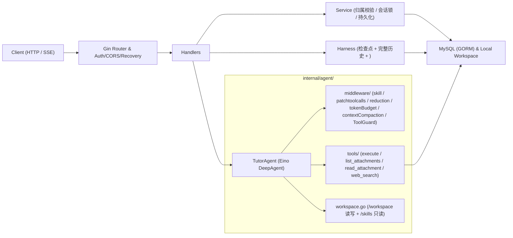

# Mentorly

基于 **Go 1.26**、**CloudWeGo Eino (`v0.9.23`) DeepAgent**、**Gin** 与 **MySQL** 构建的单 TutorAgent 学习智能体后端服务。

TutorAgent 负责教学讲解、文档附件理解与联网检索，并通过官方 Skills、虚拟文件系统与跨平台 Shell 工具直接产出 Word 文档、PDF、表格、Excalidraw 图解、PPT 课件与 HyperFrames 动画讲解视频（无独立 `ResourceAgent` 或硬编码 `generate_*` 工具）。

---

## 目录

- [核心特性](#核心特性)
- [系统架构](#系统架构)
- [中间件、工具与 Skills](#中间件工具与-skills)
- [项目结构](#项目结构)
- [快速开始](#快速开始)
- [配置说明](#配置说明)
- [API 与 SSE 协议](#api-与-sse-协议)
- [安全与隔离](#安全与隔离)
- [开发与测试](#开发与测试)

---

## 核心特性

- **单智能体统一编排**：基于 Eino DeepAgent，通过按需加载只读 `SKILL.md` 完成多模态教学产物创作，遵循「理解需求 → 规划 → 动手做 → 自检 → 交付」。
- **Eino 官方上下文治理链路**：优先复用 Eino 官方 `Skill`、`PatchToolCalls`、`Reduction`（超长输出卸载 + 旧轮次工具清理）与 `Summarization`（超阈值中文摘要 + 检查点持久化），无重复造轮子。
- **System Prompt 前缀缓存友好**：静态系统提示词在启动期构建一次长期复用（含宿主机 OS/Shell 感知）；日期、工作区文件与本轮附件通过每轮 `<turn_context>` 注入，避免逐轮破坏上游 Prompt Cache。
- **多租户工作区与跨平台执行**：每个会话隔离在 `workspace/chat/{user_id}/{conversation_id}`；虚拟文件系统阻断路径穿越与软链接逃逸；自研单文件跨平台 `execute` 工具支持 macOS / Linux / Windows，并由 `ToolGuard` 中间件统一拦截高危命令与技能目录写入。
- **完整流式体验与可观测性**：原生 SSE 实时推送正文、工具状态与错误事件；内置瞬时故障退避重试与 `finish_reason=length` 推理降级重试；结构化 JSON 日志完整追踪模型耗时、Token 用量与工具调用。

---

## 系统架构



### 单轮对话执行流水线

Handler 严格按以下顺序编排（`Service` 不持有 `Harness` 或 `Agent` 实例，`Agent` 不持有数据库依赖，统一在 [`cmd/server/main.go`](cmd/server/main.go) 装配）：

```text
Service.Prepare（校验归属 + 获取会话锁）
  → Harness.Prepare（读取最新压缩检查点 + 完整历史 + 补齐历史 <attachment_ref> + 组装 <turn_context>）
  → Service.SaveUser（落库用户消息；首轮自动截取前 20 字符作为会话标题）
  → Agent.Run（流式执行 ReAct 循环，实时推送 SSE，捕获压缩检查点）
  → Service.SaveResult（保存最终回答、工具调用记录与压缩检查点，发送 done 事件并释放锁）
```

---

## 中间件、工具与 Skills

### 1. Agent 中间件链路（[`middleware/`](internal/agent/middleware)）

每个项目中间件对应一个实现文件，配置、提示词和辅助函数放在所属文件内；Token 用量统计归入 `token.go`。装配顺序由 `agent.go` 声明，官方 Skills 与 PatchToolCalls 直接复用，不新增转发文件。

按注册顺序生效（`BeforeModelRewriteState` 正序执行，`Wrap*` 钩子按洋葱模型外层优先）：

| 顺序 | 名称 | 来源 | 职责 |
|---|---|---|---|
| 内置 | `task` | Eino DeepAgent | 注入独立上下文的 explorer / worker 子代理工具 |
| 最外层 | `ToolGuard` | [toolguard.go](internal/agent/middleware/toolguard.go) | 拦截高危命令与技能目录写入，将可恢复工具错误转为脱敏文本反馈，透传取消等致命错误 |
| `0` | `filesystem` → `skill` | Eino 官方 | 装配文件、Shell 和 Skills 工具，发现 `/skills` 下的技能 |
| `1` | `patchtoolcalls` | Eino 官方 | 调用前补齐历史中断留下的悬空工具结果 |
| `2` | `reduction` | Eino 官方 | 每次调用前成对删除旧工具记录，保留最近一批结果、技能及有效正文，关闭立即截断和卸载 |
| `3` | `todo` | 项目中间件 | 管理任务规划工具及待办提醒 |
| `4` | `tokenBudget` → `contextCompaction` | Eino 摘要与项目策略 | 裁剪后计数，80% 触发、20% 目标、每轮最多一次摘要，校验后保存检查点 |
| `5` | `thinking` | 项目中间件 | 控制供应商思考开关，输出上限由 Token 预算统一决定 |

### 2. 工具清单（[`internal/agent/tools/`](internal/agent/tools)）

- **Eino 内置工具**：`write_todos`、`ls`、`read_file`、`write_file`、`edit_file`、`glob`、`grep`、`task`、`skill`。
- **文件和 Shell 工具**由 Eino filesystem 装配，附件与搜索工具由 `tools.Build` 装配：

| 工具名 | 实现文件 | 说明 |
|---|---|---|
| `execute` | [shell.go](internal/agent/tools/shell.go) | 跨平台通用命令执行器（macOS/Linux 用 `bash`/`sh`，Windows 用 `cmd`），在会话工作区执行，自动过滤 `.env` 密钥、注入 `WORKSPACE`/`SKILLS_DIR`、支持超时，保留完整命令输出 |
| `list_attachments` | [attachments.go](internal/agent/tools/attachments.go) | 按消息顺序列出当前会话实际引用的历史附件（含消息 ID、时间、问题摘要、路径与状态），上下文压缩后可快速回溯 |
| `read_attachment` | [attachments.go](internal/agent/tools/attachments.go) | 零信任校验用户与会话归属后，按 Unicode 字符 `offset`/`limit` 分页读取附件全文 |
| `web_search` | [web_search.go](internal/agent/tools/web_search.go) | 可选 Tavily 联网搜索工具，未配置凭据时自动跳过注册 |

### 3. 内置只读 Skills（[`internal/agent/skills/`](internal/agent/skills)）

| Skill | 用途 |
|---|---|
| `docx` / `pdf` / `pptx` / `xlsx` | Word、PDF、PowerPoint 课件与电子表格的创建、编辑与分析 |
| `excalidraw-diagram` | 流程图、架构图、概念图（`.excalidraw`）生成与校验 |
| `hyperframes` / `hyperframes-cli` / `media-use` | 官方 HyperFrames 动画与讲解视频（`.mp4`）制作与渲染 |

---

## 项目结构

```text
.
├── cmd/server/                   # 服务入口、依赖装配、优雅退出
├── internal/
│   ├── agent/                    # TutorAgent 核心装配、流式执行与 Harness
│   │   ├── agent.go              # 模型构造、静态 System Prompt、DeepAgent 装配与重试策略
│   │   ├── chat.go               # Runner 流式消费、SSE 事件转换、错误分类与 Token 指标
│   │   ├── harness.go            # 检查点 + 完整历史加载、历史附件引用、<turn_context>
│   │   ├── workspace.go          # 虚拟文件系统（/workspace 读写隔离、/skills 只读）
│   │   ├── prompt.md             # 静态基础系统提示词
│   │   ├── middleware/           # Agent 中间件实现及单元测试
│   │   │   ├── filesystem.go     # 文件工具说明与官方 filesystem 配置
│   │   │   ├── reduction.go      # 官方 Reduction 历史工具记录裁剪
│   │   │   ├── token.go          # Token 估算、输出预算、校准与实际 Usage 统计
│   │   │   ├── compaction.go     # 阈值摘要、校验与活动 Skills 保留
│   │   │   ├── thinking.go       # 模型思考模式调度
│   │   │   ├── todo.go           # 待办规划与进度提醒
│   │   │   └── toolguard.go      # 工具校验与错误恢复
│   │   ├── tools/                # 外部业务工具（build / shell / list_attachments / read_attachment / web_search）
│   │   └── skills/               # 只读官方 Skills 目录（运行时严禁修改）
│   ├── config/                   # config.yaml 解析、${ENV} 展开与启动期一致性校验
│   ├── dto/                      # HTTP 请求与响应 DTO
│   ├── handlers/                 # 认证、会话/SSE、附件、工作区下载、健康检查 Handler
│   ├── middleware/               # Gin 中间件（RequestID / Logger / Recovery / CORS / JWT Auth）
│   ├── repository/               # MySQL 仓储（users / conversations / attachments）与工作区文件读取
│   ├── router/                   # HTTP 路由注册
│   ├── service/                  # 业务服务与 JWT 认证服务
│   └── utils/                    # 安全路径拼接与 zap + lumberjack 日志初始化
├── .env.example                  # 环境变量模板
├── Makefile                      # 常用开发、依赖安装、测试与构建命令
└── README.md
```

---

## 快速开始

### 1. 环境依赖

#### 基础必需依赖

| 依赖 | 版本 / 说明 | 安装方式 |
|---|---|---|
| Go | `1.26+` | [go.dev](https://go.dev/dl/) |
| MySQL | `8.0+`（推荐使用空库，启动时 AutoMigrate 自动建表） | 本地或 Docker |
| ripgrep (`rg`) | Eino 文件工具 `grep` 底层检索引擎 | `brew install ripgrep` / 系统包管理器 |

#### Skills 可选工具链（按需预装至宿主机 `PATH`）

服务端不在代码中硬编码编译器或运行时路径，直接继承宿主机环境，由 Agent 按当前系统命令自行定位并调用：

- **Python `3.12` + `uv`**（供 `docx`/`pdf`/`pptx`/`xlsx` 脚本使用）：
  ```bash
  make skills-deps
  # 安装到 ~/.local/share/mentorly/skills-python，请将其 bin 目录加入 PATH
  ```
  完整依赖清单见 [`internal/agent/skills/requirements.txt`](internal/agent/skills/requirements.txt)。
- **Node.js + 全局 npm 包**（供 `pptx`/`docx` 与 HyperFrames 视频渲染使用，建议配置 `NODE_PATH=$(npm root -g)`）：
  ```bash
  npm install -g pptxgenjs docx react-icons react react-dom sharp hyperframes
  ```
- **文档转换与音视频 CLI**（macOS 示例）：
  ```bash
  brew install libreoffice poppler pandoc cairo ffmpeg
  ```
  - 提供 `soffice`、`pdftoppm`、`pdftotext`（PDF 附件提取必需）、`pandoc`、`ffmpeg` 及 `libcairo`（使用 `cairosvg` 时建议配置 `DYLD_FALLBACK_LIBRARY_PATH=/opt/homebrew/lib`）。
  - 附件仅支持 `.doc`、`.docx`、`.pdf`、`.md`（`.doc` 在 macOS 上使用系统内置 `textutil`，`.docx` 使用 Eino 官方解析器）。

### 2. 配置并启动

```bash
# 1. 生成本地 .env 并填写 MySQL、JWT_SECRET（>=32 字节）与 LLM 凭据
make env

# 2. 创建数据库（需本机安装 mysql 客户端，也可手动建库）
make db

# 3. 启动 HTTP 服务（默认监听 0.0.0.0:8080）
make run
```

启动后验证服务与数据库连接：

```bash
curl http://127.0.0.1:8080/healthz
curl http://127.0.0.1:8080/readyz
```

> 未配置 `LLM_API_KEY` 时服务仍可正常启动，发送对话接口返回 `503`；未配置 `SEARCH_PROVIDER` / `SEARCH_API_KEY` 时自动跳过注册 `web_search`。

---

## 配置说明

应用启动按 `.env` → `internal/config/config.yaml`（`${ENV}` 展开）→ 默认值填充 → 启动期强校验顺序加载，可通过 `APP_CONFIG_PATH` 覆盖配置文件路径。

### 环境变量（[`.env.example`](.env.example)）

| 变量 | 说明 | 示例 / 备注 |
|---|---|---|
| `APP_NAME` / `APP_ENV` / `APP_HOST` / `APP_PORT` | 服务名、环境（`development`/`production`）与监听地址 | `0.0.0.0:8080` |
| `JWT_SECRET` / `JWT_ISSUER` / `JWT_EXPIRE` | HS256 签名密钥、签发者与有效期 | `JWT_SECRET` 至少 32 字节；有效期需带单位如 `168h` |
| `LLM_PROVIDER` / `LLM_MODEL` / `LLM_BASE_URL` / `LLM_API_KEY` | OpenAI 兼容模型配置（支持 `spark` / `openai`） | `BaseURL` 不含 `/chat/completions` |
| `MYSQL_USERNAME` / `MYSQL_PASSWORD` / `MYSQL_DATABASE` / `DB_DSN` | MySQL 连接配置 | 显式 `DB_DSN` 优先 |
| `SEARCH_PROVIDER` / `SEARCH_API_KEY` / `SEARCH_BASE_URL` | 可选联网搜索配置（支持 `tavily`） | 留空即禁用 |

### 核心运行参数（[`internal/config/config.yaml`](internal/config/config.yaml)）

| 配置项 | 默认值 | 说明 |
|---|---|---|
| `llm.context_window` | `1000000` | 模型总上下文窗口，按接入模型能力配置 |
| `llm.max_token` | `131072` | 最大输出 Token（含思考），每次调用按剩余窗口扣除安全余量后限制 |
| `llm.timeout` | `60s` | 模型响应头等待上限，整轮总超时由 chat.run_timeout 控制 |
| `chat.max_steps` | `40` | 单轮最大 ReAct 迭代步数 |
| `chat.shell_timeout` | `120s` | 单条 `execute` 命令超时 |
| `chat.run_timeout` | `600s` | 单轮对话总超时 |
| `attachments.max_bytes` / `max_extract_chars` / `max_per_message` | `5MB` / `12000` / `3` | 单文件体积、文本直传上限与单消息最大附件数 |

每次模型调用前通过 Eino Reduction 成对删除旧工具记录，保留最近一批工具结果与已加载 Skills，不再对长工具结果立即截断。主代理在裁剪后输入估算达到窗口 80% 时自动摘要，每轮用户请求最多一次，摘要正文上限 8192 tokens，压缩后总输入目标不超过窗口 20%。摘要使用固定 Markdown 字段，并与活动 Skills、当前请求及必要的最新结果一起保存检查点。子代理只裁剪和统计，超出容量返回预算错误。请求前估算包含工具定义与协议开销，实际 Usage 按主代理、子代理、摘要分别记录，并用于校准估算。

---

## API 与 SSE 协议

路由定义见 [`internal/router/router.go`](internal/router/router.go)，除健康检查和注册/登录外均需 `Authorization: Bearer <token>`：

| 分组 | 方法与路径 | 说明 |
|---|---|---|
| 健康检查 | `GET /healthz`、`GET /readyz` | 存活探测与 MySQL 就绪探测 |
| 认证 | `POST /api/v1/auth/register`、`POST /api/v1/auth/login`、`GET /api/v1/profile` | 注册、登录、获取当前用户资料 |
| 会话 | `POST /api/v1/conversations`、`GET /api/v1/conversations`、`PATCH /api/v1/conversations/:id`、`DELETE /api/v1/conversations/:id` | 创建、分页列表、重命名、删除会话 |
| 对话 | `GET /api/v1/conversations/:id/messages`、`POST /api/v1/conversations/:id/messages` | 查询历史问答（内联附件摘要）、发起流式对话（SSE） |
| 附件 | `POST /api/v1/attachments`、`GET /api/v1/attachments/:id`、`GET /api/v1/attachments/:id/download` | 上传、查询元数据与下载附件原件 |
| 工作区 | `GET /api/v1/workspaces/:id/files`、`GET /api/v1/workspaces/:id/files/*name` | 列出与下载当前会话工作区产物 |

### SSE 事件类型（`POST /api/v1/conversations/:id/messages`）

- `message`：流式回答分片（`reset: true` 时通知前端清空工具调用前的过渡文本或重试前的半截文本）。
- `tool_start` / `tool_end`：工具名称、`call_id`、参数摘要、截断后的结果预览与执行耗时。
- `error`：面向用户的脱敏错误信息及 `retryable` 标记。
- `done`：本轮持久化完成后推送 `message_id`、`status`（`completed` / `failed` / `cancelled`）、总耗时与工具调用列表。

---

## 安全与隔离

- **零信任身份边界**：认证中间件写入 `middleware.Identity`，工具与文件系统后端一律从运行期 `context` 提取 `userID` / `conversationID` / `workspace`，绝不信任模型参数。
- **虚拟文件系统隔离**：文件工具仅允许访问 `/workspace`（读写）与 `/skills`（只读 `ErrReadOnly`），严格阻断路径穿越与软链接逃逸（`ErrPathDenied`）。
- **命令执行防护**：
  - `ToolGuard` 中间件在执行前解析 `command`，拦截跨平台破坏性命令（如 `rm -rf /`、`sudo`、`> /dev/`、Windows 删盘/格式化等）与写入 `/skills` / `$SKILLS_DIR` 操作。
  - `execute` 工具自动剔除 `.env` 敏感应用密钥（`LLM_*`、`JWT_*`、`MYSQL_*`、`DB_DSN`、`*SECRET*`、`*PASSWORD*`、`*TOKEN*`、`*API_KEY*`），防止泄露给子进程。
  - 跨平台 `execute` 直接调用宿主机本地 Shell（无 OS 内核级沙箱）；**多租户生产环境建议配合 Docker / 容器隔离部署**。

---

## 开发与测试

```bash
make vet      # 静态检查（go vet ./...）
make test     # 全量竞态测试（go test ./... -race -count=1，覆盖 13 个测试包）
make build    # 编译服务端二进制至 bin/mentorly
make check    # 一键格式化 + 静态检查 + 编译
make clean    # 清理 bin/ 与 logs/（保留 workspace/ 产物）
```

### 调试日志

服务同时输出控制台日志与按天滚动的 JSON 日志 `logs/YYYY-MM-DD/app.log`（默认 `info` 级别），以 `conversation_id` 串联完整单轮轨迹：`[本轮上下文]`、`[模型调用]`、`[模型响应统计]`（含 `finish_reason`、耗时、Token 用量与推理字符数，不落盘推理原文）、`[Agent 输出]`、`[Agent 工具调用：...]`、`[工具返回：...]`、`[上下文压缩]` 与重试事件；单段超 `16000` 字符自动截断并对常见凭据脱敏。
