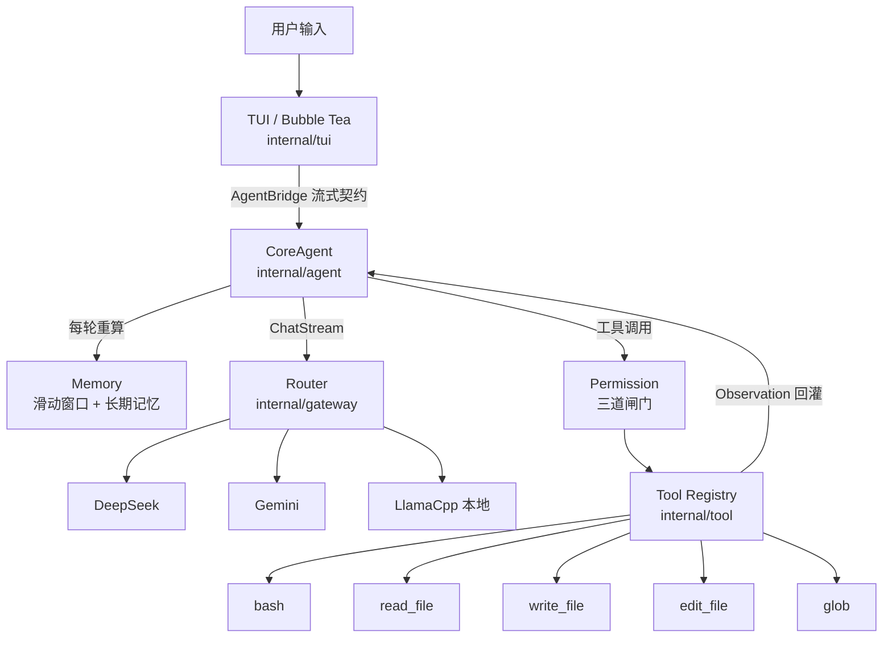

# coustea

> 一个运行在本地终端的通用 AI 个人助手：ReAct 循环 + Harness 可插拔接缝 + 多模型网关 + 三道闸门权限。

coustea 是一个用 Go 编写的终端 AI Agent。它不把工作流硬编码进代码，而是遵循 Harness 设计哲学——
**给模型提供工具、知识、上下文管理与权限边界，然后让开**。模型负责决策，代码只负责提供接缝。

- 运行形态：单机终端 TUI（[Bubble Tea](https://github.com/charmbracelet/bubbletea)），面向本地单用户
- 模型协议：所有厂商统一走 **OpenAI Chat Completions** 协议，无需为每家 SDK 单独适配
- 交互方式：流式打字输出、深度思考链折叠展示、结构化工具调用卡片、Token 用量统计

---

## 目录

- [核心特性](#核心特性)
- [架构总览](#架构总览)
- [环境要求](#环境要求)
- [安装步骤](#安装步骤)
- [配置说明](#配置说明)
- [使用示例](#使用示例)
- [内置工具](#内置工具)
- [长期记忆](#长期记忆)
- [权限模型](#权限模型)
- [开发与测试](#开发与测试)
- [贡献指南](#贡献指南)
- [安全说明](#安全说明)

---

## 核心特性

| 能力 | 说明 |
|---|---|
| **Harness 架构** | 一个 ReAct 循环 + 一圈可插拔接缝（工具、权限、记忆、网关），代码中不含"替模型做决策"的编排逻辑 |
| **多模型网关** | 内置 `llamacpp`（本地）、`deepseek`、`gemini` 三个 Provider，统一 OpenAI 协议，支持运行时热切换且不丢上下文 |
| **ReAct 工具循环** | 单轮最多 10 步推理-行动迭代，工具结果以 Observation 形式回灌模型，支持错误自愈 |
| **三道闸门权限** | 硬拒绝表 → 风险规则匹配 → 交互式审批（支持会话级信任），危险操作永不静默执行 |
| **分层长期记忆** | 全局 + 项目两级 Markdown 记忆，每轮对话开始时重新读取，运行期沉淀即时生效 |
| **流式 TUI** | 终端内实时打字、思考链展示、工具调用卡片、`PgUp/PgDn` 历史滚动、`Ctrl+C`/`Esc` 中断生成 |
| **工作区沙箱** | 文件工具通过 `SafePath` 严格限制在工作区与 `~/.coustea` 内，阻断 `../` 路径逃逸 |

---

## 架构总览

调用链自底向上：**LLM → Gateway → Agent → TUI**。



### 分层职责

| 包 | 职责 |
|---|---|
| `internal/config` | 配置加载与持久化，全局/本地配置发现，环境变量自动补全，多厂商配置历史 |
| `internal/gateway` | 统一网关接口与 OpenAI 协议 wire 层，Router 模型路由，三家 Provider 实现 |
| `internal/agent` | Harness 核心：ReAct 循环、系统提示词合成、流式事件分发、工具流水线 |
| `internal/tool` | 工具接口、线程安全注册表、执行前钩子（`PreToolUse`）、参数校验 |
| `internal/tool/builtin` | 五个内置工具实现与 `SafePath` 沙箱 |
| `internal/permission` | 三道闸门权限管线与审批回调 |
| `internal/memory` | 会话滑动窗口记忆 + 两级长期记忆文件系统 |
| `internal/tui` | Bubble Tea 终端界面、状态机、流式渲染 |

> 设计文档位于 [`outputs/`](./outputs)：`HARNESS_ARCHITECTURE.md`（Harness 架构）、`OPTIMIZATION_PLAN.md`（优化方案）、`P2_BASH_HARDENING.md`（权限接缝）。

---

## 环境要求

| 依赖 | 版本 |
|---|---|
| Go | **1.26.2 或更高**（见 `go.mod`） |
| 终端 | 支持 ANSI 转义的现代终端（iTerm2 / Windows Terminal / Alacritty 等） |
| 操作系统 | macOS / Linux / Windows |
| 模型服务 | 本地 `llama-server`，或 DeepSeek / Gemini 的 API Key（三选一） |

第三方依赖仅三个直接依赖：`bubbles`、`bubbletea`、`lipgloss`，其余为间接依赖。

---

## 安装步骤

### 1. 克隆仓库

```bash
git clone <repository-url> my-agent
cd my-agent
```

### 2. 拉取依赖

```bash
go mod download
```

### 3. 编译

```bash
make build          # 生成当前目录下的 coustea 可执行文件
```

或直接使用 Go 工具链：

```bash
go build -o coustea ./cmd/coustea
```

### 4. 验证安装

```bash
./coustea
```

首次启动若未检测到任何配置，界面会提示"欢迎使用 coustea"，输入 `/model` 即可进入配置向导。

### 5. （可选）加入 PATH

```bash
sudo mv coustea /usr/local/bin/
coustea
```

---

## 配置说明

coustea 按以下**优先级**解析配置文件：

1. 代码中显式传入的路径（`LoadConfig(path)`）
2. **当前工作目录**下的 `config.json`（项目级配置优先）
3. 用户主目录的全局配置 `~/.coustea/config.json`

若配置文件不存在，程序会**从环境变量自动补全**密钥，并按 `DEEPSEEK_API_KEY` → `GEMINI_API_KEY` → `llamacpp` 的顺序选择默认激活的 Provider。

### 方式 A：TUI 向导（推荐）

启动后输入 `/model`，按提示三步完成：选择平台 → 输入 API Key → 确认模型名称。配置会自动持久化到解析出的配置文件中，各厂商的密钥与模型会**分别记住**，之后切换平台无需重复输入。

### 方式 B：手写 `config.json`

```json
{
  "provider": "deepseek",
  "base_url": "https://api.deepseek.com",
  "model_name": "deepseek-flash",
  "api_key": "sk-xxxxxxxxxxxxxxxx",
  "providers": {
    "deepseek": {
      "base_url": "https://api.deepseek.com",
      "model_name": "deepseek-flash",
      "api_key": "sk-xxxxxxxxxxxxxxxx"
    },
    "gemini": {
      "base_url": "https://generativelanguage.googleapis.com/v1beta/openai",
      "model_name": "gemini-2.5-flash",
      "api_key": "AIza-xxxxxxxxxxxxxxxx"
    },
    "llamacpp": {
      "base_url": "http://127.0.0.1:8080",
      "model_name": "local-model"
    }
  }
}
```

> `provider` / `base_url` / `model_name` / `api_key` 为当前激活项；`providers` 保存各厂商的历史配置。
> 保存时当前激活项会自动同步进 `providers`，因此手写时只填 `providers` 也能正常工作。

### 方式 C：环境变量

```bash
export DEEPSEEK_API_KEY="sk-xxxxxxxxxxxxxxxx"
# 或
export GEMINI_API_KEY="AIza-xxxxxxxxxxxxxxxx"
# Gemini 也兼容 GOOGLE_API_KEY
```

### 支持的 Provider

| Provider | 标识 | 默认端点 | 默认模型 | 备选模型 | 需要 API Key |
|---|---|---|---|---|---|
| 本地 llama.cpp | `llamacpp` | `http://127.0.0.1:8080` | `local-model` | — | 否 |
| DeepSeek | `deepseek` | `https://api.deepseek.com` | `deepseek-flash` | `deepseek-v4-pro` | 是 |
| Google Gemini | `gemini` | `https://generativelanguage.googleapis.com/v1beta/openai` | `gemini-2.5-flash` | `gemini-2.5-pro` | 是 |

别名兼容：`llama` / `local` → `llamacpp`，`ds` → `deepseek`，`google` → `gemini`。

### 本地模型（llama.cpp）准备

```bash
# 启动 OpenAI 兼容的本地推理服务
llama-server -m /path/to/model.gguf --port 8080

# 健康检查（返回 200 表示模型已加载完成）
curl http://127.0.0.1:8080/health
```

本地 Provider 无需 API Key，是离线场景与隐私敏感任务的推荐选择。

---

## 使用示例

### 启动

```bash
make run            # 等价于 go run ./cmd/coustea
# 或使用已编译的二进制
./coustea
```

### 一次典型会话

```text
❯ You: 帮我看一下 internal/agent/agent.go 里 ReAct 循环最多迭代多少步，并解释为什么这样设计

● coustea:
  ⏳ 正在调用工具: read_file
  ↳ 参数: {"path":"internal/agent/agent.go"}
  ✔ 工具执行完成: read_file
  ↳ 结果: package agent ...

默认最大迭代次数是 10 步，由 NewAgent 中的 maxSteps 字段设定，可通过
WithMaxSteps 选项覆盖。设置上限的目的是……

  ↳ Token 用量: 4821 (输入 4310 / 输出 511)
```

模型会自动决定是否调用工具、调用哪个工具，并把结果作为 Observation 继续推理，直到得出最终回答。

### 快捷键

| 按键 | 行为 |
|---|---|
| `Enter` | 发送消息 |
| `PgUp` / `PgDn` | 滚动聊天历史 |
| `Ctrl+C` | 生成中 → 中断当前生成；空闲时 → 退出应用 |
| `Esc` | 生成中 → 中断当前生成 |
| `Ctrl+D` | 退出应用（输入框为空时） |
| `↑` / `↓` / `k` / `j` | 配置向导中移动光标 |

### 斜杠命令

| 命令 | 说明 |
|---|---|
| `/model`、`/config` | 打开模型配置向导（选择平台 → API Key → 模型名） |
| `/clear` | 清空当前会话上下文与消息列表 |
| `/exit`、`/quit`、`/q` | 退出应用 |

### 权限审批示例

当模型尝试执行 Shell 命令时，界面会弹出审批卡片：

```text
⚠ [权限审批 Gate 3] 工具 [bash] 尝试执行
参数: {"command":"go test ./internal/agent/..."}
原因: shell command execution: go test ./internal/agent/...

操作: [y] 允许本次  [a] 本会话始终允许  [n/Esc] 拒绝本次
```

| 决策 | 行为 |
|---|---|
| `y` | 仅放行本次调用 |
| `a` | 本会话内对相同 `工具:签名` 始终放行 |
| `n` / `Esc` | 拒绝；拒绝原因以 Observation 形式回灌模型，模型可自行调整策略 |

---

## 内置工具

模型可自主调用的五个内置工具（全部受权限管线约束）：

| 工具 | 参数 | 用途 |
|---|---|---|
| `bash` | `command` | 执行非交互式 Shell 命令：CLI 工具、构建/测试、git 操作、`curl` 查询远程 API |
| `read_file` | `path`、`limit`（可选） | 读取工作区内文件内容，支持限制行数 |
| `write_file` | `path`、`content` | 写入完整文件内容，自动创建缺失的父目录 |
| `edit_file` | `path`、`old_text`、`new_text` | 对现有文件做精确的单次文本替换，避免破坏周边代码 |
| `glob` | `pattern` | 递归匹配文件（支持 `**`），用于探索仓库结构；默认忽略 `.git`、`.agents` |

**安全边界**：文件类工具统一经 `SafePath` 校验，仅允许访问当前工作区与 `~/.coustea`；`bash` 的输出上限为 50,000 字节，超出部分自动截断。

### 扩展自定义工具

实现 `tool.Tool` 接口并通过 `WithTools` 或 `RegisterTools` 注册即可：

```go
type Tool interface {
    Name() string
    Description() string
    Schema() json.RawMessage
    Execute(ctx context.Context, args json.RawMessage) (string, error)
}
```

工具本身是**纯执行器，不含任何安全策略**；是否放行由权限管线统一裁决。

---

## 长期记忆

coustea 在**两级目录**中维护 Markdown 记忆，并在每轮对话开始时重新读取注入系统提示词：

| 层级 | 路径 | 文件 |
|---|---|---|
| 全局 | `~/.coustea/memory/` | `preferences.md`（个人偏好）、`learnings.md`（经验沉淀） |
| 项目 | `<工作目录>/.coustea/memory/` | `project.md`（工作区背景）、`preferences.md`、`learnings.md` |

- 首次运行会在缺失时**播种模板**（全局 `preferences.md`、项目 `project.md`），已存在的文件不会被覆盖。
- 模型可通过内置文件工具主动读写这些记忆文件；运行期写入的内容**下一轮立即生效**，无需重启。
- 记忆是背景参考而非硬性指令——与用户当前明确要求冲突时，以当前要求为准。
- `.coustea/` 已加入 `.gitignore`，不会被提交。

TUI 顶部状态栏会实时显示当前生效的记忆篇数（`🧠 N 篇记忆生效`）。

---

## 权限模型

所有工具调用都必须穿过三道闸门（`internal/permission`）：

| 闸门 | 机制 | 行为 |
|---|---|---|
| **Gate 1 — 硬拒绝表** | 字面量黑名单（`rm -rf /`、`sudo `、`shutdown`、`reboot`、`mkfs`、`dd if=`、fork 炸弹等） | 命中即**永久拒绝**，不触发人工审批 |
| **Gate 2 — 风险规则** | 破坏性命令正则（`rm`/`del`/`rmdir`）、`chmod 777`、写入 `/etc/`、路径逃逸工作区 | 标记为"需审批"，进入 Gate 3 |
| **Gate 3 — 交互审批** | TUI 审批卡片，支持"本次放行"与"本会话始终放行" | 无审批通道时**默认拒绝**（安全默认值） |

**安全默认值**：`alwaysAskBash` 默认为 `true`，即任何 Shell 命令执行前都会提示确认。若需在可信自动化场景中放行，可通过 `WithAutoApprove(true)` 显式关闭交互审批。

---

## 开发与测试

### 常用命令

| 命令 | 说明 |
|---|---|
| `make build` | 编译 `./cmd/coustea` 为本地 `coustea` 可执行文件 |
| `make run` | 以 `go run` 启动终端界面 |
| `make test` | 运行 `./internal/...` 下的包测试（verbose） |
| `go test ./...` | 运行全部包的测试，含命令包 |
| `make clean` | 删除可执行文件与 `test_config.json` |

### 当前测试规模

9 个测试文件、55 个测试用例，覆盖 `agent`、`config`、`gateway`、`memory`、`permission`、`tool`、`tool/builtin`、`tui` 全部包。

```bash
$ go test ./internal/...
ok  	my-agent/internal/agent	2.385s
ok  	my-agent/internal/config	(cached)
ok  	my-agent/internal/gateway	(cached)
ok  	my-agent/internal/memory	2.823s
ok  	my-agent/internal/permission	3.268s
ok  	my-agent/internal/tool	3.689s
ok  	my-agent/internal/tool/builtin	1.998s
ok  	my-agent/internal/tui	4.088s
```

测试原则：优先使用 `httptest` 服务器或轻量 fake 模拟 Provider 与 Agent 行为，**不依赖真实凭据**。

### 项目结构

```text
my-agent/
├── cmd/coustea/main.go        # 可执行入口：组装 LLM→Gateway→Agent→TUI 调用链
├── main.go                    # 根级入口（与 cmd 版本等价）
├── internal/
│   ├── agent/                 # Harness 核心：ReAct 循环与事件分发
│   ├── config/                # 配置加载、持久化与环境变量补全
│   ├── gateway/               # 统一网关、OpenAI wire 层、Router、三家 Provider
│   ├── memory/                # 滑动窗口记忆与两级长期记忆
│   ├── permission/            # 三道闸门权限管线
│   ├── tool/                  # 工具接口、注册表、执行前钩子
│   │   └── builtin/           # 内置工具与 SafePath 沙箱
│   └── tui/                   # Bubble Tea 终端界面
├── outputs/                   # 设计文档
├── Makefile
└── go.mod
```

---

## 贡献指南

### 前置约定（重要）

本项目遵循**设计文档先行**的协作约定：

1. **任何新功能或结构性变更，先结合全仓现状提交设计文档，等待审核通过后再动代码。**
2. 设计文档放在 `outputs/` 下，需给出证据（`文件:行`）、候选方案、推荐项、影响面与验收标准。
3. **不为旧内部实现保留兼容层、别名或弃用代码**——直接改写为唯一正确的实现。
4. 面向本地单用户，**不为并发请求设计协调或锁机制**。
5. 各阶段分别验收并暂停，通过后再进入下一阶段。

> 纯文档修订（如本 README）不触发上述流程。

### 代码风格

- 遵循标准 Go 格式化：提交前执行 `gofmt`（或 `go fmt ./...`）。
- 命名遵循 Go 惯例：导出标识符用 `MixedCaps`，非导出用 `mixedCaps`，包名短小写。
- 应用逻辑放在对应的 `internal/` 包内，新增 Provider 时**保持 gateway 边界不被穿透**。
- 注释使用中文，聚焦"为什么这样做"而非复述代码。

### 测试要求

- 测试文件与被测代码同目录，命名为 `*_test.go`，用例命名为描述性的 `TestXxx`。
- 涉及 Provider 或 Agent 行为的测试，优先使用 `httptest` 服务器或小型 fake，**不引入真实凭据**。
- 提交前确保 `go test ./...` 全绿。

### 提交信息

采用简短祈使句，一次提交只描述一个变更，例如：

```text
Add DeepSeek stream error handling
Fix workspace path escape in edit_file
Refactor permission gate into hook chain
```

### Pull Request 清单

- [ ] 说明**面向用户或架构层面**的变更内容
- [ ] 列出验证命令与结果（如 `go build ./...`、`go test ./...`）
- [ ] 关联相关 Issue
- [ ] 若涉及 TUI 可见变更，附终端截图
- [ ] 确认未提交任何真实凭据或含密钥的测试夹具

---

## 安全说明

- **凭据**：`config.json`、`*.local.json`、`test_config.json` 均已加入 `.gitignore`，请勿提交填充了真实密钥的配置文件。
- **密钥存储**：`SaveConfig` 以 `0600` 权限写入配置文件，并确保目录存在。
- **工作区隔离**：文件工具只能读写当前工作区与 `~/.coustea`，任何越界路径都会被拒绝。
- **命令执行**：`bash` 工具默认对每条命令要求人工确认，硬拒绝表中的危险指令永不执行。
- **记忆文件**：长期记忆为明文 Markdown，请避免在其中写入敏感信息。

---

## 相关文档

| 文档 | 内容 |
|---|---|
| [`outputs/HARNESS_ARCHITECTURE.md`](./outputs/HARNESS_ARCHITECTURE.md) | Harness 架构设计：循环、接缝与参考实现对照 |
| [`outputs/OPTIMIZATION_PLAN.md`](./outputs/OPTIMIZATION_PLAN.md) | 全仓架构审查结论与优化方案（P1–P5） |
| [`outputs/P2_BASH_HARDENING.md`](./outputs/P2_BASH_HARDENING.md) | 权限接缝与 Bash 加固设计 |
| [`AGENTS.md`](./AGENTS.md) | 仓库协作约定（构建、测试、提交规范） |

---

## 许可证

本项目尚未指定开源许可证。如需在组织内外分发，请先补充 `LICENSE` 文件并明确授权范围。
