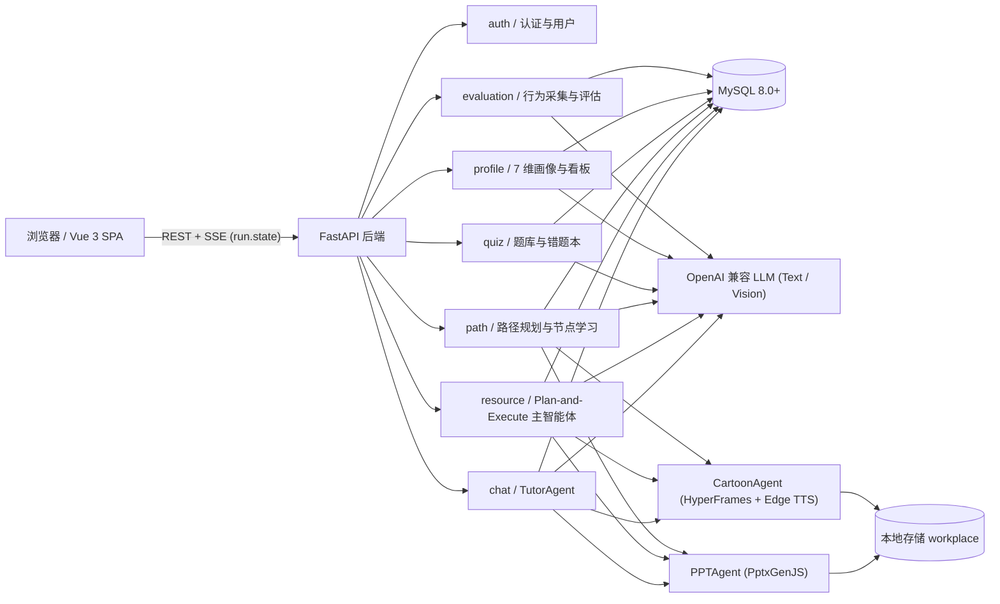

# Mentorly · 多智能体个性化学习平台

Mentorly 是一个面向个性化学习场景的全栈 AI 学习平台。前端基于 **Vue 3 + TypeScript + Vite 7** 构建单页应用，后端基于 **FastAPI + SQLModel (SQLAlchemy Async) + MySQL** 提供异步 API，围绕 **AI 辅导对话、多模态资源生成、学习路径规划、题库与错题本、7 维学习者画像、学习评估** 构建完整学习闭环。

> **编排与系统设计说明**：
> 1. **AI 辅导对话 (`chat`)**：采用基于 `learn-claude-code` 思想的无状态 ReAct / 工具循环与 `RunHooks` 快照状态机，流式推流 `event: run.state`。
> 2. **多模态资源生成 (`resource`)**：采用标准 **Plan-and-Execute 主智能体 (`ResourceLeadAgent`) + 子智能体工具箱 (`ToolRegistry`)** 架构；严格按前端授权清单装配工具白名单并拦截未授权调用，同样通过 `event: run.state` 快照流实现实时多步骤进度与思考流式推送。
> 3. **学习路径规划 (`path`)**：使用两阶段工作流（`research → strategist`），支持节点主教程、自测闯关与按需衍生专属辅助资源。
> 4. **全链路 Loguru 日志体系**：基于 ContextVars 与 `TraceLoggingMiddleware` 实现全局请求追踪（`X-Request-ID`）、用户标记（`[user:xxx]`）、异步长任务隔离与结构化工具/技能入参及结果摘要，告别黑盒。
> 5. **轻量自研架构**：全系统核心智能体流转均采用原生设计，**不依赖 LangGraph 运行时**。

---

## 目录

- [核心能力](#核心能力)
- [系统架构](#系统架构)
- [技术栈](#技术栈)
- [目录结构](#目录结构)
- [快速开始](#快速开始)
- [配置说明](#配置说明)
- [核心链路](#核心链路)
- [Agent 运行时](#agent-运行时)
- [API 概览](#api-概览)
- [数据模型](#数据模型)
- [部署说明](#部署说明)
- [常见问题](#常见问题)
- [项目说明](#项目说明)

---

## 核心能力

- **AI 辅导对话 (`chat`)**：基于 `RunState` 全量快照的 SSE 实时流式输出，支持多模态附件（图片视觉理解与 PDF/Word/Excel/CSV/Markdown 文档解析）、强制 Mermaid 图解模式（`diagram_mode`）、PPT 课件生成与教学视频生成（`video_mode`），并实时展示推理与工具调用步骤时间线（含子智能体内部进度）。
- **三层记忆与个性化档案 (`memory` & `profile`)**：融合会话未压缩近期历史、滚动会话摘要块（`ChatSessionSummaryBlock`）、7 类跨会话长期记忆（`ChatLongTermMemory`）、7 维学习者画像以及个性化教学指令档案（`AGENT.md`）与生效辅导策略。
- **多模态资源生成 (`resource`)**：基于 Plan-and-Execute 架构，由 `ResourceLeadAgent` 担任课程总规划师统筹全局，根据用户自定义勾选的目标智能体（`target_resources`）与强类型偏好（代码语言、动画音色）动态装配工具箱，协同交付课程讲义、思维导图、随堂测验、代码实操、拓展阅读、PPTX 课件与带配音字幕的 MP4 教学动画。
- **全链路追踪与 Loguru 系统日志**：基于 ContextVars 协程级追踪与 `TraceLoggingMiddleware` 为所有 HTTP 请求注入 `X-Request-ID`，JWT 中间件打标用户身份，异步长任务自动隔离 Trace 作用域；提供工具调用参数易读提炼（`summarize_tool_args`）与结果摘要（`summarize_tool_result`），精确记录耗时，消除黑盒调用。
- **学习路径规划 (`path`)**：通过 `research → strategist` 两阶段生成课程级阶段与节点（含自动修复与兜底路径），节点内形成「主教程生成 → 5 题闯关测验 → 按需衍生思维导图/代码/PPT/阅读/视频辅助资源」的学习闭环。
- **题库与错题本 (`quiz`)**：覆盖 408 核心科目（数据结构与算法、计算机组成原理、计算机网络、操作系统），支持单选、多选、判断、填空与主观分析题；客观题与精确填空规则判分，主观题支持单题/批量并发 LLM 审阅；答错题目自动归集至错题本并累计错误次数。
- **7 维学习者画像 (`profile`)**：知识层 3 维（知识基础、易错点偏好、知识缺口模式）+ 认知层 4 维（认知风格、学习目标导向、难度耐受度、自纠能力水平），支持 Onboarding 基线采集、事件驱动画像更新与首页能力雷达图。
- **学习评估与看板 (`evaluation`)**：统一采集跨模块学习行为事件（`LearningEvent`）、页面活跃会话时长（`LearningSession`）与每日首次登录活跃（`UserDailyActivity`），按周期生成学习评估报告（`LearningAssessment`）并反哺当前生效辅导策略。
- **课件与视频生产 (`shared/ppt` & `shared/cartoon`)**：`PPTAgent` 基于 PptxGenJS + LibreOffice + Poppler + 视觉模型逐页审查生产可编辑 `.pptx`；`CartoonAgent` 基于 HyperFrames CLI + Edge TTS + 关键帧视觉审查 + `ffprobe` 校验生产 1080p `.mp4` 教学视频。

---

## 系统架构



- **前端**：Vue 3 SPA，开发环境通过 Vite 将 `/api` 与 `/static` 代理到后端 `127.0.0.1:9999`；Markdown 渲染在独立 Web Worker 中完成语法高亮与公式排版。
- **后端**：FastAPI 单服务，按领域模块化组织（`api.py` → `service.py` → `schemas.py`）；启动时自动建表、清理上次进程遗留的未完成聊天运行，并检查 RAG 索引健康状态。
- **数据与存储**：MySQL 存储全部业务与运行快照数据；用户上传附件、头像、生成的 PPTX/PDF/预览图与 MP4/WebVTT 字幕存储在本地 `storage/workplace` 目录并通过 `/static` 挂载访问。

---

## 技术栈

| 分类 | 选型 |
|------|------|
| **前端核心** | Vue 3.5 (`<script setup lang="ts">`) · TypeScript 5.9 · Vite 7 · Vue Router 4 · Tailwind CSS 4 · PrimeVue 4 · Reka UI |
| **前端渲染与可视化** | Unified / Remark / Rehype (Web Worker) · KaTeX · Shiki · Mermaid 12 · markmap · ECharts 6 · D3 · GSAP · Monaco Editor |
| **后端核心** | Python ≥ 3.13 · FastAPI · SQLModel · SQLAlchemy 2.0 Async · `aiomysql` · Pydantic v2 · Loguru |
| **鉴权与安全** | PyJWT（HS256）· Passlib / bcrypt · 全局 `JWTMiddleware` |
| **Agent 运行时** | 自研无状态 ReAct 循环 (`run_tutor_agent`) · `RunHooks` 快照状态机 · `ToolRegistry` · 沙箱工具集 · 无状态子智能体 |
| **课件与视频** | PptxGenJS · LibreOffice (`soffice`) · Poppler (`pdftoppm`) · HyperFrames CLI · Edge TTS · FFmpeg / `ffprobe` |
| **数据库** | MySQL 8.0+（`server/docker-compose.yml` 提供 MySQL 8.4 容器） |
| **测试与工程化** | `pytest` · `pytest-asyncio` · Vitest · `vue-tsc` · `uv` · `npm` |

---

## 目录结构

```text
.
├── src/                              # Vue 3 + TypeScript 前端源码
│   ├── app/                          # 应用入口 (main.ts)、主布局 (MainLayout.vue)、路由与守卫、学习行为追踪插件
│   ├── components/ui/                # 通用基础 UI 原语 (button / dialog / select / toggle 等)
│   ├── features/                     # 业务域模块
│   │   ├── auth/                     # 登录、注册、Onboarding 首次引导弹窗
│   │   ├── chat/                     # AI 辅导对话 (Tutor.vue, useChatRun.ts, ChatRunStatus, ChatComposer 等)
│   │   ├── dashboard/                # 首页仪表盘视图與聚合接口
│   │   ├── resource/                 # 多模态资源生成向导、实时进度、资源详情与历史
│   │   ├── learning-path/            # 学习路径创建、阶段总览、节点学习工作区、路径历史
│   │   ├── question-bank/            # 题库筛选练习、AI 主观题批改、答题历史、错题本
│   │   ├── profile/                  # 7 维学习者画像、能力雷达、个人资料编辑
│   │   ├── evaluation/               # 学习事件与会话时长上报模型
│   │   └── learning-assessment/      # 学习评估报告与看板可视化页面
│   ├── shared/                       # 跨模块共享基础设施 (Axios 封装、Token 管理、Web Worker Markdown 管线、多模态产物渲染器)
│   └── README.md                     # 前端模块说明文档
├── server/                           # FastAPI 后端工程
│   ├── app/
│   │   ├── auth/                     # 用户注册、登录、JWT 校验、个人资料与头像上传
│   │   ├── chat/                     # TutorAgent 循环、RunHooks 快照流、上下文组装、三层记忆、沙箱与业务工具
│   │   ├── resource/                 # Plan-and-Execute 资源生成 (ResourceLeadAgent + 7 类子工具按需白名单装配)
│   │   ├── path/                     # 学习路径两阶段规划、节点教程/测验/辅助资源 (text_resource.py/ppt.py/cartoon.py)
│   │   ├── profile/                  # 7 维学习者画像服务、Onboarding 落库、AGENT.md 生成与仪表盘推荐
│   │   ├── quiz/                     # 题库分页检索、客观题判分、主观题单题/批量 LLM 审阅、错题本管理
│   │   ├── evaluation/               # 学习事件/会话记录、事实聚合、周期评估报告生成与辅导策略更新
│   │   ├── shared/                   # 跨模块 Agent 基础设施：ToolRegistry、沙箱工具、SkillLoader、PPTAgent、CartoonAgent
│   │   ├── infra/                    # 数据库连接池、统一 SQLModel 表定义 (models.py)、LLM 客户端封装、原生 Loguru 全链路日志
│   │   ├── middleware/               # TraceLoggingMiddleware (请求追踪与耗时)、JWTMiddleware (身份解析)
│   │   ├── config.py                 # YAML 配置加载与路径常量
│   │   ├── exceptions.py             # 全局异常处理
│   │   ├── response.py               # HttpResponse 统一响应信封
│   │   ├── routes.py                 # 路由集中挂载
│   │   └── main.py                   # FastAPI 应用创建与生命周期管理
│   ├── skills/                       # Agent 技能目录 (pptx, hyperframes, hyperframes-cli, hyperframes-registry, media-use)
│   ├── tests/                        # 后端单元测试与集成测试 (镜像 app/ 目录结构)
│   ├── config.example.yaml           # 配置文件模板（复制为 config.yaml 使用）
│   ├── docker-compose.yml            # 本地开发 MySQL 8.4 容器编排
│   ├── pyproject.toml                # Python 依赖与 pytest 配置
│   └── README.md                     # 后端模块说明文档
├── public/                           # 静态公共资源
├── package.json                      # 前端与 HyperFrames CLI 依赖
└── vite.config.ts                    # Vite 构建、分包与开发代理配置
```

---

## 快速开始

### 环境要求

| 依赖 | 版本要求 | 用途 |
|------|----------|------|
| Python | ≥ 3.13 | 后端运行时 |
| uv | 最新版 | Python 依赖管理与虚拟环境运行 |
| MySQL | ≥ 8.0 | 业务数据库（`docker compose` 默认提供 8.4） |
| Node.js | ≥ 22 | 前端构建、PptxGenJS 脚本执行与 HyperFrames CLI |
| FFmpeg / `ffprobe` | ≥ 4.0 | 教学视频编码合成与音视频流校验 |
| LibreOffice (`soffice`) + Poppler (`pdftoppm`) | 最新版 | PPTX 转 PDF 与 PNG 逐页视觉审查预览 |
| 中文字体 | 如 Noto Sans CJK / Hiragino Sans GB | 课件与动画视频中文渲染 |
| Ollama + `bge-m3` | 可选 | 本地知识库向量嵌入服务（也可配置云端兼容接口） |

### 1. 启动 MySQL

可使用 `server/docker-compose.yml` 一键启动开发用 MySQL：

```bash
cd server
docker compose up -d mysql
```

或使用本地已有 MySQL 手动创建数据库：

```sql
CREATE DATABASE agent CHARACTER SET utf8mb4 COLLATE utf8mb4_0900_as_cs;
```

> 服务启动时 `init_db()` 会通过 `SQLModel.metadata.create_all` 自动创建缺失表。注意 `create_all` 不会自动修改已有表的列结构，开发期若变更了列类型或约束，请重建数据库后重启服务。

### 2. 配置并启动后端

```bash
cd server
uv sync
cp config.example.yaml config.yaml
# 编辑 config.yaml，填写 database.url、jwt.secret_key、models.text（及可选的 models.vision）
uv run fastapi dev app/main.py --port 9999
```

- 交互式 API 文档（Swagger UI）：<http://127.0.0.1:9999/docs>
- 生产环境启动命令：
  ```bash
  uv run uvicorn app.main:app --host 0.0.0.0 --port 9999
  ```

### 3. 安装并启动前端

在仓库根目录下执行：

```bash
npm install
npm run dev
```

浏览器访问 <http://localhost:5173>。Vite 默认将 `/api` 与 `/static` 代理至 `http://127.0.0.1:9999`，可通过环境变量覆盖：

```bash
VITE_API_PROXY_TARGET=http://127.0.0.1:9999 npm run dev
```

### 4. 运行测试与类型检查

```bash
# 后端测试
cd server
uv run pytest
uv run pytest tests/chat -q

# 前端单测与生产构建校验（含 vue-tsc 类型检查）
npm run test:run
npm run build
```

---

## 配置说明

后端唯一权威配置源为 `server/config.yaml`（不使用 `.env`）。完整配置模板参见 [server/config.example.yaml](file:///Users/apple/Code/Python/software/server/config.example.yaml)。

| 配置键 | 必填 | 默认值 / 说明 |
|--------|:----:|---------------|
| `app.host` / `app.port` | 否 | 默认 `"127.0.0.1"` / `9999` |
| `database.url` | **是** | MySQL 异步连接串，必须以 `mysql+aiomysql://` 开头 |
| `database.pool_size` / `max_overflow` / `pool_recycle` | 否 | 连接池参数，默认 `20` / `30` / `1800` |
| `jwt.secret_key` | **是** | JWT 签名密钥（建议 ≥ 32 位随机字符） |
| `jwt.algorithm` / `jwt.expire_days` | 否 | 默认 `"HS256"` / `7` 天 |
| `models.text` | **是** | 文本主模型配置：`base_url`、`api_key`、`model_name`、`timeout`（默认 300s）、`max_retries` |
| `models.vision` | 否 | 视觉模型配置：用于 `view_image` 图片理解及 PPT/视频逐帧视觉审查 |
| `paths.workplace` / `logs` | 否 | 本地工作区与日志持久化目录（默认位于 `./storage/*`） |
| `memory.compress_min_messages` / `compress_min_tokens` | 否 | 触发会话摘要压缩的消息数 / Token 阈值，默认 `16` / `4000` |
| `memory.compress_keep_recent_messages` / `summary_context_blocks` | 否 | 压缩时保留的近期消息数（默认 `4`）与加载进上下文的摘要块数（默认 `3`） |
| `memory.update_min_messages` / `update_min_tokens` / `ltm_min_confidence` | 否 | 长期记忆更新阈值（默认 `12` 条 / `6000` Token）与最低写入置信度（`0.75`） |
| `chat.max_upload_files` / `max_file_content_chars` / `history_limit` | 否 | 单轮最大附件数（`12`）、文档解析最大字符数（`15000`）、上下文历史加载条数（`20`） |
| `paths_config.quiz_size` / `pass_score` | 否 | 学习路径节点测验题数（默认 `5`）与通过分数线（默认 `3`） |

---

## 核心链路

### 1. AI 辅导对话 (`server/app/chat/`)

重构后的 `chat` 模块遵循线性、无冗余后台任务嵌套的设计：

```text
POST /api/v1/ai/chat/messages (ChatRequest)
  → 构造统一契约 AgentInput（注入 user_id, username, run_id）
  → prepare_chat_run：
      1. 校验上传附件归属与本地文件存在性 (_validate_attachments)
      2. 行锁获取或创建 ChatSession，检查/恢复异常中断的遗留运行
      3. 落库用户 ChatMessage、更新会话 Token 水位、创建 queued 状态的 ChatRun
      4. 在进程内注册 RunHooks 状态容器 (_active_runs[run_id])
  → BackgroundTasks 启动 execute_chat_run(inp)：
      1. preparing 阶段：build_turn_messages 并行加载未压缩历史、滚动摘要、生效辅导策略与 AGENT.md，
         注入当前日期、附件清单、强制视频 (video_mode) 或强制 Mermaid 图解 (diagram_mode) 指令
      2. 装配工具：build_tutor_tools 构建 13 个工具并绑定子智能体进度回调 hooks.on_subagent_progress
      3. 执行循环：run_tutor_agent 驱动无状态 ReAct 循环（最多 8 步模型调用 / 6 轮工具调用），
         流式文本与工具执行状态实时更新至 RunHooks 并唤醒 SSE 订阅队列
      4. saving 阶段：save_run_result 在单个数据库事务中一次性写入本轮新增的 assistant/tool 消息链、
         更新会话记忆水位并持久化 ChatRun 终态快照，随后向 SSE 订阅者发布最终快照
      5. 后置任务：若运行 completed，通过 asyncio.gather 并发执行会话摘要压缩 (compress_session)、
         长期记忆增量更新 (update_long_term_memory)、学习事件记录 (record_dialogue_event) 与首轮标题生成
```

- **快照流式协议 (`event: run.state`)**：`GET /api/v1/ai/chat/runs/{run_id}/events` 不推送碎片化的增量事件，而是每次状态变更时推送完整 `RunState` 快照（通过容量为 1 的通知队列 + `0.1s` 节流合并，最高约 10 次/秒，空闲 25 秒心跳）。前端刷新或断线重连后直接挂载最新快照即可无缝恢复。
- **随时取消**：`POST /api/v1/ai/chat/runs/{run_id}/cancel` 直接取消运行中的 `asyncio.Task`（进入 `saving` 阶段后保护事务不被打断）。

### 2. 多模态资源生成 (`server/app/resource/`)

重构后的多模态资源生成全面对齐 `chat` 模块快照流与 Plan-and-Execute 架构：

```text
POST /api/v1/ai/resources (ResourceGenerationRequest)
  → 校验 target_resources（用户灵活选择的目标资源类型）与 preferences（代码语言、动画音色）
  → prepare_resource_run：持久化创建 queued 状态任务记录与全局快照状态机 ResourceRunHooks
  → BackgroundTasks 异步执行 execute_resource_run(run_id)：
      1. 白名单装配：build_resource_tools 仅为用户选中的目标智能体构建执行工具 (ToolRegistry)
      2. 独立链路追踪：绑定 trace_scope(f"res-{run_id[:8]}", username)
      3. 主智能体调度：run_resource_lead_agent (ResourceLeadAgent) 作为课程总规划师启动循环：
         - 输出全局教学设计与编排思考流 (thought_text)
         - 依次发起并调度子智能体工具调用 (generate_lecture_content, generate_mindmap 等)
         - 严格权限校验：尝试调用未授权工具直接拦截并拒绝执行，引导主 Agent 输出总结
      4. 终态落库：保存 GeneratedResourceItem 明细、多模态产物与元数据，标记 completed
      5. 快照广播：全生命周期通过 SSE (event: run.state) 实时向前端同步步骤进度与思考卡片
```

| 目标 Agent ID | 工具名称 | 产物格式 | 核心能力说明 |
|---------------|----------|----------|--------------|
| `content` | `generate_lecture_content` | `markdown` | 体系化深度课程讲义正文，包含清晰章节、原理图解与对比解析 |
| `mindmap` | `generate_mindmap` | `markdown` | Mermaid 脑图格式结构化知识导图（前端自适应渲染） |
| `quiz` | `generate_quiz` | `json` | 包含单选、多选与判断题的随堂自测试卷（严格符合试题数据契约） |
| `code` | `generate_code` | `markdown` | 规范工程实战代码示例，严格对齐用户选定的编程语言与难度 |
| `reading` | `generate_reading` | `json` | 权威官方文档与精选学术文献清单（含推荐理由与预估阅读时长） |
| `ppt` | `generate_ppt_deck` | `pptx` | 调用 `PPTAgent`，经 PptxGenJS 编写、LibreOffice 编译与逐页视觉审查 |
| `cartoon` | `generate_teaching_video` | `mp4` | 调用 `CartoonAgent`，经 Edge TTS 旁白合成、HyperFrames 时间轴审查与 1080p 严格渲染 |

- **严格按需调度**：前端勾选哪些 Agent，后端仅装配哪些工具，未选中的工具无法被调用。
- **快照流同步**：对齐 `chat` 模块的 `event: run.state` 实时推送完整状态快照（包含当前步骤、各子智能体实时百分比进度、思考流文本与多模态产物卡片）。

### 3. 学习路径规划与节点学习 (`server/app/path/`)

```text
POST /api/v1/ai/path-plan
  → PathPlannerAgent 两阶段规划 (research → strategist) + repair_plan 结构对齐修复（异常时降级至 build_fallback_plan）
  → 生成阶段与 PathNode（初始首节点 available，其余 locked）
  → 节点学习工作流 (run_learn_workflow)：
      1. start 阶段：调用 RAG 知识库与画像，生成节点主教程 (PathNodeTutorial) 并标记节点为 in_progress
      2. questions 阶段：基于当前教程生成 5 道单选题 (PathNodeQuestion)
      3. quiz 阶段：提交作答并自动判分（答错题自动同步至错题本 WrongQuestion）；
         得分 ≥ 3/5 标记节点 completed（否则 completed_with_gaps），自动解锁后续节点并更新路径总进度
      4. 节点辅助资源：按需异步生成绑定该节点的 mindmap / code / ppt / reading / cartoon 资源 (PathNodeResource)
```

> **架构隔离约束**：独立资源生成（`generated_resources`）与学习路径节点资源（`path_node_resources`）复用底层生成能力，但拥有各自独立的 API 路由、持久化表结构与前端详情视图，互不混用。

### 4. 题库、画像与学习评估

- **题库与错题本 (`server/app/quiz/`)**：支持按科目、题型、难度、关键词分页检索题目；`POST /quiz/review` 与 `POST /quiz/review/batch` 提供主观题单题与并发池批量 AI 批改（填空题精确匹配时规则短路免调模型）；`POST /quiz/submit` 记录答题历史并自动维护错题本。
- **7 维学习者画像 (`server/app/profile/`)**：聚合用户基础学情（学校、专业、年级、目标、选修课程）与 7 个能力维度（文字描述 + 支撑证据 + 0–100 得分），生成每用户专属的 `AGENT.md` 教学档案，并为首页提供冷启动感知的下一步学习推荐、能力雷达图与动态加权快捷入口。
- **学习评估 (`server/app/evaluation/`)**：汇总统计窗口（默认 7 天）内的活跃天数、每日学习时长、模块分布、练习正确率与路径完成率，异步调用 LLM 产出评估报告并更新 `UserProfile.guidance_strategy`（结论、推荐单次时长、辅导风格、重点主题），在下一轮 AI 辅导对话中自动生效。

---

## Agent 运行时

| 模块路径 | 核心职责 |
|----------|----------|
| [`server/app/chat/schemas.py`](file:///Users/apple/Code/Python/software/server/app/chat/schemas.py) | 定义 `ChatRequest`、`AgentInput`、`RunState`、`RunStep`、`SubStep`、`RunArtifact`、`SourceItem` 与 `encode_chat_sse` |
| [`server/app/chat/service.py`](file:///Users/apple/Code/Python/software/server/app/chat/service.py) | 负责 `prepare_chat_run`、`execute_chat_run`、`save_run_result`（单事务落库）、运行取消与会话/历史查询 |
| [`server/app/chat/context.py`](file:///Users/apple/Code/Python/software/server/app/chat/context.py) | 历史消息加载、孤立 `tool_calls` 配对清洗、早期长工具输出裁剪，以及并行注入摘要/辅导策略/`AGENT.md` |
| [`server/app/chat/agent.py`](file:///Users/apple/Code/Python/software/server/app/chat/agent.py) | `run_tutor_agent`：纯净的无状态模型流式调用与工具执行循环，返回 `AgentResult(answer, new_messages)` |
| [`server/app/chat/hooks.py`](file:///Users/apple/Code/Python/software/server/app/chat/hooks.py) | `RunHooks`：记录真实运行阶段、耗时、工具参数/输出预览、引用来源与产物，通过单槽位通知队列驱动 SSE |
| [`server/app/chat/memory.py`](file:///Users/apple/Code/Python/software/server/app/chat/memory.py) | 基于水位线的会话滚动摘要压缩（`compress_session`）与基于稳定信号/阈值的 7 类长期记忆更新（`update_long_term_memory`） |
| [`server/app/chat/tools.py`](file:///Users/apple/Code/Python/software/server/app/chat/tools.py) | 装配 TutorAgent 的 12 个工具，并将 PPT / 视频子智能体的内部进度桥接到 `RunHooks.on_subagent_progress` |
| [`server/app/chat/files.py`](file:///Users/apple/Code/Python/software/server/app/chat/files.py) | 聊天上传文件安全校验、沙箱路径解析及多格式文档（PDF/Docx/Excel/CSV/文本）内容提取 |
| [`server/app/resource/agent.py`](file:///Users/apple/Code/Python/software/server/app/resource/agent.py) | `run_resource_lead_agent`：标准 Plan-and-Execute 循环，课程总规划师生成全局思路并调度子工具 |
| [`server/app/resource/tools.py`](file:///Users/apple/Code/Python/software/server/app/resource/tools.py) | `build_resource_tools`：7 类教学资源 SubAgent 工具箱，根据用户请求白名单动态装配 |
| [`server/app/resource/hooks.py`](file:///Users/apple/Code/Python/software/server/app/resource/hooks.py) | `ResourceRunHooks`：全生命周期资源生成快照容器与单槽位 SSE 通知队列 |
| [`server/app/shared/tools/registry.py`](file:///Users/apple/Code/Python/software/server/app/shared/tools/registry.py) | `Tool` / `ToolRegistry`、`summarize_tool_args` (入参易读提炼) 与 `summarize_tool_result` (结果摘要) |
| [`server/app/shared/tools/`](file:///Users/apple/Code/Python/software/server/app/shared/tools/__init__.py) | 工作区越界防护 (`sandbox.py`)、`SkillLoader` (`skills.py`) 与 7 个内置沙箱工具 (`builtin/`) |
| [`server/app/shared/ppt/agent.py`](file:///Users/apple/Code/Python/software/server/app/shared/ppt/agent.py) | `PPTAgent`：最多 60 步工具循环，PptxGenJS 编写 → LibreOffice/pdftoppm 渲染 → 视觉模型逐页审查修复（最多 2 轮） |
| [`server/app/shared/cartoon/agent.py`](file:///Users/apple/Code/Python/software/server/app/shared/cartoon/agent.py) | `CartoonAgent`：最多 60 步工具循环，Edge TTS (7.3.1+ Sec-MS-GEC v2) 合成中文旁白 → HyperFrames CLI 关键帧截图审查 → 渲染 1080p MP4 并经 `ffprobe` 核验 |
| [`server/app/infra/logging.py`](file:///Users/apple/Code/Python/software/server/app/infra/logging.py) | 原生 Loguru 全链路日志基础设施、ContextVars 链路绑定（`trace_id`、`user`）、彩色控制台与双滚动文件 Sink |
| [`server/app/middleware/trace.py`](file:///Users/apple/Code/Python/software/server/app/middleware/trace.py) | `TraceLoggingMiddleware`：全局 HTTP 请求入口追踪、`X-Request-ID` 生成与回显、毫秒级耗时度量 |

**TutorAgent 可用工具（共 12 个）**

- **沙箱工作区工具（7 个）**：`bash`、`read`、`write`、`edit`、`glob`、`grep`、`view_image`
- **教学业务工具（5 个）**：`read_document`、`get_learner_profile`、`get_long_term_memory`、`generate_ppt_deck`、`generate_teaching_video`

---

## API 概览

所有业务接口统一返回 `HttpResponse` 信封格式：`{ "code": 200, "message": "...", "data": ... }`。

| 路由前缀 | 所属模块 | 核心端点 |
|----------|----------|----------|
| `/api/v1/users` | `auth` | `POST ""`（注册）、`POST /auth`（登录）、`POST /auth/logout`、`GET /auth/status`、`GET/PATCH /me`、`POST /me/avatar` |
| `/api/v1/ai/chat` | `chat` | `POST /messages`、`POST /upload`、`GET /runs/{run_id}`、`GET /runs/{run_id}/events`（SSE）、`POST /runs/{run_id}/cancel`、`GET/POST/PATCH/DELETE /sessions`、`GET /history` |
| `/api/v1/ai/resources` | `resource` | `POST ""`（创建生成任务）、`GET ""`（列表）、`GET /{id}`（详情）、`GET /{id}/status`、`GET /{id}/events`（SSE） |
| `/api/v1/ai/path-plan` | `path` | `POST ""`（创建路径）、`GET /{id}/runs/{run_id}/events`（SSE）、`GET /latest`、`GET /history`、`GET /{id}`、`GET /nodes/{id}/workspace`、`POST /nodes/{id}/start-learning`、`POST /nodes/{id}/tutorial`、`GET/POST /nodes/{id}/questions`、`POST /nodes/{id}/quiz-submit`、`POST /nodes/{id}/resources/{type}`、`POST /{id}/events`、`GET /{id}/evaluation` |
| `/api/v1/ai/profile` | `profile` | `GET/PATCH /profile`、`GET/PATCH /profile/onboarding`、`GET /schools/search` |
| `/api/v1/ai/quiz` & `/wrong` | `quiz` | `GET /quiz`、`POST /quiz/review`、`POST /quiz/review/batch`、`GET /quiz/history`、`POST /quiz/submit`、`GET /wrong`、`POST /wrong/{id}/archive`、`DELETE /wrong/{id}` |
| `/api/v1/ai/evaluation` | `evaluation` | `POST /events`、`POST /sessions`、`POST /assessments`、`GET /assessments/latest`、`GET /assessments`、`GET /assessments/{id}`、`GET /dashboard`、`GET /assessments/{id}/dashboard` |
| `/api/v1/ai/dashboard` | `path` / `profile` / `resource` | `GET /continue-learning`、`GET /recent-resources`、`GET /recommendation`、`GET /profile-radar`、`GET /quick-actions` |

---

## 数据模型

数据库共注册 **26 张表**，集中定义于 [`server/app/infra/models.py`](file:///Users/apple/Code/Python/software/server/app/infra/models.py)：

| 业务域 | 数据表 |
|--------|--------|
| **用户与基础数据** | `users`、`user_daily_activities`、`schools` |
| **AI 辅导与用量** | `chat_sessions`、`chat_messages`、`chat_runs`、`llm_usage` |
| **会话摘要与长期记忆** | `chat_session_summary_blocks`、`chat_long_term_memories` |
| **学习者画像** | `user_profiles`、`user_profile_dimensions` |
| **多模态资源生成** | `generated_resources`、`generated_resource_items`、`generated_resource_agent_runs`、`generated_resource_run_events` |
| **学习路径与节点工作区** | `learning_paths`、`path_nodes`、`path_node_tutorials`、`path_node_questions`、`path_node_resources` |
| **题库与错题本** | `quiz_questions`、`quiz_answer_history`、`wrong_questions` |
| **学习评估与行为事件** | `learning_events`、`learning_sessions`、`learning_assessments` |

---

## 部署说明

1. **前端构建与托管**：执行 `npm run build` 生成 `dist/` 静态产物，由 Nginx 托管，并将 `/api` 与 `/static` 反向代理至后端 FastAPI 服务。
2. **SSE 反向代理配置**：Nginx 代理 `/api/v1/ai/chat/runs/`、`/api/v1/ai/resources/` 与 `/api/v1/ai/path-plan/` 的 SSE 端点时，需配置 `proxy_buffering off;`、`proxy_cache off;` 与充足的 `proxy_read_timeout`（建议 `3600s`）。
3. **进程模型说明**：当前聊天运行态注册表（`_active_runs`）与路径规划事件通道保存在单进程内存中。生产部署建议使用单 Worker（`uvicorn app.main:app --workers 1`），若需多 Worker 水平扩展，需将进程内通知机制替换为 Redis Pub/Sub。
4. **系统级渲染工具链**：如需在生产环境启用 PPT 与教学视频生成，部署宿主机或容器镜像需安装 Node.js ≥ 22、LibreOffice (`soffice`)、Poppler (`pdftoppm`)、FFmpeg / `ffprobe` 及中文字体，并确保仓库根目录已执行 `npm ci`（供 `node_modules/.bin/hyperframes` 与 `pptxgenjs` 调用）。详见 [server/skills/README.md](file:///Users/apple/Code/Python/software/server/skills/README.md)。

---

## 常见问题

| 现象 | 排查与解决方向 |
|------|----------------|
| 启动报错 `database.url` 为空 | 检查 `server/config.yaml` 是否存在且已配置 `mysql+aiomysql://` 连接串 |
| 数据库报错列不存在或表结构不匹配 | `SQLModel.metadata.create_all` 不会自动迁移旧表；开发环境下请删除并重建 `agent` 数据库后重启后端 |
| 知识库检索未生效 | 确认 `config.yaml` 中 `knowledge.enabled: true`，嵌入服务可访问，并已执行 `uv run python -m app.rag.build` |
| PPT 生成失败或中文乱码 | 确认 `soffice`、`pdftoppm` 及中文字体已安装并在 `PATH` 中；macOS Headless 环境可参考 `server/skills/README.md` 字体说明 |
| 教学视频生成失败 | 确认根目录已运行 `npm ci` 安装 `hyperframes`，且 Node.js ≥ 22、`ffmpeg`、`ffprobe` 可用 |
| 语音合成报 403 握手失败 | 微软 Edge 语音端点启用了 `Sec-MS-GEC v2` 校验，请确认已升级至 `edge-tts >= 7.3.1`，执行 `cd server && uv sync` 即可 |
| `pytest` 报 `httpx.InvalidURL: Invalid port ':1]'` | 本机环境变量 `NO_PROXY` / `no_proxy` 含 `[::1]` 等格式时触发，执行 `unset NO_PROXY no_proxy` 后重跑测试 |

---

## 项目说明

- **前端详细文档**：[src/README.md](file:///Users/apple/Code/Python/software/src/README.md)
- **后端详细文档**：[server/README.md](file:///Users/apple/Code/Python/software/server/README.md)
- **Agent 技能与多媒体运行时说明**：[server/skills/README.md](file:///Users/apple/Code/Python/software/server/skills/README.md)
