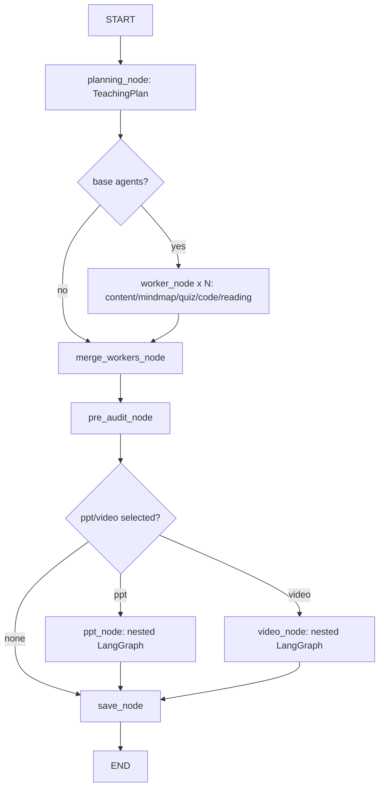

# LangGraph Resource Agent Optimization Implementation Plan

> **For agentic workers:** REQUIRED SUB-SKILL: Use superpowers:subagent-driven-development (recommended) or superpowers:executing-plans to implement this plan task-by-task. Steps use checkbox (`- [ ]`) syntax for tracking.

**Goal:** 重构多智能体资源生成后端，让 standalone resource 使用 LangGraph 完成 `plan -> 基础资源并行 -> PPT/Video 聚合生成`，并让路径规划通过稳定内部接口复用 content/code/mindmap/ppt/reading agent。

**Architecture:** PlanningAgent 只输出总体教学方向、概要、大纲和边界，不输出每个 agent 的任务分配。content/mindmap/quiz/code/reading 并行生成完整资源，同时每个成功结果必须携带短交接摘要 `DownstreamContext`；PPT 和 Video 只读取 `TeachingPlan + DownstreamContext`，不读取上游全文，且各自内部继续使用小型 LangGraph 并行生成页面/分镜。路径域不直接访问 `AGENT_REGISTRY`，改为调用 resource 域暴露的 `generate_path_node_resource()` facade。

**Tech Stack:** FastAPI, SQLModel, PostgreSQL JSONB, Pydantic v2, LangGraph, pytest, Vue TypeScript 最小契约同步。

---

## Non-Negotiable Requirements

- 禁止兼容旧代码：删除/拒绝 `LearningBlueprint`、`AgentInstruction`、`ExecutionPlan`、`previous_results`、`summary_data` 等旧契约。
- PlanningAgent 只负责总体方向、大纲、约束、教学策略；不能输出“content agent 做什么 / ppt agent 做什么”这种 per-agent 指令。
- 基础 agent 成功时必须输出 `downstream_context`，用于下游 PPT/Video/Review 知道“我生成了什么”，避免读取大正文。
- PPT 和 Video 是资源生成系统的同层聚合 agent：它们基于 `TeachingPlan + 上游基础 agent 的 DownstreamContext` 生成，且二者可并行。
- PPT 和 Video 内部可以保留自己的小 LangGraph，不拆多个文件；子 agent 数量少而合适。
- content/code/mindmap/ppt/reading 必须保留路径规划可调用接口，但路径域不应直接理解 registry 或 agent 实例化细节。
- 数据库与 `server/app/infra/models.py`、`server/init_schema.sql` 必须同步；已有 `generated_resources` 与 `generated_resource_items` 表继续承载 standalone resource，不与 path 表合并。
- 优先修改后端；前端只做必要类型/请求字段同步，避免阻塞构建。

## Desired Runtime Topology



This fixes the current early-end bug when only `ppt` or `video` is selected, and prevents PPT/Video from starting before the pre-audit branch has completed.

## File Map

- Modify: `server/app/resource/schemas.py`
  - Make new contracts strict.
  - Keep `TeachingPlan`, `DownstreamContext`, `ResourceInput`, `NodeInput`.
  - Remove old model exports and forbid unknown fields.
- Modify: `server/app/resource/prompts/planning.md`
  - Planning prompt must only produce global teaching plan.
- Modify: `server/app/resource/agents/common.py`
  - Add helpers for handoff validation, compact prompt formatting, path node context.
- Modify: `server/app/resource/agents/content.py`
- Modify: `server/app/resource/agents/mindmap.py`
- Modify: `server/app/resource/agents/code.py`
- Modify: `server/app/resource/agents/reading.py`
- Modify: `server/app/resource/agents/quiz.py`
  - Ensure every successful standalone result emits `downstream_context`.
- Modify: `server/app/resource/agents/ppt.py`
- Modify: `server/app/resource/agents/video.py`
  - Ensure resource generation uses only `TeachingPlan + upstream_handoffs`.
  - Keep internal subgraph in the same file.
  - Keep/verify `generate_node()` for path use.
- Modify: `server/app/resource/workflow_graph.py`
  - Rewire LangGraph topology as above.
  - Add no-base route to `merge_workers`.
  - Run aggregation only after pre-audit.
  - Compile graph through a cached function.
- Modify: `server/app/resource/service.py`
  - Persist final status defensively.
  - Persist plan/review metadata.
  - Save `depends_on_agents`, `source_resource_item_ids`, `output_contract`.
  - Stop importing old contract names.
- Create: `server/app/resource/node_facade.py`
  - Internal resource-domain facade for path-domain resource generation.
- Modify: `server/app/path/service.py`
  - Replace direct `AGENT_REGISTRY[...]().generate_node()` with `generate_path_node_resource()`.
  - Keep path persistence in path tables.
- Modify: `server/app/infra/models.py`
  - Keep generated resource schema aligned with new workflow metadata and handoff fields.
- Modify: `server/init_schema.sql`
  - Keep SQL schema aligned with SQLModel.
- Modify: `server/tests/resource/test_workflow_graph_langgraph.py`
  - New topology/routing tests.
- Modify: `server/tests/resource/test_resource_contract.py`
  - DB/model strict contract tests.
- Modify: `server/tests/resource/test_video_service_orchestration.py`
  - Update no-legacy and handoff tests.
- Create: `server/tests/resource/test_path_node_facade.py`
  - Tests for resource facade used by path planning.
- Modify: `server/tests/infra/test_schema_validation_all.py`
- Modify: `server/tests/test_all_agents.py`
- Modify: `server/tests/test_astron_code.py`
  - Remove old imports and assertions around `ExecutionPlan`/`LearningBlueprint`.
- Modify minimally: `src/features/resource/model/resource.ts`
- Modify minimally: `src/features/resource/model/ResourceGeneratorConstants.ts`
- Modify minimally: `src/features/resource/views/ResourceGenerator.vue`
  - Add missing video config to frontend request/types if still failing build.

---

### Task 1: Seal The New Schema Contract

**Files:**
- Modify: `server/app/resource/schemas.py`
- Test: `server/tests/resource/test_video_service_orchestration.py`
- Test: `server/tests/infra/test_schema_validation_all.py`
- Test: `server/tests/test_all_agents.py`

- [ ] **Step 1: Add failing tests that old request fields are rejected**

Add this test to `server/tests/resource/test_video_service_orchestration.py`:

```python
import pytest
from pydantic import ValidationError

from app.resource.schemas import ResourceInput, NodeInput, ResourceGenerationRequest


def test_resource_input_rejects_removed_previous_results_contract():
    with pytest.raises(ValidationError):
        ResourceInput.model_validate({
            "resource_id": 1,
            "learning_need": "讲解 TCP",
            "previous_results": {"content": "旧契约"},
        })


def test_resource_generation_request_rejects_removed_summary_data_contract():
    with pytest.raises(ValidationError):
        ResourceGenerationRequest.model_validate({
            "learning_need": "讲解 TCP",
            "selected_agents": [{"agent_id": "content", "enabled": True}],
            "summary_data": {"content": "旧契约"},
        })


def test_node_input_rejects_unknown_legacy_fields():
    with pytest.raises(ValidationError):
        NodeInput.model_validate({
            "path_id": 1,
            "node_id": 2,
            "node_key": "n1",
            "path_title": "网络学习路径",
            "path_goal": "掌握 TCP",
            "node_title": "TCP",
            "tutorial_title": "TCP 教程",
            "tutorial_markdown": "正文",
            "previous_results": {},
        })
```

- [ ] **Step 2: Run tests and verify failure**

Run from `server/`:

```bash
uv run pytest tests/resource/test_video_service_orchestration.py::test_resource_input_rejects_removed_previous_results_contract tests/resource/test_video_service_orchestration.py::test_node_input_rejects_unknown_legacy_fields -q
```

Expected: fail because `ResourceInput` and `NodeInput` currently allow extra fields.

- [ ] **Step 3: Make runtime input models strict**

In `server/app/resource/schemas.py`, add `model_config = ConfigDict(extra="forbid")` to `ResourceInput`, `NodeInput`, `AgentResult`, `DownstreamMaterial`, and `DownstreamContext`.

Expected final definitions:

```python
class DownstreamMaterial(BaseModel):
    model_config = ConfigDict(extra="forbid")

    outline_id: str = ""
    type: Literal["explanation", "structure", "practice", "code", "reading", "example", "visual"] = "explanation"
    summary: str = Field(default="", max_length=500)
    key_points: list[str] = Field(default_factory=list, max_length=8)
    evidence_excerpt: str = Field(default="", max_length=180)
    priority: int = Field(default=3, ge=1, le=5)


class DownstreamContext(BaseModel):
    """基础 agent 给 PPT/Video/Review 的短交接摘要。"""
    model_config = ConfigDict(extra="forbid")

    schema_version: Literal["resource_handoff/v1"] = "resource_handoff/v1"
    source_agent: str
    title: str = ""
    one_sentence_summary: str = Field(default="", max_length=180)
    covered_outline_ids: list[str] = Field(default_factory=list)
    materials: list[DownstreamMaterial] = Field(default_factory=list, max_length=8)
    reusable_assets: ReusableAssets = Field(default_factory=ReusableAssets)
    cautions: list[str] = Field(default_factory=list, max_length=6)


class AgentResult(BaseModel):
    model_config = ConfigDict(extra="forbid")

    success: bool = True
    content: str = ""
    file_type: str = "markdown"
    title: str = ""
    summary: str = ""
    metrics: dict[str, Any] = Field(default_factory=dict)
    downstream_context: DownstreamContext | None = None
    metadata: dict[str, Any] = Field(default_factory=dict)
    error: str = ""


class ResourceInput(BaseModel):
    """standalone 多智能体资源生成输入。"""
    model_config = ConfigDict(extra="forbid")

    resource_id: int | None = None
    learning_need: str
    learning_scenario: LearningScenario = "self_study"
    agent_name: str = ""
    agent_config: dict[str, Any] = Field(default_factory=dict)
    teaching_plan: TeachingPlan | None = None
    profile: dict[str, Any] = Field(default_factory=dict)
    upstream_handoffs: dict[str, DownstreamContext] = Field(default_factory=dict)


class NodeInput(BaseModel):
    """路径规划当前节点资源生成输入。"""
    model_config = ConfigDict(extra="forbid")

    path_id: int
    node_id: int
    node_key: str
    path_title: str
    path_goal: str
    stage_id: str | None = None
    node_title: str
    difficulty: str | None = None
    mastery_target: str | None = None
    prerequisites: list[str] = Field(default_factory=list)
    knowledge_points: list[str] = Field(default_factory=list)
    weak_knowledge_points: list[str] = Field(default_factory=list)
    generation_focus: list[str] = Field(default_factory=list)
    tutorial_title: str
    tutorial_summary: str | None = None
    tutorial_markdown: str
    profile: dict[str, Any] = Field(default_factory=dict)
    existing_resources: dict[str, AgentResult] = Field(default_factory=dict)
    agent_config: dict[str, Any] = Field(default_factory=dict)
```

- [ ] **Step 4: Remove old imports from global tests**

In `server/tests/infra/test_schema_validation_all.py`, remove imports of `ExecutionPlan`. Replace old schema fixture assertions with assertions against `TeachingPlan`.

Use this replacement pattern:

```python
from app.resource.schemas import TeachingPlan


def test_teaching_plan_schema_accepts_global_outline_only():
    plan = TeachingPlan.model_validate({
        "topic": "TCP",
        "learning_goal": "理解三次握手和可靠传输",
        "audience": "初学者",
        "difficulty": "beginner",
        "teaching_strategy": "先直观类比，再协议细节",
        "summary": "围绕连接建立、确认机制和常见误区讲解 TCP。",
        "outline": [
            {
                "id": "o1",
                "title": "TCP 要解决的问题",
                "goal": "理解可靠传输的目标",
                "key_points": ["连接", "确认", "重传"],
            }
        ],
        "boundaries": ["不展开拥塞控制算法推导"],
    })

    assert plan.outline[0].id == "o1"
```

In `server/tests/test_all_agents.py`, replace `LearningBlueprint`, `AgentInstruction`, `ExecutionPlan` imports with:

```python
from app.resource.schemas import TeachingPlan, DownstreamContext, AgentResult
```

Update assertions to check:

```python
assert hasattr(TeachingPlan, "model_validate")
assert hasattr(DownstreamContext, "model_validate")
assert hasattr(AgentResult, "model_validate")
```

Do not leave any test import of `ExecutionPlan`, `LearningBlueprint`, or `AgentInstruction`.

- [ ] **Step 5: Verify schema contract**

Run from `server/`:

```bash
uv run pytest tests/resource/test_video_service_orchestration.py tests/infra/test_schema_validation_all.py tests/test_all_agents.py -q
```

Expected: pass or only fail on unrelated pre-existing test expectations that this task explicitly updates.

- [ ] **Step 6: Commit**

```bash
git add server/app/resource/schemas.py server/tests/resource/test_video_service_orchestration.py server/tests/infra/test_schema_validation_all.py server/tests/test_all_agents.py
git commit -m "refactor: seal resource generation schema contract"
```

---

### Task 2: Make Planning Output Global Direction Only

**Files:**
- Modify: `server/app/resource/prompts/planning.md`
- Modify: `server/app/resource/agents/planning.py`
- Test: `server/tests/resource/test_prompt_contracts.py`

- [ ] **Step 1: Add prompt contract tests**

Add to `server/tests/resource/test_prompt_contracts.py`:

```python
from pathlib import Path


def test_planning_prompt_does_not_assign_per_agent_tasks():
    prompt = Path("app/resource/prompts/planning.md").read_text(encoding="utf-8")

    forbidden = [
        "agent_instructions",
        "每个 agent",
        "content agent",
        "ppt agent",
        "video agent",
        "为各 agent",
        "AgentInstruction",
        "ExecutionPlan",
        "LearningBlueprint",
    ]
    for word in forbidden:
        assert word not in prompt


def test_planning_prompt_requires_global_teaching_plan_fields():
    prompt = Path("app/resource/prompts/planning.md").read_text(encoding="utf-8")

    for word in ["topic", "learning_goal", "summary", "outline", "boundaries"]:
        assert word in prompt
```

- [ ] **Step 2: Run prompt tests and verify failure if old wording remains**

Run from `server/`:

```bash
uv run pytest tests/resource/test_prompt_contracts.py::test_planning_prompt_does_not_assign_per_agent_tasks tests/resource/test_prompt_contracts.py::test_planning_prompt_requires_global_teaching_plan_fields -q
```

Expected: fail if the prompt still contains per-agent planning wording.

- [ ] **Step 3: Rewrite planning prompt**

Replace `server/app/resource/prompts/planning.md` with a prompt that requires this JSON shape and explicitly forbids per-agent task allocation:

```markdown
你是资源生成系统的教学规划智能体。你只负责根据用户学习需求生成全局教学方向、概要、大纲和边界，不能给 content、mindmap、quiz、code、reading、ppt、video 分配具体任务。

输入包含：
- 学习需求
- 学习场景
- 学习者画像摘要
- 已启用资源类型列表

输出必须是严格 JSON 对象，不要 markdown fence：

{
  "topic": "主题",
  "learning_goal": "学习目标",
  "audience": "目标学习者",
  "difficulty": "beginner | intermediate | advanced",
  "teaching_strategy": "整体教学策略",
  "summary": "100-200 字整体概要",
  "outline": [
    {
      "id": "o1",
      "title": "大纲标题",
      "goal": "这一节要达成的理解目标",
      "key_points": ["要点1", "要点2"],
      "common_misconceptions": ["常见误区"],
      "suggested_examples": ["建议例子"],
      "suggested_visuals": ["建议视觉表达"],
      "must_not_miss": true
    }
  ],
  "boundaries": ["不展开的内容或风险边界"]
}

规则：
- outline 是全局教学大纲，不是 agent 执行计划。
- id 必须从 o1 开始连续递增。
- 只输出上方 JSON 字段，任何额外字段都不允许。
- 不要写“某某 agent 应该生成什么”。
- 大纲应足够让所有下游资源保持同一主题、目标、难度和边界。
```

- [ ] **Step 4: Harden `PlanningAgent` parsing**

In `server/app/resource/agents/planning.py`, ensure `generate_resource()` validates only `TeachingPlan`.

Expected parsing structure:

```python
parsed = salvage_json_from_llm(raw_content)
if not parsed:
    return AgentResult(success=False, error="规划智能体未返回合法 JSON", metadata={"agent_id": self.agent_id})

try:
    teaching_plan = TeachingPlan.model_validate(parsed)
except Exception as exc:
    return AgentResult(success=False, error=f"规划结果不符合 TeachingPlan: {exc}", metadata={"agent_id": self.agent_id})

return AgentResult(
    success=True,
    content=teaching_plan.model_dump_json(ensure_ascii=False),
    file_type="json",
    title=f"{teaching_plan.topic} 教学规划",
    summary=teaching_plan.summary,
    metadata={
        "agent_id": self.agent_id,
        "teaching_plan": teaching_plan.model_dump(mode="json"),
        "output_contract": "teaching_plan/v1",
    },
)
```

- [ ] **Step 5: Verify**

Run from `server/`:

```bash
uv run pytest tests/resource/test_prompt_contracts.py -q
```

Expected: pass.

- [ ] **Step 6: Commit**

```bash
git add server/app/resource/prompts/planning.md server/app/resource/agents/planning.py server/tests/resource/test_prompt_contracts.py
git commit -m "refactor: constrain planning agent to global teaching plan"
```

---

### Task 3: Require Compact Handoffs From Base Agents

**Files:**
- Modify: `server/app/resource/agents/common.py`
- Modify: `server/app/resource/agents/content.py`
- Modify: `server/app/resource/agents/mindmap.py`
- Modify: `server/app/resource/agents/code.py`
- Modify: `server/app/resource/agents/reading.py`
- Modify: `server/app/resource/agents/quiz.py`
- Modify: `server/app/resource/service.py`
- Test: `server/tests/resource/test_handoff_coverage.py`
- Test: `server/tests/resource/test_review_handoff_envelope.py`

- [ ] **Step 1: Add failing tests for mandatory handoff**

Add to `server/tests/resource/test_handoff_coverage.py`:

```python
import pytest

from app.resource.schemas import AgentResult, DownstreamContext, TeachingPlan, TeachingOutlineItem
from app.resource.service import _collect_successful_handoffs, _require_downstream_context_for_base_result


def test_successful_base_agent_without_handoff_is_rejected():
    result = AgentResult(
        success=True,
        content="完整正文",
        file_type="markdown",
        title="课程内容",
        summary="摘要",
        metadata={"agent_id": "content"},
    )

    with pytest.raises(ValueError, match="downstream_context"):
        _require_downstream_context_for_base_result("content", result)


def test_successful_base_agent_handoff_covers_valid_outline_ids_only():
    plan = TeachingPlan(
        topic="TCP",
        outline=[
            TeachingOutlineItem(id="o1", title="连接建立"),
            TeachingOutlineItem(id="o2", title="可靠传输"),
        ],
    )
    result = AgentResult(
        success=True,
        content="正文",
        file_type="markdown",
        title="课程内容",
        summary="摘要",
        downstream_context=DownstreamContext(
            source_agent="content",
            covered_outline_ids=["o1", "bad"],
            one_sentence_summary="解释 TCP 连接建立。",
        ),
        metadata={"agent_id": "content"},
    )

    _require_downstream_context_for_base_result("content", result)
    handoffs = _collect_successful_handoffs({"content": result}, teaching_plan=plan)

    assert handoffs["content"].covered_outline_ids == ["o1"]
```

- [ ] **Step 2: Run tests and verify failure**

Run from `server/`:

```bash
uv run pytest tests/resource/test_handoff_coverage.py::test_successful_base_agent_without_handoff_is_rejected tests/resource/test_handoff_coverage.py::test_successful_base_agent_handoff_covers_valid_outline_ids_only -q
```

Expected: fail because `_require_downstream_context_for_base_result` does not exist and `_collect_successful_handoffs` does not filter outline ids by plan.

- [ ] **Step 3: Add service-level handoff enforcement**

In `server/app/resource/service.py`, replace `_collect_successful_handoffs` with this signature and add the validator:

```python
def _require_downstream_context_for_base_result(agent_id: str, result: AgentResult) -> None:
    if agent_id not in BASE_RESOURCE_AGENT_IDS:
        return
    if not result.success:
        return
    if result.downstream_context is None:
        raise ValueError(f"{agent_id} 成功结果缺少 downstream_context")
    if result.downstream_context.source_agent != agent_id:
        raise ValueError(f"{agent_id} downstream_context.source_agent 不匹配")


def _collect_successful_handoffs(
    results: dict[str, AgentResult],
    *,
    teaching_plan: TeachingPlan | None = None,
) -> dict[str, DownstreamContext]:
    allowed_outline_ids = {
        item.id
        for item in (teaching_plan.outline if teaching_plan else [])
    }
    handoffs: dict[str, DownstreamContext] = {}
    for agent_id, result in results.items():
        if agent_id not in BASE_RESOURCE_AGENT_IDS:
            continue
        if not result.success or result.downstream_context is None:
            continue
        handoff = result.downstream_context
        if allowed_outline_ids:
            handoff = handoff.model_copy(update={
                "covered_outline_ids": [
                    outline_id
                    for outline_id in handoff.covered_outline_ids
                    if outline_id in allowed_outline_ids
                ],
                "materials": [
                    material
                    for material in handoff.materials
                    if not material.outline_id or material.outline_id in allowed_outline_ids
                ],
            })
        handoffs[agent_id] = handoff
    return handoffs
```

In `server/app/resource/workflow_graph.py`, call the validator after each base worker returns:

```python
result = await agent.generate_resource(resource_input)
_require_downstream_context_for_base_result(agent_id, result)
```

Use the new collect signature in PPT/Video nodes:

```python
base_handoffs = _collect_successful_handoffs(
    state["results"],
    teaching_plan=state["teaching_plan"],
)
```

- [ ] **Step 4: Ensure each base agent creates a handoff**

For `content.py`, `mindmap.py`, `code.py`, `reading.py`, `quiz.py`, every successful `generate_resource()` should return `AgentResult(..., downstream_context=build_basic_handoff(...))`.

Example for `content.py`:

```python
downstream_context = build_basic_handoff(
    source_agent=self.agent_id,
    title=result_title,
    summary=result_summary,
    teaching_plan=input_data.teaching_plan,
    material_type="explanation",
    key_points=extracted_key_points,
    evidence=first_content_excerpt(content),
    examples=extracted_examples,
    cautions=[],
)

return AgentResult(
    success=True,
    content=content,
    file_type="markdown",
    title=result_title,
    summary=result_summary,
    downstream_context=downstream_context,
    metadata={
        "agent_id": self.agent_id,
        "output_contract": "resource/content/v1",
    },
)
```

Use these `material_type` values:

```python
{
    "content": "explanation",
    "mindmap": "structure",
    "quiz": "practice",
    "code": "code",
    "reading": "reading",
}
```

- [ ] **Step 5: Ensure review envelope avoids full base content**

In `server/app/resource/review.py`, change `build_pre_audit_envelope()` so `deep_audit_resources` uses `downstream_context` only for successful base resources.

Expected item shape:

```python
{
    "agent_id": agent_id,
    "title": result.title,
    "summary": result.summary,
    "handoff": result.downstream_context.model_dump(mode="json") if result.downstream_context else None,
    "audit_content": "",
}
```

Only include full `audit_content` for aggregate artifacts `ppt` and `video` in their dedicated audit envelope.

- [ ] **Step 6: Add review compact-context assertion**

Add to `server/tests/resource/test_review_handoff_envelope.py`:

```python
from app.resource.review import build_pre_audit_envelope
from app.resource.schemas import AgentResult, DownstreamContext, ResourceGenerationRequest


def test_pre_audit_uses_handoff_not_full_base_content():
    request = ResourceGenerationRequest.model_validate({
        "learning_need": "讲解 TCP",
        "selected_agents": [{"agent_id": "content", "enabled": True}],
    })
    full_content = "这是一段很长的完整正文，不应该进入前置审核上下文。"
    result = AgentResult(
        success=True,
        content=full_content,
        file_type="markdown",
        title="TCP 内容",
        summary="TCP 摘要",
        downstream_context=DownstreamContext(
            source_agent="content",
            one_sentence_summary="讲解 TCP 连接建立。",
        ),
        metadata={"agent_id": "content"},
    )

    envelope, missing = build_pre_audit_envelope(
        request=request,
        results={"content": result},
        profile={},
        teaching_plan=None,
    )

    assert missing == []
    serialized = str(envelope)
    assert full_content not in serialized
    assert "one_sentence_summary" in serialized
```

- [ ] **Step 7: Verify**

Run from `server/`:

```bash
uv run pytest tests/resource/test_handoff_coverage.py tests/resource/test_review_handoff_envelope.py tests/resource/test_video_service_orchestration.py -q
```

Expected: pass.

- [ ] **Step 8: Commit**

```bash
git add server/app/resource/agents server/app/resource/service.py server/app/resource/workflow_graph.py server/app/resource/review.py server/tests/resource/test_handoff_coverage.py server/tests/resource/test_review_handoff_envelope.py server/tests/resource/test_video_service_orchestration.py
git commit -m "refactor: require compact downstream handoffs"
```

---

### Task 4: Rewire The Parent LangGraph Topology

**Files:**
- Modify: `server/app/resource/workflow_graph.py`
- Modify: `server/app/resource/service.py`
- Test: `server/tests/resource/test_workflow_graph_langgraph.py`

- [ ] **Step 1: Add topology tests**

Create `server/tests/resource/test_workflow_graph_langgraph.py`:

```python
import pytest

from app.resource.schemas import AgentSelection, ResourceAgentId, ResourceGenerationRequest, TeachingPlan
from app.resource.workflow_graph import route_workers_or_merge, route_aggregation_after_audit


def _request(agent_ids: list[str]) -> ResourceGenerationRequest:
    return ResourceGenerationRequest(
        learning_need="讲解 TCP",
        selected_agents=[
            AgentSelection(agent_id=ResourceAgentId(agent_id), enabled=True, priority=index)
            for index, agent_id in enumerate(agent_ids)
        ],
    )


def _state(agent_ids: list[str]) -> dict:
    return {
        "user_id": 1,
        "resource_id": 2,
        "request": _request(agent_ids),
        "profile": {},
        "run_id": "test",
        "emitter": None,
        "teaching_plan": TeachingPlan(topic="TCP"),
        "results": {},
        "review_results": [],
    }


def test_only_video_routes_from_planning_to_merge_not_end():
    routes = route_workers_or_merge(_state(["video"]))

    assert routes == ["merge_workers"]


def test_content_and_video_routes_base_worker_first():
    routes = route_workers_or_merge(_state(["content", "video"]))

    assert len(routes) == 1
    assert routes[0].node == "worker_node"
    assert routes[0].arg["agent_id"] == "content"


def test_after_pre_audit_routes_ppt_and_video_in_parallel():
    routes = route_aggregation_after_audit(_state(["content", "ppt", "video"]))

    assert routes == ["ppt_node", "video_node"]


def test_after_pre_audit_routes_to_save_when_no_aggregation_agent():
    routes = route_aggregation_after_audit(_state(["content", "reading"]))

    assert routes == ["save_node"]
```

- [ ] **Step 2: Run tests and verify failure**

Run from `server/`:

```bash
uv run pytest tests/resource/test_workflow_graph_langgraph.py -q
```

Expected: fail because `route_workers_or_merge` and `route_aggregation_after_audit` do not exist.

- [ ] **Step 3: Replace planning conditional route**

In `server/app/resource/workflow_graph.py`, replace `route_workers()` with:

```python
def _base_worker_ids(state: ParentState) -> list[str]:
    enabled = state["request"].enabled_agent_ids()
    return [agent_id for agent_id in enabled if agent_id in {"content", "mindmap", "quiz", "code", "reading"}]


def route_workers_or_merge(state: ParentState) -> list[Send] | list[str]:
    worker_ids = _base_worker_ids(state)
    if not worker_ids:
        return ["merge_workers"]
    return [
        Send("worker_node", {
            "agent_id": agent_id,
            "user_id": state["user_id"],
            "resource_id": state["resource_id"],
            "request": state["request"],
            "teaching_plan": state["teaching_plan"],
            "profile": state["profile"],
            "run_id": state["run_id"],
            "emitter": state["emitter"],
        })
        for agent_id in worker_ids
    ]
```

- [ ] **Step 4: Route aggregation only after pre-audit**

Replace `route_post_workers()` with:

```python
def route_aggregation_after_audit(state: ParentState) -> list[str]:
    enabled = state["request"].enabled_agent_ids()
    destinations: list[str] = []
    if PPT_AGENT_ID in enabled:
        destinations.append("ppt_node")
    if VIDEO_AGENT_ID in enabled:
        destinations.append("video_node")
    return destinations or ["save_node"]
```

- [ ] **Step 5: Rewire `build_parent_graph()`**

Replace edge setup in `build_parent_graph()`:

```python
workflow.add_edge(START, "planning")
workflow.add_conditional_edges(
    "planning",
    route_workers_or_merge,
    ["worker_node", "merge_workers"],
)
workflow.add_edge("worker_node", "merge_workers")
workflow.add_edge("merge_workers", "pre_audit_node")
workflow.add_conditional_edges(
    "pre_audit_node",
    route_aggregation_after_audit,
    ["ppt_node", "video_node", "save_node"],
)
workflow.add_edge("ppt_node", "save_node")
workflow.add_edge("video_node", "save_node")
workflow.add_edge("save_node", END)
```

Do not keep the old `merge_workers -> ppt/video/save` conditional route.

- [ ] **Step 6: Make `merge_workers_node()` tolerate no base workers**

Use:

```python
async def merge_workers_node(state: ParentState) -> dict[str, Any]:
    results = state.get("results") or {}
    success_count = sum(1 for result in results.values() if result.success)
    fail_count = sum(1 for result in results.values() if not result.success)
    worker_agents = _select_worker_agents(state["request"].enabled_agent_ids(), AGENT_REGISTRY)
    coordinator_status = "failed" if worker_agents and success_count == 0 else "finished"
    message = (
        f"基础资源并行生成完成：成功 {success_count} 个，失败 {fail_count} 个"
        if worker_agents
        else "未选择基础资源，聚合资源将基于教学计划生成"
    )
    await state["emitter"].emit_agent(
        COORDINATOR_AGENT_ID,
        status=coordinator_status,
        message=message,
        progress=70,
    )
    return {"results": results}
```

- [ ] **Step 7: Cache compiled parent graph**

In `server/app/resource/workflow_graph.py`:

```python
from functools import lru_cache


@lru_cache(maxsize=1)
def build_parent_graph() -> Any:
    workflow = StateGraph(ParentState)
    ...
    return workflow.compile()
```

Do not cache PPT/Video subgraphs globally if their compiled graph captures `self`; use an instance-level cache there in Task 6.

- [ ] **Step 8: Defensively fail if graph returns no success**

In `server/app/resource/service.py`, after `final_state = await graph.ainvoke(initial_state)`:

```python
success = bool(final_state.get("success", False))
if not success:
    async with session_scope() as session:
        usecases = ResourceService(session)
        resource = await usecases.get_resource(user_id, resource_id)
        if resource is not None and resource.status == "generating":
            await usecases.update_resource_status(resource_id, "failed", error_message="LangGraph 未产生成功终态")
```

Update `update_resource_status()` signature in the same file:

```python
async def update_resource_status(
    self,
    resource_id: int,
    status: str,
    *,
    error_message: str | None = None,
) -> None:
    async with self._get_write_lock(resource_id):
        resource = await self.session.get(GeneratedResource, resource_id)
        if resource:
            resource.status = status
            resource.error_message = error_message
            resource.updated_at = datetime.now(timezone.utc)
            await self._commit(resource)
```

Update existing call sites to pass no `error_message` except exception/failure paths.

- [ ] **Step 9: Verify**

Run from `server/`:

```bash
uv run pytest tests/resource/test_workflow_graph_langgraph.py tests/resource/test_video_service_orchestration.py -q
```

Expected: pass.

- [ ] **Step 10: Commit**

```bash
git add server/app/resource/workflow_graph.py server/app/resource/service.py server/tests/resource/test_workflow_graph_langgraph.py
git commit -m "refactor: harden langgraph resource topology"
```

---

### Task 5: Persist Workflow Metadata And Agent Dependencies

**Files:**
- Modify: `server/app/infra/models.py`
- Modify: `server/init_schema.sql`
- Modify: `server/app/resource/service.py`
- Test: `server/tests/resource/test_resource_contract.py`
- Test: `server/tests/resource/test_video_service_orchestration.py`

- [ ] **Step 1: Add DB contract tests**

Add to `server/tests/resource/test_resource_contract.py`:

```python
def test_generated_resources_has_langgraph_workflow_metadata_columns():
    table_sql = _table_sql("generated_resources")

    assert "teaching_plan       JSONB" in table_sql
    assert "workflow_metadata   JSONB" in table_sql
    assert "selected_agents     JSONB" in table_sql
    assert "agent_configs       JSONB" in table_sql
    assert "summary_data" not in table_sql
    assert "execution_plan" not in table_sql


def test_generated_resource_items_has_dependency_and_handoff_columns():
    table_sql = _table_sql("generated_resource_items")

    assert "downstream_context              JSONB" in table_sql
    assert "depends_on_agents               JSONB" in table_sql
    assert "source_resource_item_ids        JSONB" in table_sql
    assert "output_contract                 VARCHAR(80)" in table_sql
```

- [ ] **Step 2: Run tests**

Run from `server/`:

```bash
uv run pytest tests/resource/test_resource_contract.py -q
```

Expected: pass if current schema already has these fields; if it fails, fix SQL/model before continuing.

- [ ] **Step 3: Populate dependency fields when saving agent results**

In `server/app/resource/service.py`, update `save_agent_result()`:

```python
depends_on_agents = result.metadata.get("depends_on_agents")
if not isinstance(depends_on_agents, list):
    depends_on_agents = result.metadata.get("upstream_handoff_agent_ids")
if not isinstance(depends_on_agents, list):
    depends_on_agents = []

source_resource_item_ids = result.metadata.get("source_resource_item_ids")
if not isinstance(source_resource_item_ids, list):
    source_resource_item_ids = []

resource_item = GeneratedResourceItemModel(
    resource_id=resource_id,
    user_id=user_id,
    agent_type=agent_id,
    content_format=result.file_type,
    title=title,
    summary=result.summary,
    output_contract=str(result.metadata.get("output_contract") or f"resource/{agent_id}/v1"),
    generated_by=agent_id,
    content_json=content_json,
    content_text=content_text,
    metadata_json=result.metadata,
    metrics=result.metrics,
    downstream_context=result.downstream_context.model_dump(mode="json") if result.downstream_context else None,
    depends_on_agents=depends_on_agents,
    source_resource_item_ids=source_resource_item_ids,
    status="finished",
    updated_at=datetime.now(timezone.utc),
)
```

- [ ] **Step 4: Add helper to resolve source item ids for PPT/Video**

Add to `ResourceService`:

```python
async def resource_item_ids_by_agent(
    self,
    *,
    user_id: int,
    resource_id: int,
    agent_ids: list[str],
) -> dict[str, int]:
    if not agent_ids:
        return {}
    statement = (
        select(GeneratedResourceItemModel)
        .where(GeneratedResourceItemModel.user_id == user_id)
        .where(GeneratedResourceItemModel.resource_id == resource_id)
        .where(col(GeneratedResourceItemModel.agent_type).in_(agent_ids))
    )
    result = await self.session.exec(statement)
    return {item.agent_type: int(item.id) for item in result.all() if item.id is not None}
```

In `ppt_node()` and `video_node()`, before calling the aggregate agent:

```python
async with session_scope() as session:
    usecases = ResourceService(session)
    source_item_ids_by_agent = await usecases.resource_item_ids_by_agent(
        user_id=state["user_id"],
        resource_id=state["resource_id"],
        agent_ids=list(base_handoffs.keys()),
    )
```

Pass metadata through `agent_config_extra` for PPT and through `video_input.agent_config` for Video:

```python
"upstream_handoff_agent_ids": list(base_handoffs.keys()),
"source_resource_item_ids": list(source_item_ids_by_agent.values()),
```

After `ppt_result`/`video_result`, ensure:

```python
result.metadata["depends_on_agents"] = list(base_handoffs.keys())
result.metadata["source_resource_item_ids"] = list(source_item_ids_by_agent.values())
```

- [ ] **Step 5: Add test for aggregate dependency metadata**

Add to `server/tests/resource/test_video_service_orchestration.py`:

```python
def test_aggregate_result_dependency_metadata_is_saved_from_metadata():
    result = AgentResult(
        success=True,
        content="{}",
        file_type="json",
        title="讲解视频",
        summary="视频摘要",
        metadata={
            "agent_id": "video",
            "output_contract": "resource/video/v1",
            "depends_on_agents": ["content", "code"],
            "source_resource_item_ids": [10, 11],
        },
    )

    assert result.metadata["depends_on_agents"] == ["content", "code"]
    assert result.metadata["source_resource_item_ids"] == [10, 11]
```

This test is intentionally light; DB save behavior is covered by service integration tests if present. Do not introduce a new database fixture unless one already exists in the resource test suite.

- [ ] **Step 6: Verify**

Run from `server/`:

```bash
uv run pytest tests/resource/test_resource_contract.py tests/resource/test_video_service_orchestration.py -q
```

Expected: pass.

- [ ] **Step 7: Commit**

```bash
git add server/app/infra/models.py server/init_schema.sql server/app/resource/service.py server/tests/resource/test_resource_contract.py server/tests/resource/test_video_service_orchestration.py
git commit -m "refactor: persist resource workflow dependencies"
```

---

### Task 6: Keep PPT And Video As Internal Mini Multi-Agent Systems

**Files:**
- Modify: `server/app/resource/agents/ppt.py`
- Modify: `server/app/resource/agents/video.py`
- Test: `server/tests/resource/test_video_agent.py`
- Test: `server/tests/resource/test_prompt_contracts.py`

- [ ] **Step 1: Add tests that PPT/Video use handoff contract**

Add to `server/tests/resource/test_video_agent.py`:

```python
from app.resource.agents.video import build_video_material
from app.resource.schemas import DownstreamContext, ResourceInput, TeachingPlan


def test_video_material_uses_handoffs_not_previous_results():
    input_data = ResourceInput(
        resource_id=1,
        learning_need="讲解 TCP",
        teaching_plan=TeachingPlan(topic="TCP"),
        upstream_handoffs={
            "content": DownstreamContext(
                source_agent="content",
                one_sentence_summary="解释 TCP 连接建立。",
                covered_outline_ids=["o1"],
            )
        },
    )

    material = build_video_material(input_data)
    serialized = material.model_dump_json()

    assert "previous_results" not in serialized
    assert "解释 TCP 连接建立" in serialized
```

If `build_video_material` does not exist, add it in Step 3.

- [ ] **Step 2: Run tests and verify failure if builder is missing**

Run from `server/`:

```bash
uv run pytest tests/resource/test_video_agent.py::test_video_material_uses_handoffs_not_previous_results -q
```

Expected: fail if `build_video_material` is not exported.

- [ ] **Step 3: Normalize Video material builder**

In `server/app/resource/agents/video.py`, ensure a top-level function exists:

```python
def build_video_material(input_data: ResourceInput) -> MaterialBundle:
    """Build compact material for VideoAgent from TeachingPlan + DownstreamContext only."""
    return build_resource_material(input_data)
```

If Video has its own material type instead of sharing `MaterialBundle`, keep the existing type but preserve this input rule:

```python
source_handoffs = input_data.upstream_handoffs or {}
materials = extract_materials_from_handoffs(source_handoffs)
coverage = outline_coverage_summary(input_data.teaching_plan, source_handoffs)
```

Do not read `previous_results`; do not query persisted full content.

- [ ] **Step 4: Ensure internal graph structure remains in one file**

In both `ppt.py` and `video.py`, keep subgraph nodes in the same file:

For PPT:

```python
extract_material -> plan_outline -> Send(write_slide) -> build_payload
```

For Video:

```python
extract_material -> plan_outline -> Send(write_scene) -> build_payload
```

Do not split these nodes into separate files.

- [ ] **Step 5: Add instance-level compiled graph cache**

In `PptAgent.__init__()` and `VideoAgent.__init__()`:

```python
self._compiled_graph = None
```

In each `_run_pipeline()`:

```python
if self._compiled_graph is None:
    self._compiled_graph = self._build_graph()
final_state = await self._compiled_graph.ainvoke(initial_state)
```

Do not use module-level `@lru_cache` for these subgraphs if node callables capture `self`.

- [ ] **Step 6: Add aggregate result metadata**

In `PptAgent.generate_resource()` and `VideoAgent.generate_resource()`, ensure metadata includes:

```python
"agent_id": self.agent_id,
"output_contract": "resource/ppt/v1",  # or resource/video/v1
"upstream_handoff_agent_ids": list(input_data.upstream_handoffs.keys()),
"depends_on_agents": list(input_data.upstream_handoffs.keys()),
"source_handoff_agent_ids": list(input_data.upstream_handoffs.keys()),
```

PPT/Video `downstream_context` is optional for downstream aggregation, but if present it must pass `DownstreamContext` strict validation.

- [ ] **Step 7: Verify**

Run from `server/`:

```bash
uv run pytest tests/resource/test_video_agent.py tests/resource/test_prompt_contracts.py -q
```

Expected: pass.

- [ ] **Step 8: Commit**

```bash
git add server/app/resource/agents/ppt.py server/app/resource/agents/video.py server/tests/resource/test_video_agent.py server/tests/resource/test_prompt_contracts.py
git commit -m "refactor: keep ppt and video nested graph handoff based"
```

---

### Task 7: Add Resource-Domain Facade For Path Planning

**Files:**
- Create: `server/app/resource/node_facade.py`
- Modify: `server/app/path/service.py`
- Test: `server/tests/resource/test_path_node_facade.py`
- Test: `server/tests/path/test_path_node_resource_list.py`

- [ ] **Step 1: Add facade tests**

Create `server/tests/resource/test_path_node_facade.py`:

```python
import pytest

from app.resource.node_facade import SUPPORTED_PATH_RESOURCE_AGENT_IDS, generate_path_node_resource
from app.resource.schemas import AgentResult, NodeInput


def _node_input() -> NodeInput:
    return NodeInput(
        path_id=1,
        node_id=2,
        node_key="n1",
        path_title="网络学习路径",
        path_goal="掌握 TCP",
        node_title="TCP",
        tutorial_title="TCP 教程",
        tutorial_markdown="TCP 正文",
    )


def test_path_facade_exposes_required_agent_ids():
    assert {"content", "code", "mindmap", "ppt", "reading"}.issubset(SUPPORTED_PATH_RESOURCE_AGENT_IDS)


@pytest.mark.asyncio
async def test_path_facade_rejects_unsupported_agent_id():
    with pytest.raises(ValueError, match="不支持"):
        await generate_path_node_resource("review", _node_input())


@pytest.mark.asyncio
async def test_path_facade_calls_generate_node(monkeypatch):
    calls = []

    class FakeAgent:
        agent_id = "content"

        def __init__(self, emitter=None):
            self.emitter = emitter

        async def generate_node(self, input_data):
            calls.append(input_data.node_key)
            return AgentResult(
                success=True,
                content="节点资源",
                file_type="markdown",
                title="节点资源",
                summary="摘要",
                metadata={"agent_id": "content"},
            )

    monkeypatch.setitem(
        __import__("app.resource.node_facade", fromlist=["AGENT_REGISTRY"]).AGENT_REGISTRY,
        "content",
        FakeAgent,
    )

    result = await generate_path_node_resource("content", _node_input())

    assert result.success is True
    assert calls == ["n1"]
```

- [ ] **Step 2: Run tests and verify failure**

Run from `server/`:

```bash
uv run pytest tests/resource/test_path_node_facade.py -q
```

Expected: fail because `node_facade.py` does not exist.

- [ ] **Step 3: Implement facade**

Create `server/app/resource/node_facade.py`:

```python
"""Internal facade for path-domain resource generation.

Path service should call this module instead of instantiating resource agents
from AGENT_REGISTRY directly. This keeps path persistence separate while
preserving a stable resource-generation interface for path nodes.
"""

from __future__ import annotations

from app.resource.agents import AGENT_REGISTRY
from app.resource.events import AgentEventEmitter
from app.resource.schemas import AgentResult, NodeInput


SUPPORTED_PATH_RESOURCE_AGENT_IDS: set[str] = {
    "content",
    "code",
    "mindmap",
    "ppt",
    "reading",
}


async def generate_path_node_resource(
    agent_id: str,
    input_data: NodeInput,
    *,
    emitter: AgentEventEmitter | None = None,
) -> AgentResult:
    if agent_id not in SUPPORTED_PATH_RESOURCE_AGENT_IDS:
        raise ValueError(f"不支持的路径节点资源类型: {agent_id}")
    agent_cls = AGENT_REGISTRY.get(agent_id)
    if agent_cls is None:
        raise ValueError(f"资源智能体未注册: {agent_id}")
    agent = agent_cls(emitter)
    result = await agent.generate_node(input_data)
    result.metadata.setdefault("agent_id", agent_id)
    result.metadata.setdefault("source", "path_node")
    result.metadata.setdefault("output_contract", f"path_node/{agent_id}/v1")
    return result
```

- [ ] **Step 4: Replace direct registry usage in PathService**

In `server/app/path/service.py`, replace:

```python
from app.resource.agents import AGENT_REGISTRY
```

with:

```python
from app.resource.node_facade import SUPPORTED_PATH_RESOURCE_AGENT_IDS, generate_path_node_resource
```

Replace validation:

```python
if payload.resource_type not in AUX_RESOURCE_TYPES:
    raise ValueError(f"不支持的资源类型: {payload.resource_type}")
```

with:

```python
if payload.resource_type not in SUPPORTED_PATH_RESOURCE_AGENT_IDS:
    raise ValueError(f"不支持的资源类型: {payload.resource_type}")
```

Replace:

```python
agent = AGENT_REGISTRY[payload.resource_type]()
result = await agent.generate_node(node_input)
```

with:

```python
result = await generate_path_node_resource(payload.resource_type, node_input)
```

Do not change path persistence tables.

- [ ] **Step 5: Verify**

Run from `server/`:

```bash
uv run pytest tests/resource/test_path_node_facade.py tests/path/test_path_node_resource_list.py -q
```

Expected: pass.

- [ ] **Step 6: Commit**

```bash
git add server/app/resource/node_facade.py server/app/path/service.py server/tests/resource/test_path_node_facade.py
git commit -m "refactor: expose resource facade for path node generation"
```

---

### Task 8: Finish Save Semantics And Runtime Status

**Files:**
- Modify: `server/app/resource/service.py`
- Modify: `server/app/resource/workflow_graph.py`
- Test: `server/tests/resource/test_video_service_orchestration.py`
- Test: `server/tests/resource/test_workflow_graph_langgraph.py`

- [ ] **Step 1: Add final-state status tests**

Add to `server/tests/resource/test_video_service_orchestration.py`:

```python
from app.resource.service import ResourceService
from app.resource.review import VIDEO_AGENT_ID


def test_overall_progress_has_nonzero_worker_stage_when_no_base_workers():
    progress = ResourceService._calculate_overall_progress(
        status="generating",
        selected_agents=[VIDEO_AGENT_ID],
        agent_snapshots={
            "planning": {"progress": 100},
            "pre_review": {"progress": 100},
            "video": {"progress": 50},
            "video_review": {"progress": 0},
        },
    )

    assert progress > 0
```

- [ ] **Step 2: Update progress calculation for no base workers**

In `ResourceService._calculate_overall_progress()`, change worker stage progress:

```python
worker_progress = (
    round(sum(progress_for(agent_id) for agent_id in worker_agents) / len(worker_agents))
    if worker_agents
    else 100
)
```

Then use:

```python
(45, worker_progress),
```

This prevents only-PPT/only-Video runs from appearing stuck at a low percentage.

- [ ] **Step 3: Add workflow metadata on save**

In `save_generation_results()`, set:

```python
resource.workflow_metadata = {
    "workflow_schema_version": "resource_workflow/langgraph/v2",
    "selected_agents": request.enabled_agent_ids(),
    "successful_agents": [item.agent_type for item in saved_items],
    "failed_agents": failed_agents,
    "review_passed": review_result.passed,
}
```

- [ ] **Step 4: Make save success criteria match selected agents**

In `save_node()`, after reloading `saved_items`:

```python
selected = set(state["request"].enabled_agent_ids())
saved_agent_ids = {item.agent_type for item in saved_items}
expected_resource_agents = selected & {"content", "mindmap", "quiz", "code", "reading", "ppt", "video"}
has_required_output = bool(saved_agent_ids & expected_resource_agents)
current_status = resource.status if resource else "failed"
success = current_status in ("completed", "partial_completed") and has_required_output
```

- [ ] **Step 5: Verify**

Run from `server/`:

```bash
uv run pytest tests/resource/test_video_service_orchestration.py tests/resource/test_workflow_graph_langgraph.py -q
```

Expected: pass.

- [ ] **Step 6: Commit**

```bash
git add server/app/resource/service.py server/app/resource/workflow_graph.py server/tests/resource/test_video_service_orchestration.py
git commit -m "fix: finalize resource workflow status semantics"
```

---

### Task 9: Remove Remaining Legacy Contract References

**Files:**
- Modify: all files found by grep
- Test: `server/tests/resource/test_resource_contract.py`

- [ ] **Step 1: Add no-legacy grep test**

Add to `server/tests/resource/test_resource_contract.py`:

```python
from pathlib import Path


def test_resource_domain_does_not_reference_removed_legacy_contracts():
    root = Path(__file__).resolve().parents[2] / "app" / "resource"
    forbidden = [
        "LearningBlueprint",
        "AgentInstruction",
        "ExecutionPlan",
        "previous_results",
        "summary_data",
    ]

    offenders: list[str] = []
    for path in root.rglob("*.py"):
        text = path.read_text(encoding="utf-8")
        for word in forbidden:
            if word in text:
                offenders.append(f"{path.relative_to(root)}:{word}")

    assert offenders == []
```

- [ ] **Step 2: Run the test**

Run from `server/`:

```bash
uv run pytest tests/resource/test_resource_contract.py::test_resource_domain_does_not_reference_removed_legacy_contracts -q
```

Expected: fail if any legacy references remain.

- [ ] **Step 3: Remove all offenders**

Run from repo root:

```bash
rg -n "LearningBlueprint|AgentInstruction|ExecutionPlan|previous_results|summary_data" server/app/resource server/tests/resource server/tests/infra server/tests/test_all_agents.py server/tests/test_astron_code.py
```

For every offender:
- Replace schema references with `TeachingPlan`, `DownstreamContext`, `AgentResult`.
- Replace `previous_results` with `upstream_handoffs`.
- Delete `summary_data` checks and replace with `downstream_context`.
- Do not add aliases.
- Do not leave compatibility parsing.

- [ ] **Step 4: Verify**

Run from `server/`:

```bash
uv run pytest tests/resource/test_resource_contract.py tests/infra/test_schema_validation_all.py tests/test_all_agents.py tests/test_astron_code.py -q
```

Expected: pass for these files. If `tests/test_astron_code.py` contains unrelated external-service assumptions, mark the exact unrelated failure in the final handoff and keep all resource-contract assertions passing.

- [ ] **Step 5: Commit**

```bash
git add server/app/resource server/tests/resource server/tests/infra/test_schema_validation_all.py server/tests/test_all_agents.py server/tests/test_astron_code.py
git commit -m "refactor: remove legacy resource planning contract"
```

---

### Task 10: Minimal Frontend Contract Sync

**Files:**
- Modify: `src/features/resource/model/resource.ts`
- Modify: `src/features/resource/model/ResourceGeneratorConstants.ts`
- Modify: `src/features/resource/views/ResourceGenerator.vue`

- [ ] **Step 1: Fix missing video config in frontend defaults**

In `src/features/resource/views/ResourceGenerator.vue`, ensure `agentConfigs` includes `video`:

```ts
video: {
  duration_seconds: 180,
  scene_count: 6,
  style: 'explainer',
  voice: 'teacher',
  aspect_ratio: '16:9',
  include_captions: true,
  output_format: 'preview',
},
```

- [ ] **Step 2: Include video config in request payload**

In the request construction, ensure:

```ts
agent_configs: {
  content: agentConfigs.content,
  mindmap: agentConfigs.mindmap,
  quiz: agentConfigs.quiz,
  code: agentConfigs.code,
  reading: agentConfigs.reading,
  ppt: agentConfigs.ppt,
  video: agentConfigs.video,
}
```

- [ ] **Step 3: Align TS type with backend**

In `src/features/resource/model/resource.ts`, ensure `VideoConfig` includes:

```ts
export interface VideoConfig {
  duration_seconds: number
  scene_count: number
  style: 'explainer' | 'lecture' | 'screencast' | 'case_walkthrough'
  voice: 'teacher' | 'coach' | 'concise'
  aspect_ratio: '16:9' | '9:16' | '1:1'
  include_captions: boolean
  output_format: 'preview'
}
```

- [ ] **Step 4: Verify frontend build**

Run from repo root:

```bash
npm run build
```

Expected: no resource/video config errors. If auth/dashboard pre-existing TS errors remain, record them separately and do not fix them in this task.

- [ ] **Step 5: Commit**

```bash
git add src/features/resource/model/resource.ts src/features/resource/model/ResourceGeneratorConstants.ts src/features/resource/views/ResourceGenerator.vue
git commit -m "fix: sync resource video frontend contract"
```

---

### Task 11: Full Verification

**Files:**
- No code changes unless verification exposes a regression.

- [ ] **Step 1: Run focused resource tests**

Run from `server/`:

```bash
uv run pytest tests/resource -q
```

Expected: all pass.

- [ ] **Step 2: Run path tests touched by facade**

Run from `server/`:

```bash
uv run pytest tests/path/test_path_node_resource_list.py tests/path/test_resource_policy.py -q
```

Expected: all pass.

- [ ] **Step 3: Run old global import tests**

Run from `server/`:

```bash
uv run pytest tests/infra/test_schema_validation_all.py tests/test_all_agents.py tests/test_astron_code.py -q
```

Expected: no import errors for `ExecutionPlan`, `LearningBlueprint`, `AgentInstruction`. Any unrelated external-service failure must be documented with exact file/test name.

- [ ] **Step 4: Run frontend build**

Run from repo root:

```bash
npm run build
```

Expected: no resource-domain TypeScript errors. Existing unrelated auth/dashboard errors may remain; list exact errors in the implementation report.

- [ ] **Step 5: Inspect graph topology**

Run from `server/`:

```bash
uv run python - <<'PY'
from app.resource.workflow_graph import export_mermaid_topology
print(export_mermaid_topology())
PY
```

Expected topology contains:
- `planning`
- `worker_node`
- `merge_workers`
- `pre_audit_node`
- `ppt_node`
- `video_node`
- `save_node`

And routing semantics from tests confirm:
- only `video` does not end after planning
- only `ppt` does not end after planning
- `ppt` and `video` run after `pre_audit_node`

- [ ] **Step 6: Commit verification-only fixes if any**

If verification required fixes:

```bash
git add <changed-files>
git commit -m "fix: complete resource workflow verification"
```

If no fixes were required, do not create an empty commit.

---

## Implementation Notes For Claude Code

- Use `rtk` prefix for shell commands in this repository.
- Run backend commands from `server/`.
- Do not use compatibility aliases for removed models or fields.
- Do not merge standalone `resource` persistence with `path` persistence.
- Do not move PPT/Video sub-agent graph nodes into separate files.
- Do not make PlanningAgent output agent-specific instructions.
- Do not pass full content from base agents to PPT/Video. Use `DownstreamContext`.
- If a selected run has no base agents, continue from planning to pre-audit to PPT/Video/save. Do not let LangGraph terminate early.
- Keep `server/app/infra/models.py` and `server/init_schema.sql` synchronized.

## Final Expected State

- Standalone resource generation uses a LangGraph parent workflow:
  - planning
  - parallel base workers
  - pre-audit
  - parallel PPT/Video aggregation
  - single save/finalization
- Base workers produce full resources plus compact `DownstreamContext`.
- PPT/Video read compact handoffs and teaching plan, not full upstream content.
- PPT/Video keep internal mini LangGraph pipelines in their own files.
- Path planning calls `generate_path_node_resource()` for content/code/mindmap/ppt/reading.
- Old contracts are rejected rather than silently ignored.
- DB records persist teaching plan, workflow metadata, downstream context, dependencies, and output contracts.
- Focused backend tests pass; frontend has no resource/video contract build error.
