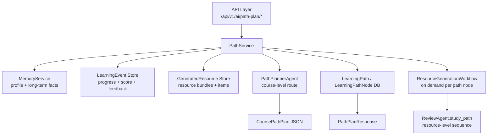
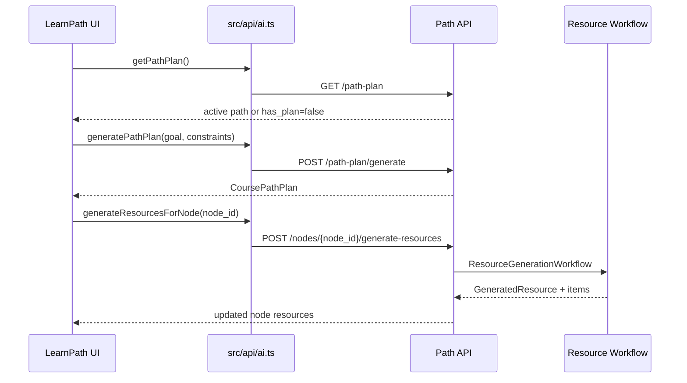

# Course-Level Path Planner + Course Atlas UI Design

> 日期: 2026-05-22
> 范围: `server/app/path`, `server/app/resource`, `server/app/evaluation`, `src/views/LearnPath.vue`, `src/api/ai.ts`
> 依赖: 现有多智能体资源生成工作流、学习画像、学习事件、路径规划持久化模型

## 1. 背景

`server/need.md` 要求系统具备个性化学习路径规划和资源推送能力：路径需要结合学习画像、已生成资源、学习进度、掌握度、偏好与薄弱点，而不是只展示静态步骤。

当前后端已经有 `server/app/path` 模块，但它更像一个规则评分器：围绕 `content`、`mindmap`、`diagram`、`quiz`、`code`、`reading` 这些资源智能体类型，生成固定阶段的资源学习顺序。它能复用现有资源，但还不是“课程级路径规划”。

当前前端 `src/views/LearnPath.vue` 仍使用 mock path，没有接入真实 `/api/v1/ai/path-plan`。因此这次设计选择 B 方案：新增课程级 `PathPlannerAgent`，保留资源多智能体工作流，让路径规划页面成为独立的学习地图，而不是资源生成页面的另一个皮肤。

## 2. 目标

1. 生成课程级学习路径：回答“先学什么、后学什么、为什么这样学”。
2. 路径节点绑定资源：每个课程节点可以推荐或触发生成 `content`、`mindmap`、`diagram`、`quiz`、`code`、`reading` 等资源。
3. 利用学习画像和学习事件：路径应考虑基础水平、学习偏好、薄弱点、历史完成情况、测验分数和反馈。
4. 支持动态调整：当用户完成节点、测验低分、反馈太难或重建路径时，后端能给出调整理由。
5. 重设计路径页面：多智能体资源页是“生产线/控制台”，路径页是“课程地图/导航系统”，两者视觉和交互不能雷同。

## 3. 非目标

1. 不在本阶段重写资源生成工作流。
2. 不把所有课程知识点存成通用知识图谱数据库。
3. 不让路径规划 Agent 直接写长期记忆或画像。
4. 不要求路径页实时展示所有资源 Agent 的内部执行日志；实时生产过程仍属于资源生成页。
5. 不强制移除现有规则路径算法；它将作为兜底和兼容层保留。

## 4. 核心设计

采用两层路径结构：

1. 课程级路径 `CoursePathPlan`

   由新的 `PathPlannerAgent` 生成，节点是课程知识点、能力目标或实践任务。例如“函数基础”“递归思想”“动态规划状态定义”“项目接口设计”。

2. 资源级学习序列 `ResourceStudyPath`

   由现有 `ReviewAgent.study_path` 和 `GeneratedResourceItem` 提供，节点是某个课程节点下的具体材料和练习。例如先看讲解，再看图解，再做 quiz，最后做 code practice。

这能把两个问题拆开：

1. 路径规划负责学习路线和依赖关系。
2. 多智能体资源系统负责给某个路径节点生产高质量学习材料。

## 5. 后端架构



### 5.1 PathPlannerAgent

新增 `server/app/path/agents/planner.py`，职责是生成课程级路径，不生成完整学习资源内容。

输入：

1. `user_id`
2. `goal`: 用户学习目标或课程主题
3. `profile_context`: 画像和学习偏好
4. `progress_context`: 学习事件、完成节点、测验表现
5. `resource_context`: 已有资源 bundle 和资源 item 摘要
6. `constraints`: 时间、难度、期望产出、考试/项目/自学场景

输出：

1. `title`
2. `goal`
3. `stages`
4. `nodes`
5. `edges`
6. `recommended_start_node_id`
7. `adjustment_rationale`
8. `resource_strategy`

Agent 输出必须是可校验 JSON。解析失败时，`PathService` 使用现有规则规划器兜底。

### 5.2 PathService

`PathService` 继续作为路径领域服务，但职责需要分层：

1. `build_course_path_context(...)`

   汇总画像、长期记忆、学习事件、已有资源、当前活跃路径。

2. `generate_course_path(...)`

   调用 `PathPlannerAgent`，校验输出，保存 `LearningPath` 和 `LearningPathNode`。

3. `get_active_path(...)`

   读取当前活跃路径，不因为一次 GET 自动重建。

4. `bind_resources_to_node(...)`

   将 `GeneratedResourceItem` 或 `GeneratedResource` 绑定到某个路径节点。

5. `recommend_resources_for_node(...)`

   根据节点目标、用户偏好和已有资源，推荐已存在资源或建议生成新资源。

6. `record_node_progress(...)`

   保存节点进度，写入 `LearningEvent`，必要时标记路径需要调整。

7. `rebuild_course_path(...)`

   在用户显式重建或学习事件触发时，基于旧路径、反馈和进度生成新版路径。

### 5.3 API

保留现有接口，新增课程级语义。

```text
GET  /api/v1/ai/path-plan
POST /api/v1/ai/path-plan/generate
POST /api/v1/ai/path-plan/rebuild
POST /api/v1/ai/path-plan/node-progress
POST /api/v1/ai/path-plan/nodes/{node_id}/resources
POST /api/v1/ai/path-plan/nodes/{node_id}/generate-resources
```

接口约定：

1. `GET /path-plan` 只读取活跃路径；没有路径时返回 `has_plan=false`，不偷偷生成。
2. `POST /path-plan/generate` 根据目标创建新课程路径。
3. `POST /path-plan/rebuild` 基于反馈、进度和旧路径生成新版。
4. `POST /path-plan/node-progress` 更新节点进度并记录学习事件。
5. `POST /nodes/{node_id}/resources` 绑定已有资源。
6. `POST /nodes/{node_id}/generate-resources` 为节点构造 `learning_need`，调用现有资源生成工作流。

### 5.4 数据模型

优先复用已有 `LearningPath` 和 `LearningPathNode`，但当前模型没有通用 metadata 字段。第一阶段需要做一个小型 schema 扩展，而不是新建一组复杂路径表。

`LearningPath` 新增 `path_metadata: dict[str, Any] | None = JSONB`，保存：

```json
{
  "kind": "course_path",
  "goal": "学习目标",
  "planner_version": "course-v1",
  "profile_snapshot": "画像摘要",
  "resource_strategy": {},
  "adjustment_rationale": [],
  "review_state": {
    "needs_review": false,
    "reason": ""
  },
  "source": "agent|fallback"
}
```

`LearningPathNode` 新增 `node_metadata: dict[str, Any] | None = JSONB`，保存：

```json
{
  "stage_id": "foundation",
  "node_type": "concept|practice|project|assessment",
  "prerequisites": ["node-id"],
  "mastery_target": "能够解释并应用...",
  "estimated_minutes": 30,
  "difficulty": "beginner|intermediate|advanced",
  "resource_recommendations": [],
  "bound_resource_ids": [],
  "bound_resource_item_ids": [],
  "evidence": {
    "profile_reason": "为什么适合该用户",
    "progress_reason": "为什么当前应该学它"
  }
}
```

如果后续发现 JSON metadata 查询压力变大，再拆出 `PathNodeResourceBinding` 表。

## 6. 前端信息架构

`LearnPath.vue` 从 mock 页面升级为真实路径容器，拆成几个局部组件：

1. `PathAtlasMap.vue`

   主视觉区域，展示阶段、路线、节点状态和依赖边。

2. `PathStageRail.vue`

   左侧或顶部阶段轨道，展示 foundation、core、practice、extension 等阶段进度。

3. `PathNodePanel.vue`

   右侧节点详情：学习目标、为什么推荐、前置知识、掌握目标、下一步动作。

4. `PathResourceDock.vue`

   当前节点下的资源推荐和已绑定资源。

5. `PathGenerateDialog.vue`

   生成或重建路径的入口，收集目标、场景、时间约束、难度偏好。

6. `PathEmptyState.vue`

   没有路径时展示目标输入和示例，不自动生成。

页面数据流：



## 7. 视觉与交互方向

路径页采用 “Course Atlas” 风格：像展开一张学习地图，而不是进入一个生产控制台。

### 7.1 路径页视觉关键词

1. 地图
2. 航线
3. 羊皮纸/纸张纹理
4. 学术墨绿
5. 琥珀高亮
6. 深蓝坐标
7. 节点像地标或路标

建议色彩：

1. `#F7F0DC` parchment
2. `#183A37` deep ink green
3. `#C9852B` amber route
4. `#213A5C` atlas blue
5. `#7A8B68` muted sage

### 7.2 与资源生成页的差异

资源生成页：

1. 多智能体工厂
2. 任务编排
3. Agent 执行状态
4. 资源卡片产出
5. 强调“生产过程”

路径规划页：

1. 学习地图
2. 路线导航
3. 当前坐标
4. 下一站行动
5. 强调“学习旅程”

### 7.3 交互

1. 初次进入没有路径时，展示地图空状态和目标输入。
2. 生成路径后，地图从左到右或从上到下展开，节点按阶段逐个点亮。
3. 点击节点时，右侧面板显示推荐理由和资源动作。
4. 当前节点有更强的视觉焦点，未解锁节点降低对比度但仍可查看原因。
5. “为本节点生成资源” 可以跳到资源生成页展示多智能体实时流程，也可以在路径页显示简化进度；第一阶段推荐跳转或弹出轻量进度，避免复制资源页。

## 8. 路径和资源的关系

路径节点不直接保存大段资源内容，只保存资源引用和推荐原因。

生成节点资源时，服务层构造结构化 `learning_need`：

```text
路径节点: {node.title}
掌握目标: {node.mastery_target}
前置知识: {node.prerequisites}
用户画像: {profile_summary}
薄弱点: {weak_points}
期望资源: content, diagram, quiz, code
```

然后调用现有 `ResourceGenerationWorkflow`。生成完成后，`GeneratedResource` 和 `GeneratedResourceItem` 绑定回路径节点。

这保持了清晰边界：

1. `PathPlannerAgent` 负责学习路线。
2. `ResourceGenerationWorkflow` 负责资源生产。
3. `ReviewAgent` 负责资源包内部学习顺序。
4. `EvaluationService` 负责从事件中提取掌握度和画像信号。

## 9. 动态调整策略

触发路径调整的信号：

1. 节点完成。
2. 测验分数低于阈值。
3. 用户反馈“太难”“太简单”“不相关”。
4. 用户切换学习目标或场景。
5. 新生成资源覆盖了旧路径的薄弱节点。

第一阶段不自动在后台重写整条路径。推荐策略：

1. 写入 `LearningEvent`。
2. 更新节点状态和局部推荐。
3. 在 `path_metadata.review_state` 标记 `needs_review=true`。
4. 前端展示“路径可优化”提示。
5. 用户点击后调用 `POST /path-plan/rebuild`。

这样能避免用户正在学习时路线突然变化。

## 10. 失败与兜底

1. Agent JSON 解析失败：使用现有规则规划器生成兼容路径，并在 `path_metadata.source` 标记 `fallback`。
2. 没有画像：使用用户目标和默认初学者画像生成路径。
3. 没有资源：路径仍可生成，但节点显示“建议生成资源”。
4. 资源生成部分失败：绑定成功生成的资源，失败资源显示可重试。
5. 旧路径数据缺少课程级 `node_metadata`：前端降级展示资源型路径，不阻塞页面。

## 11. 测试计划

后端：

1. `PathPlannerAgent` 单测：给定画像、进度和目标，输出可解析的课程路径 JSON。
2. `PathService.generate_course_path` 单测：保存 `LearningPath` 和 `LearningPathNode`，节点包含 `path_metadata` / `node_metadata`、依赖和推荐理由。
3. `PathService.get_active_path` 单测：GET 不自动生成。
4. 资源绑定单测：节点能绑定 `GeneratedResource` 和 `GeneratedResourceItem`。
5. rebuild 单测：反馈和低分事件会进入 planner context。
6. fallback 单测：Agent 输出坏 JSON 时使用现有规则路径。

前端：

1. `src/api/ai.ts` 类型覆盖新接口。
2. `LearnPath.vue` 无路径、生成中、有路径、资源生成中、失败态均可渲染。
3. 节点点击更新 `PathNodePanel`。
4. 资源生成动作携带正确 `node_id`。
5. 移除 mock path 对主流程的依赖。

回归：

```bash
uv run pytest tests/path -q
uv run pytest tests/resource -q
npm run build
```

如果 `npm run build` 仍出现既有无关 TS 报错，需要在实现计划中单独标记，不混入路径规划改动。

## 12. 分阶段交付

### Phase 1: 后端课程路径能力

1. 新增路径 planner schemas。
2. 新增 `PathPlannerAgent` 和 prompt。
3. 新增 `POST /path-plan/generate`。
4. `GET /path-plan` 改为读取活跃路径。
5. 增加 `path_metadata` 和 `node_metadata` JSONB 字段，并保存课程节点扩展信息。
6. 保留规则规划器兜底。

### Phase 2: 资源绑定

1. 新增节点资源推荐和绑定接口。
2. 支持从路径节点触发现有资源生成工作流。
3. 生成完成后绑定资源到路径节点。
4. 学习事件关联 path/node/resource。

### Phase 3: Course Atlas UI

1. 重写 `LearnPath.vue` 容器逻辑。
2. 拆分地图、阶段轨、节点面板、资源 dock。
3. 接入真实 API。
4. 建立和资源生成页不同的视觉系统。
5. 完成响应式布局。

### Phase 4: 动态调整

1. 将测验分数、完成事件、反馈纳入 rebuild context。
2. 前端展示“路径可优化”提示。
3. rebuild 后展示变更摘要。

## 13. 关键决策

1. 选择 B 方案：课程级 `PathPlannerAgent` + 现有资源多智能体工作流。
2. 路径节点是知识点/能力目标，不是资源类型。
3. 资源生成页和路径页分工明确，视觉不能雷同。
4. 第一阶段使用小型 JSONB schema 扩展，暂不新增复杂绑定表。
5. GET 路径只读取，不隐式生成。
6. 动态调整采用用户确认式 rebuild，不自动打断学习路线。

## 14. 实现前检查

进入实现计划前需要确认：

1. 是否接受第一阶段用 `path_metadata` / `node_metadata` JSONB 保存课程路径扩展字段。
2. 是否接受路径页优先做 Course Atlas 风格，而不是沿用现有控制台风格。
3. 是否接受“节点触发资源生成”第一版跳转或轻量进度，而不是复制完整资源生成页面。
4. 是否需要在实现计划里把 `LearnPath.vue` 的 mock 页面直接替换，还是保留一个开发开关。
