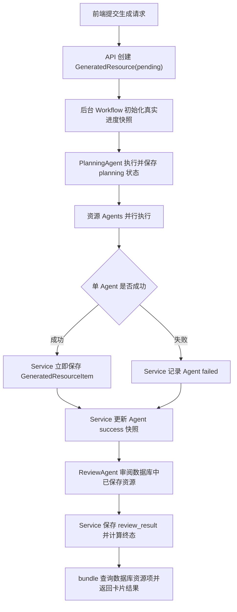

# 多智能体资源真实进度与 PPT 预览闭环设计

## 状态

- 日期：2026-05-26
- 范围：多智能体资源生成、数据库组装结果、真实执行进度、PPT 在线预览
- 前置设计：延续 `2026-05-25-multi-agent-ppt-preview-integration-design.md` 的 PPT JSON 播放契约
- 明确不包含：学习路径规划实现、PPTX 文件导出、测试目录中既有无关失败修复

## 目标

学习资源生成任务必须展示真实执行过程，并在已有资源可用时进入卡片化结果页：

1. 每个资源 Agent 成功生成内容后立即由服务层写入数据库，不等整个工作流结束。
2. `bundle` 始终从数据库已保存资源组装，数据库是前端结果的唯一事实源。
3. 前端进度只显示后端真实工作状态，不再人为写入 50% 或伪造 Planning 成功。
4. PPT Agent 生成与现有播放器兼容的在线预览 JSON，并作为普通资源卡片进入结果页。
5. ReviewAgent 审阅已持久化、可被前端展示的资源，失败或不达标时准确暴露任务状态。

## 当前问题

现有链路已经具备并行 Agent、资源模型、PPT 播放组件和资源详情查询，但仍有四个闭环断点：

- 成功结果在全部 Agent 和审阅完成后才统一保存；单个 Agent 已完成时前端仍拿不到其真实成果。
- `AgentEventEmitter` 的事件只进入后台队列，当前 API 没有消费者，因此前端状态接口只能返回总状态。
- 前端任务启动后会本地伪造 `planning=success` 与各 Agent `progress=50`，且只把 `success` 当终态；后端真实终态 `completed` 或 `partial_completed` 无法正常进入结果页。
- PPT 后端仅支持 `theme-logic-blue` 与 `preview`，而前端仍暴露未实现主题和 `pptx` 输出，可能直接触发请求校验失败。

## 设计决策

### 数据库作为事实源

`GeneratedResource` 是任务记录，`GeneratedResourceItem` 是单 Agent 资源记录。工作流的内存结果只用于本轮控制流，不作为 API 输出来源。`get_resource_bundle()` 只查询资源项及任务元信息并返回前端。

Agent 不直接持有数据库会话，也不承担资源保存职责。Agent 只负责生成 `WorkerResult`；`ResourceGenerationWorkflow` 在收到成功结果后调用 `ResourceUsecases` 立即持久化。这样保留决策/生成层的纯度，也确保数据库入库时机贴合真实执行。

### 真实进度采用任务快照

本期不恢复 SSE 推送。状态查询端点返回数据库中的最新执行快照，前端通过轮询呈现真实进度。快照存入现有 `GeneratedResource.personalization` JSON 字段，不引入数据库迁移。

采用快照而不是完整事件表，是因为当前页面只需要当前进展、各 Agent 状态和有限步骤记录。事件审计、重放和长连接推送可以在后续独立升级，不阻塞当前功能闭环。

### PPT 只交付已支持能力

本期 PPT 是可在线浏览的结构化教学幻灯片，不声称提供 `.pptx` 下载。前端只暴露 `theme-logic-blue` 与 `preview`，所有场景默认配置均使用该契约。

## 分层职责

| 层级 | 责任 | 不负责 |
| --- | --- | --- |
| Resource API | 创建任务、查询真实状态、返回数据库 bundle | 生成内容、模拟进度 |
| ResourceUsecases | 保存单资源、合并进度快照、计算终态、从数据库组装 bundle | 调用 LLM |
| ResourceGenerationWorkflow | 编排 planning、并行资源生成、review、最终完成；在成功结果产生时请求保存 | 直接读写 ORM |
| Resource Agents | 根据指令产生内容与元数据，包括 PPT JSON | 直接保存数据库或决定页面状态 |
| ReviewAgent | 对已保存且可展示的资源进行质量审阅 | 生成学习路径业务 |
| Frontend ResourceGenerator | 轮询真实状态、呈现工作节点、终态加载卡片 bundle、打开 PPT 预览 | 本地虚构 Agent 成功或进度 |

## 后端数据契约

### 任务状态

`GeneratedResource.status` 使用以下终态与运行状态：

| 状态 | 含义 |
| --- | --- |
| `pending` | 任务已创建，尚未执行规划 |
| `planning` | PlanningAgent 正在制定资源指令 |
| `generating` | 至少一个资源 Agent 正在运行或等待运行 |
| `reviewing` | 资源生成阶段结束，ReviewAgent 正在校验已保存资源 |
| `completed` | 所有请求资源已保存且质量审阅通过 |
| `partial_completed` | 至少一个资源可展示，但存在资源失败或质量审阅未通过 |
| `failed` | 没有可展示资源，或工作流在可用资源产生前失败 |

### 进度快照

`GeneratedResource.personalization` 在保留 `execution_plan`、`review_result`、`failed_agents`、`selected_agents` 的同时增加 `workflow_progress`：

```json
{
  "workflow_progress": {
    "stage": "generating",
    "progress": 46,
    "latest_message": "PPT Agent 已生成 6 页在线预览",
    "agents": {
      "planning": {
        "status": "success",
        "progress": 100,
        "message": "资源生成计划已完成",
        "steps": []
      },
      "ppt": {
        "status": "success",
        "progress": 100,
        "message": "PPT 在线预览已保存",
        "steps": []
      },
      "review": {
        "status": "waiting",
        "progress": 0,
        "message": "",
        "steps": []
      },
      "bundle": {
        "status": "waiting",
        "progress": 0,
        "message": "",
        "steps": []
      }
    }
  }
}
```

每个节点状态只允许 `waiting`、`running`、`success`、`failed`、`skipped`。`steps` 只保留供 UI 展示的简短步骤记录，不能存储完整资源正文或 bundle，避免重复大对象写入 JSON 字段。

### 状态 API 响应

`GET /api/v1/ai/generate/task/{resource_id}/status` 返回当前用户拥有的任务真实状态：

```json
{
  "resource_id": 23,
  "status": "generating",
  "progress": {
    "stage": "generating",
    "progress": 46,
    "latest_message": "PPT Agent 已生成 6 页在线预览",
    "agents": {}
  }
}
```

接口没有进度快照时返回初始化的等待状态，而不是返回前端需要猜测的空结构。

## 工作流



### 资源即时保存

`_run_resource_agents()` 接收 `user_id` 与 `resource_id`。每个 Agent 完成后：

1. 成功且有有效内容时，调用服务层公开方法保存这一条资源项。
2. 保存成功后才将该 Agent 标记为 `success`，保证 UI 的成功状态对应数据库可读取内容。
3. 生成失败或保存失败时，将该 Agent 标记为 `failed`；其他并行 Agent 继续执行。

最终收口方法只更新任务元信息和终态，不再次批量插入成功资源，避免重复入库。

### 并行数据库写入保护

资源 Agent 并行完成时会竞争同一个后台会话。服务层为进度合并与资源项保存提供同一把异步写锁，将数据库变更串行提交；LLM 生成仍保持并行。这样避免在单个 `AsyncSession` 上并发 `commit/flush` 导致不稳定结果。

### 事件与快照衔接

保留 Agent 已有事件语义，并给 `AgentEventEmitter` 注入可等待的事件落库回调。每个真实 `emit_*` 调用在发送到内部队列的同时，更新任务快照。API 不读取无人消费的进程内队列，页面状态只读取落库结果。

### 审阅输入与终态

生成阶段结束后，服务层从数据库读取已经保存的资源摘要或正文预览，并作为输入交给 ReviewAgent 审阅，确保审阅对象与结果页显示对象相同，同时不让 ReviewAgent 直接依赖数据库。

终态规则：

- 全部选中资源已成功保存，且 ReviewAgent 执行成功并判定通过：`completed`。
- 至少一条资源成功保存，但存在任意资源失败、ReviewAgent 异常或质量未通过：`partial_completed`。
- 没有成功保存的资源：`failed`。

学习路径字段在本期不驱动页面或任务成功判定，仅可随审阅结果保存以便后续路径规划功能接入。

## PPT Agent 教学质量与展示契约

### 生成内容

PPT Agent 输出必须满足播放器结构校验，并提升教学价值：

- 总页数严格等于请求 `page_count`，包含封面与目录。
- 第一页为 `cover`，第二页为 `agenda`，后续为正文布局。
- 正文至少覆盖学习目标、核心机制讲解、例子或对比分析、总结或练习引导。
- 每页标题应表达一个明确教学结论；备注用于补充口头讲解，而不是重复标题。
- 不输出未实现主题、下载链接或伪造 PPTX 文件路径。

### 前端配置与播放

- 生成配置仅展示在线预览与唯一可用主题，不提供无法兑现的选项。
- 数据库 bundle 中 `agent_type="ppt"` 的资源卡片使用已有 `PptView/PptPlayer` 打开在线播放。
- PPT 生成失败不阻塞其他资源卡片显示；任务以 `partial_completed` 呈现并标明失败 Agent。

## 前端页面行为

### 工作过程页

发起生成后，页面根据所选 Agent 建立全部为 `waiting` 的节点视图。每次轮询应用后端 `progress.agents` 的真实快照：

- `running` 节点显示当前真实消息与步骤记录。
- `success` 节点表示对应资源已经入库或阶段真实完成。
- `failed` 节点显示失败原因，不伪装为继续执行。
- 顶部总进度取后端快照值，不以本地定时器推进。

### 卡片结果页

- 轮询返回 `completed` 或 `partial_completed` 时，页面停止轮询并调用资源详情接口读取数据库 bundle。
- `completed` 直接进入卡片化结果页。
- `partial_completed` 进入同一结果页并显示“部分资源生成失败或审阅未通过”的明确提示；所有成功资源仍可查看。
- `failed` 且没有可用资源时保留失败页，不渲染空卡片。

## 清理范围

本次实施应删除或替换以下直接造成错误体验的冗余逻辑：

- 前端固定结果页或本地模拟进度分支。
- 前端未受后端支持的 PPT 主题与 `pptx` 选项。
- API 中已失效的 SSE 描述或未使用导入，仅限与本链路直接相关部分。

不会顺手重构聊天、数字人、路径规划或与当前闭环无关的测试代码。

## 错误处理

- 单 Agent 生成异常：记录该节点失败并继续等待其他资源；只要有资源入库便允许部分完成。
- 单资源保存异常：该 Agent 视为失败，错误信息进入真实进度；不得向前端标记成功。
- ReviewAgent 异常或质量不通过：已有资源保留并可展示，任务为 `partial_completed`。
- bundle 查询失败：资源数据仍在数据库；API 返回可追踪错误，前端保留任务入口以便重试加载。
- 后台致命异常且没有资源入库：任务置为 `failed` 并在进度快照中记录最后错误。

## 验收与验证

### 后端

- 单个资源 Agent 完成时对应资源项立即可从数据库读取，而不是等待全部 Agent。
- 状态接口返回真实 Agent 快照与运行阶段；事件消息与任务快照保持一致。
- ReviewAgent 输入来自已保存资源；质量失败会产生 `partial_completed`。
- `get_resource_bundle()` 只通过数据库资源项组装内容。
- PPT 合法 JSON 可被保存；页数、布局或交付模式不合法时资源不发布。

### 前端

- 启动任务后无本地伪造成功或 50% 进度。
- `completed` 和 `partial_completed` 均能加载数据库 bundle 并进入卡片化展示。
- `partial_completed` 对失败资源给出可见提示，同时可浏览成功资源。
- 页面不再允许选择后端不支持的 PPT 主题或 PPTX 输出。
- PPT 卡片可打开现有在线播放器。

### 执行验证

- 运行后端资源域的针对性验证；忽略已知且与本次实现无关的测试模块故障，但明确记录结果。
- 运行前端类型检查和构建。
- 在可用本地前端环境中，通过浏览器验证真实工作流状态、卡片终态与 PPT 预览交互。

## 预计修改文件

| 文件 | 修改目的 |
| --- | --- |
| `server/app/resource/events.py` | 将真实事件连接至可持久化快照回调 |
| `server/app/resource/service.py` | 即时保存单资源、合并快照、计算终态、数据库 bundle |
| `server/app/resource/workflow.py` | 在 Agent 完成节点触发保存并按真实阶段编排 |
| `server/app/resource/api.py` | 状态接口返回真实进度数据并清理过时接口描述 |
| `server/app/resource/agents/review.py` | 审阅已持久化可展示资源并暴露质量结果 |
| `server/app/resource/agents/ppt.py` | 强化教学 PPT 生成约束及在线预览契约 |
| `server/app/prompts/resource/ppt.md` | 提升 PPT 教学内容要求 |
| `src/api/resource.ts` | 补足进度与 PPT 配置类型契约 |
| `src/views/ResourceGenerator.vue` | 使用真实轮询快照、卡片终态和受支持 PPT 配置 |
