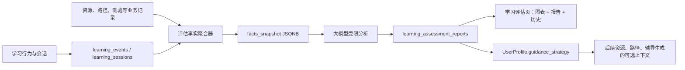

# 学习效果评估重构设计

## 目标与边界

本重构实现一个供学生主动查看的“学习效果评估”能力：系统采集已有的学习行为、练习测试与资源使用信号，用户可随时按 7、14 或 30 天范围生成一份学习报告。报告包含可信的统计图表、由大模型生成的解释和下一步建议，并据此更新用户当前辅导策略。

这是一次破坏式重构。旧的周摘要、旧评估汇总接口、个人中心内嵌学业看板及其前端调用全部删除；不保留接口、数据库表或响应格式兼容层。保留原始学习事实，且不合并独立资源生成（`resource`）与学习路径（`path`）的记录、详情页或持久化模型。

不在本期实现的内容：自动改写既有学习路径、自动推送资源、持续后台生成、排名、复杂评分算法、独立的辅导策略历史表。学习评估的职责是“看清学习情况并形成可复用的当前建议”，而非替用户自动改变学习计划。

## 已确认的产品决策

1. 新增一级页面 `/learning-assessment`，承载完整报告、图表和历史报告。
2. 首页保持现状，只展示当前画像分数；不加入学习评估模块。
3. 个人中心不是画像或报告页。它保留账号和学业资料，只显示一张简短的“当前学习建议”卡片以及前往评估页的入口，不展示图表、画像分数或历史报告。
4. 用户点击“生成报告”后立即生成，支持 7、14、30 日。生成过程中同一用户只能有一条进行中的报告。
5. 所有图表只读取数据库聚合出的事实快照；大模型只解释事实，绝不能凭空补充数量、学习行为、优弱项或分数。
6. 报告生成成功后，更新 `UserProfile` 上当前的 `guidance_strategy`。不自动改写 `overall_score` 或画像维度，避免把报告推断伪装成量化画像。

## 架构



评估模块分为四个互不混杂的单元：

| 单元 | 职责 | 不负责 |
| --- | --- | --- |
| 行为采集 | 写入标准化学习事件和学习会话 | 生成结论或修改画像 |
| 事实聚合 | 以 SQL 和业务记录产生可审计的统计快照 | 调用大模型 |
| 报告生成 | 将快照交给受限提示词并保存不可变报告 | 重新计算图表 |
| 策略访问 | 为真正需要个性化的生成模块提供当前建议 | 自动修改既有资源、路径或任务 |

## 数据模型

### 1. 标准化学习事实

保留并重构 `LearningEvent` 与 `LearningSession`，作为统一的行为事实层。现有数据不删除；新字段以迁移方式回填。

`learning_events` 新增或明确字段：

| 字段 | 类型 | 规则 |
| --- | --- | --- |
| `occurred_at` | `TIMESTAMPTZ NOT NULL` | 事件实际发生时间；旧数据以 `created_at` 回填 |
| `client_event_id` | `VARCHAR(64) NULL` | 前端 UUID，用于同一用户事件幂等；建立部分唯一索引 |
| `event_type` | `VARCHAR(64) NOT NULL` | 必须是受控枚举，禁止任意字符串 |
| `module` | `VARCHAR(32) NOT NULL` | `chat`、`resource`、`path`、`quiz`、`visualizer` |
| `entity_id`、`course`、`topic`、`score`、`event_metadata` | 保留 | 只记录事件事实，扩展字段放入受限元数据 |

`learning_sessions` 同步增加 `client_session_id`（用户内唯一）及 `occurred_at`/结束时间语义校验。服务端只接受合理时长，例如 1 秒至 4 小时；超限时截断或拒绝，不允许前端写入任意学习时长。

V1 事件字典固定如下。前端事件生产者必须映射到其中之一，不能新增同义事件：

| 模块 | 事件 |
| --- | --- |
| `chat` | `chat_dialogue` |
| `resource` | `resource_generated`、`resource_viewed`、`resource_completed`、`resource_feedback` |
| `path` | `path_node_started`、`path_node_completed`、`path_quiz_answered`、`path_feedback` |
| `quiz` | `quiz_submitted` |
| `visualizer` | `visualizer_run` |

对 `path_quiz_answered` 与 `quiz_submitted`，元数据必须包含 `is_correct`、`topic`（可为空但须明确）和可选 `attempt_index`；不可把答题文本或敏感对话内容写入评估事件。`resource_feedback` 必须包含枚举反馈值，不能只存自然语言。

### 2. 报告表

新增 `learning_assessment_reports`。一行表示一份不可变的用户生成报告。

```text
id BIGSERIAL PRIMARY KEY
user_id BIGINT NOT NULL REFERENCES users(id) ON DELETE CASCADE
range_days SMALLINT NOT NULL CHECK (range_days IN (7, 14, 30))
window_start TIMESTAMPTZ NOT NULL
window_end TIMESTAMPTZ NOT NULL
status VARCHAR(16) NOT NULL CHECK (status IN ('generating', 'ready', 'failed'))
facts_snapshot JSONB NULL
report_markdown TEXT NULL
generated_at TIMESTAMPTZ NULL
failure_code VARCHAR(64) NULL
created_at TIMESTAMPTZ NOT NULL DEFAULT NOW()
updated_at TIMESTAMPTZ NOT NULL DEFAULT NOW()
```

约束和索引：

- `window_end > window_start`；服务端根据请求范围计算窗口，客户端不能传时间。
- `(user_id, created_at DESC)` 用于历史列表。
- `(user_id, status)` 用于判断生成中状态。
- 每个用户最多一条 `status = 'generating'` 的部分唯一索引。
- `facts_snapshot` 与 `report_markdown` 只在 `ready` 时同时存在；`failed` 必须有 `failure_code`。

### 3. 当前辅导策略

在 `user_profiles` 增加：

```text
guidance_strategy JSONB NOT NULL DEFAULT '{}'
guidance_updated_at TIMESTAMPTZ NULL
last_assessment_report_id BIGINT NULL REFERENCES learning_assessment_reports(id) ON DELETE SET NULL
```

它只保存当前状态，不保存历史。报告 Markdown 中的“当前辅导建议”章节是该次报告的历史策略说明，因此任何过去报告都可复盘；机器使用的当前策略只从 `UserProfile.guidance_strategy` 读取。

策略更新必须是评估模块内独立的定向数据库操作：先按 `user_id` 读取 `UserProfile` 行（不存在则以默认画像字段创建一行），再且仅再写入 `guidance_strategy`、`guidance_updated_at`、`last_assessment_report_id` 和通用 `updated_at`。严禁调用 `ProfileService.infer_profile_from_digest`、全局评分刷新、维度更新或任何会改写画像的服务；本操作不得修改 `overall_score`、`scored_at` 或任一 `UserProfileDimension`。因此每次生成学习报告后，用户仍读取原有画像数据，而只有当前辅导策略发生变化。

策略固定为以下结构，空字段采用 `null` 或空数组，不自行扩展：

```json
{
  "version": 1,
  "focus_topics": ["二叉树遍历"],
  "preferred_resource_types": ["练习", "可视化演示"],
  "recommended_session_minutes": 25,
  "weekly_goal": "完成 3 次针对薄弱知识点的练习",
  "tutoring_style": "先提示思路，再给出分步讲解",
  "reason": "近期该主题正确率低于其他主题，且有足够答题样本支撑。"
}
```

## 事实快照与评估规则

事实聚合器输入为当前用户和 `[window_start, window_end)`。它必须只查询该用户的数据；资源与路径分别统计，不通过共享 agent 基础设施相互拼接业务记录。

快照最小结构：

```json
{
  "window": {"days": 7, "start": "...", "end": "..."},
  "activity": {
    "active_days": 4,
    "total_minutes": 96,
    "daily_minutes": [{"date": "2026-07-11", "minutes": 24}],
    "module_distribution": [{"module": "path", "count": 8}]
  },
  "resource_usage": {
    "generated": 3, "viewed": 4, "completed": 2,
    "feedback": {"helpful": 2, "not_helpful": 0}
  },
  "learning_path": {"nodes_started": 4, "nodes_completed": 2, "completion_rate": 0.5},
  "practice": {
    "submitted": 12, "correct": 8, "accuracy": 0.667,
    "by_topic": [{"topic": "图", "submitted": 5, "correct": 2, "accuracy": 0.4, "enough_evidence": true}]
  },
  "topics": {"encountered": ["图", "二叉树"]},
  "data_quality": {"has_activity": true, "insufficient_topics": ["动态规划"]}
}
```

规则：

- 活跃天数以用户当地日期或产品统一时区（当前统一为 `Asia/Shanghai`）去重；全链路均使用 `TIMESTAMPTZ`。
- 学习时长优先使用经过校验的 `learning_sessions.duration_seconds`；没有会话时不从事件数量猜测分钟数。
- 练习准确率只来自有正确性字段的题目事件或测验业务记录，分母为已提交且判定完成的题。
- 某主题至少 5 次有效作答，且覆盖至少 2 个独立尝试/会话，才允许称为“需重点复习”或“掌握较好”；否则只能标注“样本不足”。
- 若窗口内没有有效活动，仍生成报告，但图表为零/空状态，大模型输出“数据不足，建议先完成一次学习活动”，不得编造建议依据。

## 大模型报告

报告生成采用“聚合先行，模型解释后置”。模型输入只含事实快照、用户显式学科资料（若存在）和受限输出契约，不含完整聊天记录、资源正文或任意用户私密内容。

数据库和报告详情 API 只保存、返回 `report_markdown`，不再保存 `report_content JSONB`。Markdown 必须依次使用以下二级标题，缺一不可：

```markdown
## 学习概览
## 做得好的地方
## 重点复习
## 学习习惯
## 下一步行动
## 当前辅导建议
## 数据说明
```

为可靠更新当前辅导策略，模型在内部调用时仍返回一个很小的受限 JSON 包装：`report_markdown` 加 `guidance_strategy`。服务端先校验策略对象字段和 Markdown 标题、长度（最多 4,000 字）、禁止 HTML/脚本和禁止快照外数值；然后只将 Markdown 写入报告表，并将策略写入 `UserProfile`。API 不暴露这层内部包装结构。

提示词必须明确：只能引用快照中的事实和数值；没有证据则说数据不足；不输出诊断、人格判断、排名、虚构分数或长篇复述。模型响应不合法、超时或失败时，报告改为 `failed`，保留失败码，且不覆盖已有 `guidance_strategy`。前端以 Markdown 白名单渲染，禁用原始 HTML、脚本、内嵌样式、远程图片和不安全链接。

## API 合约

保留且重构采集入口：

```text
POST /api/v1/ai/evaluation/events
POST /api/v1/ai/evaluation/sessions
```

二者使用明确的 Pydantic 请求类型、用户内幂等键和 `HttpResponse` 信封。重复事件/会话返回成功和既有记录，不再产生重复统计。

删除：

```text
GET /api/v1/ai/evaluation/summary
GET /api/v1/ai/evaluation/time-stats
GET /api/v1/ai/dashboard/study-stats
```

新增：

| 方法与路径 | 请求/响应 | 语义 |
| --- | --- | --- |
| `POST /api/v1/ai/evaluation/reports` | `{ "range_days": 7|14|30 }` → 报告详情 | 建立并同步生成报告；已有生成中报告返回 `409` |
| `GET /api/v1/ai/evaluation/reports/latest` | 报告详情或 `null` | 取得最新 `ready` 报告 |
| `GET /api/v1/ai/evaluation/reports?page=1&page_size=10` | 摘要分页 | 仅返回当前用户历史 |
| `GET /api/v1/ai/evaluation/reports/{report_id}` | 报告详情 | 非本人返回 `404`，不泄露存在性 |
| `GET /api/v1/ai/evaluation/guidance-strategy` | `{ guidance_strategy, guidance_updated_at, last_assessment_report_id }` | 独立输出当前策略；供个人中心和确有需求的生成服务读取 |

报告详情包括 `id`、窗口、状态、`facts_snapshot`、`report_markdown`、生成时间。历史摘要不回传事实快照或 Markdown 正文。所有读取接口不得写数据库；报告生成是唯一允许更新策略的路径。

## 生成事务与错误处理

生成顺序固定为：

1. 鉴权后校验 `range_days`；以服务器当前时间计算窗口。
2. 原子创建 `generating` 报告。若存在同用户生成中记录，返回 `409 assessment_generation_in_progress`。
3. 聚合事实快照并保存到该报告。
4. 调用大模型，校验内部策略对象和固定 Markdown 章节。
5. 单一事务内将报告更新为 `ready`；直接读取 `UserProfile` 行并只更新 `guidance_strategy`、`guidance_updated_at`、`last_assessment_report_id` 和 `updated_at`，不调用画像服务且不改动分数、维度或 `scored_at`。
6. 模型或校验失败则将报告更新为 `failed`；不得删除旧报告，不得更改当前策略。

数据库异常使用现有 `HttpResponse` 错误格式。日志仅记录用户 ID、报告 ID、窗口、耗时和失败码，不打印快照全文或模型回复全文。

## 前端信息架构

新增 `src/features/learning-assessment/`，页面分为：

1. 顶部：7/14/30 天范围选择、报告窗口、生成按钮和生成中状态。
2. 概览：活跃天数、可信学习时长、练习正确率、路径完成度；数据不存在时显示 `--`，不显示伪零分。
3. 图表：每日学习时长趋势、模块使用分布、资源使用与路径完成、按主题练习正确率。全部直接读取 `facts_snapshot`。
4. AI 报告：安全渲染 `report_markdown`，展示概览、做得好的地方、重点复习、学习习惯、下一步行动、当前辅导建议和数据说明。
5. 当前辅导策略：清晰展示它将怎样影响后续生成，但不宣称已修改既有资源或路径。
6. 历史报告：日期、范围、摘要、查看详情；报告为失败状态时显示可重试，不伪造内容。

路由增加一级 `/learning-assessment`，主导航增加“学习评估”。`Home.vue` 不改动。`Profile.vue` 删除整段旧学业看板、图表、旧评估状态与旧 API 调用，只保留一张当前学习建议卡和链接；它不读取画像，也不展示报告数据。

学习路径详情页已有的路径专属评估保持原语义和接口，它不是全局学习报告，不能由新页面替换。

## 策略的使用边界

新增集中访问函数 `get_effective_guidance_strategy(user_id, db)`。它只读取 `UserProfile` 的当前策略，缺失时返回安全默认值。资源生成、路径规划、辅导对话和题库在各自真正支持的提示词/参数位置按需接入；算法可视化或不具备个性化决策点的 agent 不强行注入。

接入规则：只影响新生成的内容；不得改写已经生成的资源、已经存在的路径节点或历史会话；策略中的建议是上下文而不是强制指令。每个接入点必须有测试证明：无策略时行为不报错，有策略时提示词/生成输入可见其受控字段。

## 删除和迁移范围

删除以下旧实现及所有引用：

- `WeeklyLearningDigest` 模型和 `weekly_learning_digests` 表。
- `server/app/profile/weekly/`、周摘要提示词、画像服务中“读取时生成周摘要/更新画像”的副作用。
- 旧 `evaluation/summary`、`evaluation/time-stats`、`dashboard/study-stats` API 及其响应类型和前端客户端。
- `Profile.vue` 中的旧学业数据看板、图表、状态、样式和加载逻辑。

迁移必须同时维护三处数据库真相：`server/app/infra/models.py`、`server/init_schema.sql`、新建显式迁移文件（例如 `server/migrations/20260712_learning_assessment_refactor.sql`），并将新 SQLModel 加入 `REGISTERED_MODELS`。迁移顺序为：回填事件时间与幂等列、创建报告表/索引、扩展 `user_profiles`、删除旧周摘要依赖和表。保留原始学习事件、会话、资源、路径、测验和聊天业务数据。

## 验收标准

- 用户能在新页面生成 7、14、30 天报告，随后查看其不可变历史。
- 同用户并发生成只能有一条进行中记录；同一客户端事件/会话不会双计。
- 图表与指标完全可从 `facts_snapshot` 复算；大模型输出没有快照外数值。
- 有效题目样本不足时不把主题判成薄弱或优势。
- 成功报告只更新当前策略字段；失败报告不更新策略；`overall_score`、`scored_at` 和所有画像维度在评估生成前后完全不变；读取报告、策略和个人中心不产生写操作。
- 首页不增加评估内容；个人中心没有评估图表或画像；路径专属评估仍可用。
- 不存在旧周摘要表、旧评估汇总接口、旧个人中心评估客户端代码。
- 前端 `npm run build` 通过；后端新增评估测试通过。全量后端测试允许仅记录既有的三项 chat 失败，不能把本重构问题归入既有失败。
