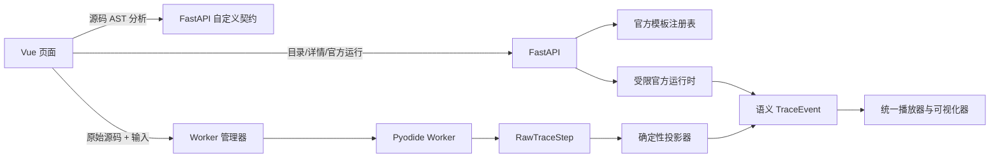

# Python 算法可视化重构设计

**日期：** 2026-07-16  
**状态：** 待书面审阅  
**范围：** `server/app/algorithm_visualizer/` 与 `src/features/algorithm-visualization/`

## 1. 目标

算法可视化只支持 Python，并明确分成两条互不混合的执行链：

1. **官方模板**：后端运行仓库内受信、已注册、可回归测试的 Python 模板，返回语义化 `TraceEvent[]`。
2. **用户自定义代码**：后端只解析 Python AST 并生成入口函数/输入契约；浏览器在独立 Web Worker 的 Pyodide 中执行原始代码，通过 `sys.settrace` 获取逐行状态，再由前端投影为专用可视化。

本次不保留旧接口、旧错误枚举、服务端自定义代码执行或 LLM 插装兼容层。允许重命名模块、删除未使用文件并同步重写测试。

完成后的关键性质：

- 用户代码不会在 FastAPI 进程或服务器子进程中执行。
- 官方模板的展示源码与执行源码来自同一个注册项。
- 任意自定义代码至少可以退化为调用栈、局部变量和对象关系视图。
- 数组、栈/队列、链表、树、图和 DP 表只有在状态满足显式结构契约时才使用专用视图，绝不补造关系。
- 死循环可以通过终止 Worker 硬停止，页面保持响应，下一次运行使用全新解释器。

## 2. 非目标

- 不支持 JavaScript、C/C++、Java 或其他语言。
- 不自动理解任意算法的“交换”“最短路松弛”“回溯”等高层语义。
- 不支持第三方 Python 包、`pip`/`micropip` 安装、交互式 `input()`、DOM 访问或持久化文件系统。
- 不把浏览器 Worker 宣称为多租户安全沙箱。它的主要安全作用是让用户代码远离服务器和主 UI 线程。
- 不新增 Docker、Lambda 或 `server/workplace` 执行目录。自定义代码不在服务器执行，因此无需服务器工作区。
- 不修改 resource、path、chat、evaluation 等其他业务的模型或页面；仅继续使用已有官方运行埋点。

## 3. 方案依据

调研结论如下：

- [Algorithm Visualizer](https://github.com/algorithm-visualizer/algorithm-visualizer) 的官方算法使用显式 tracer 命令，前端代码执行放在 Web Worker 中。
- [VisuAlgo](https://visualgo.net/) 和 [USFCA Visualizations](https://www.cs.usfca.edu/~galles/visualization/source.html) 的专用动画来自预先编写的状态转换，而不是从任意源码可靠推断算法语义。
- [Python Tutor](https://github.com/pgbovine/OnlinePythonTutor) 的通用能力建立在逐步执行、栈帧、局部变量和堆对象标识之上；专用算法视图仍需要额外映射。
- [Pyodide Web Worker 文档](https://pyodide.org/en/stable/usage/webworker.html) 要求 module Worker，并建议在 Worker 内使用 `loadPyodide` 和 `runPythonAsync`，避免阻塞 UI。
- [Pyodide 中断文档](https://pyodide.org/en/stable/usage/keyboard-interrupts.html) 的软中断依赖 `SharedArrayBuffer` 和跨源隔离响应头。当前应用无需引入全局 COOP/COEP：超时直接 `Worker.terminate()`，随后重建运行时。
- [Pyodide 部署文档](https://pyodide.org/en/stable/usage/downloading-and-deploying.html) 要求 loader 与运行时资源版本完全一致；npm core 只包含启动所需 wasm/stdlib，其他包需要另行下载。
- [Pyodide 类型转换文档](https://pyodide.org/en/stable/usage/type-conversions.html) 说明 PyProxy 需要显式销毁且深层转换存在语义限制，因此 Worker 边界只传受限 JSON 数据。
- [Vite Web Worker 文档](https://vite.dev/guide/features.html#web-workers) 推荐 `new Worker(new URL('./worker.ts', import.meta.url), { type: 'module' })`，并要求构造参数保持静态。

在本机使用当前 npm `pyodide@314.0.2` 验证，CPython `sys.settrace` 能捕获以 `<user_code>` 编译的逐行事件。采用 Pyodide 而不是 Skulpt，是为了使用真实 CPython 语义和标准调试接口。

## 4. 总体架构



两条链只在 `TraceEvent[]` 处汇合：

- 官方链直接生成高质量语义事件。
- 自定义链先生成通用执行状态，再由纯函数投影器生成相同的渲染协议。

## 5. 后端设计

### 5.1 新 API

统一前缀仍为 `/api/v1/ai/algorithm-visualizer`，旧 `/languages`、`/algorithms`、`/templates?algorithm=...`、`/custom-contract` 和通用 `/run` 删除。

| 方法 | 路径 | 用途 |
| --- | --- | --- |
| `GET` | `/templates` | 返回官方模板摘要目录 |
| `GET` | `/templates/{template_key}` | 返回模板源码、版本、默认输入和输入 Schema |
| `POST` | `/templates/{template_key}/runs` | 只运行指定官方模板；请求体只有 `inputData` |
| `POST` | `/custom/analyze` | 只解析自定义源码；不导入、不执行、不调用 LLM |

所有响应继续使用项目统一信封 `{code, message, data}`。四个端点均要求当前登录用户；自定义源码只在请求内存中解析，不写日志、不写磁盘、不进入数据库。

模板摘要：

```ts
interface TemplateSummary {
  key: string
  name: string
  domain: string
  difficulty: 'easy' | 'medium' | 'hard'
  visualizerType: OfficialVisualizerType
}
```

模板详情：

```ts
interface TemplateDetail extends TemplateSummary {
  language: 'python'
  entryFunction: string
  sourceCode: string
  version: `sha256:${string}`
  defaultInput: Record<string, unknown>
  inputSchema: InputSchema
}
```

官方运行成功数据：

```ts
interface OfficialRunResult {
  templateKey: string
  templateVersion: string
  visualizerType: OfficialVisualizerType
  events: TraceEvent[]
  result: unknown
  summary: string
}
```

不再返回恒定的 `language: python`、`executionMode: official` 或请求体中的重复 algorithm 字段。

### 5.2 官方模板注册与输入模型

`TemplateSpec` 是唯一目录来源，包含：key、领域、名称、难度、可视化类型、入口函数、默认输入、Pydantic 输入模型、显式 observation adapter 和源码路径。删除独立 `ALGORITHMS` 字典、`visual_path`、语言数组和从默认值推断 Schema 的逻辑。

每个官方模板的公开入口签名必须与 input model 字段完全一致，并且只接收 JSON 兼容输入。后端不再使用 `_bind_arguments` 做名称别名、补 `left/right`、构造链表/树或把 edge list 隐式换成邻接表：

- quick sort 暴露 `quick_sort(arr)`，递归边界由私有 helper 管理。
- 链表反转暴露 `reverse_list(values)`，链表构造和结果转换属于模板源码。
- 二叉树遍历暴露 `preorder_traversal(values)`，树构造属于模板源码。
- BFS、DFS 和 Dijkstra 直接接收注册表声明的 `num_nodes`、`edges`、`start`，在模板源码内建立邻接结构。

因此详情中的 sourceCode 可以原样“基于此模板自定义”，相同 defaultInput 也能在 Pyodide 中运行；展示源码和执行源码仍是同一文件。

每个模板使用显式 Pydantic 输入模型，并由该模型生成前端 Schema：

- 普通排序数组：1..64 个有限整数。
- 二分查找：1..64 个有限整数，必须升序；target 为有限整数。
- 链表：1..64 个节点。
- 二叉树：1..63 个层序节点；允许 `null` 表示空子节点，但根不能为空。
- 括号匹配：1..512 个字符。
- 图：`num_nodes` 为 1..64，边数不超过 256，起点和所有端点必须在范围内。
- Dijkstra：在图约束基础上，权重为 0..1,000,000 的有限数。
- 0/1 背包：1..24 件物品，weights/values 等长，weight > 0，capacity 为 0..64。
- 所有模型 `extra='forbid'`，不接受未声明字段。

这些约束既控制响应规模，也保证官方算法的运行复杂度可预测。

### 5.3 官方运行时

`service.run_official_visualization()` 改为异步深接口，负责查找模板、验证输入、获取并发槽、`asyncio.to_thread()` 执行、验证 trace、映射错误及记录埋点。

官方模板不使用通用变量名猜测。每个注册项引用一个确定性的 observation adapter；adapter 知道该模板哪些 locals 对应数组、指针、节点、边或 DP cell，并把逐行 frame 映射为语义事件。这样保留官方模板的教学质量，同时不把 tracer 调用混入学生阅读的算法源码。

运行约束：

- 进程内 semaphore 最多允许 4 个官方运行并发。
- 等待并发槽超过 1 秒返回 `OFFICIAL_BUSY`，不无限排队。
- `sys.settrace` 只观察注册模板源码，最多执行 50,000 个 Python 行事件。
- 最多生成 600 个可视化事件；超过限制立即抛出受控异常，而不是只停止记录后继续运行。
- 序列化后事件数据最大 4 MiB。
- `sys.settrace`、stdout 重定向和所有临时状态必须在 `finally` 中恢复。

官方代码受信且输入有界，因此线程用于避免阻塞事件循环；它不是任意代码隔离方案。

### 5.4 Trace 验证

后端在返回官方事件前验证完整不变量：

- step 连续、id 唯一、源码行号有效、事件总量和大小不超限。
- 数组值可序列化。
- 栈/队列指针索引存在。
- 链表节点 id 唯一，`next` 和命名指针只能引用现有节点。
- 树的 `left`、`right`、`children` 只能引用现有节点，不自动按数组下标连边。
- 图边只能指向现有节点；同一有向边不重复。
- DP 表必须为矩形，headers 宽度一致，所有高亮/target 坐标在范围内。

### 5.5 自定义 AST 契约

`POST /custom/analyze` 请求：

```ts
interface AnalyzeCustomCodeRequest {
  code: string
  entryFunction?: string
}
```

响应：

```ts
interface CustomCodeContract {
  sourceHash: `sha256:${string}`
  entryFunction: string
  functions: Array<{
    name: string
    line: number
    parameters: Array<{
      name: string
      required: boolean
      schema: InputSchema
      defaultValue?: unknown
    }>
  }>
  observableVariables: Array<{
    name: string
    scope: 'parameter' | 'local'
    line: number
  }>
  inputSchema: InputSchema
  defaultInput: Record<string, unknown>
}
```

规则：

- 源码最多 24,000 字符、4,000 个 AST 节点、语法嵌套深度 40。
- 只允许选择同步、顶层、公开函数作为入口。
- 首版入口函数只支持普通 positional-or-keyword 参数；明确拒绝 positional-only、keyword-only、`*args`、`**kwargs` 和 async 函数。
- 默认参数不进入 required；只接受 `ast.literal_eval` 可解析的 JSON 兼容默认值。
- 正确解析 `list[str]`、`list[int]`、嵌套 list、tuple、dict、bool、int、float、str 和 `T | None`。
- 未知注解使用通用 JSON 字段，不再武断映射为 integer。
- `observableVariables` 只列出参数和入口函数作用域内按源码顺序赋值的名称，不声称其算法语义。
- `sourceHash` 是把 CRLF 规范化为 LF 后对 UTF-8 源码计算的 SHA-256；前端仅接受与当前代码快照一致的响应，防止旧请求覆盖新代码。

AST 分析不执行 import、装饰器、默认表达式或顶层语句。

### 5.6 后端模块边界

- `api.py`：HTTP、认证、统一信封和错误到 status code 的映射。
- `schemas.py`：API DTO 和严格的语义 `TraceEvent` 联合。
- `template_registry.py`：13 个 `TemplateSpec` 的唯一目录。
- `template_inputs.py`：官方 Pydantic 输入模型及跨字段约束。
- `official_runtime.py`：加载受信源码、逐行追踪、调用 observation adapter。
- `official_adapters/`：按 array、structure、graph、table 分组的显式官方状态适配器。
- `trace_builder.py`：小型事件构建器，取代带 SDK 含义的 `tracer_sdks/python_tracer.py`。
- `trace_validation.py`：渲染协议不变量。
- `custom_contract.py`：只读 AST 分析。
- `service.py`：并发、线程 offload、限制和领域错误。
- `events.py`：只记录官方模板运行。

### 5.7 后端错误

算法域错误统一放入信封 `data.errorType`，message 为可展示中文，不向客户端返回内部 traceback：

| HTTP | errorType | 场景 |
| --- | --- | --- |
| 404 | `TEMPLATE_NOT_FOUND` | 模板 key 不存在 |
| 422 | `INVALID_TEMPLATE_INPUT` | 官方输入字段或跨字段约束失败 |
| 422 | `INVALID_CUSTOM_CODE` | 语法、规模或签名不支持 |
| 422 | `ENTRY_FUNCTION_NOT_FOUND` | 指定入口不存在 |
| 503 | `OFFICIAL_BUSY` | 官方运行并发槽超时 |
| 500 | `OFFICIAL_EXECUTION_FAILED` | 受信模板内部失败 |
| 500 | `INVALID_OFFICIAL_TRACE` | 模板产生非法渲染协议 |

未知异常只写服务器日志并返回稳定错误，不再把 `str(exception)` 作为 400 直接泄漏。

## 6. 自定义 Python Worker

### 6.1 加载与生命周期

- 添加精确版本 `pyodide@314.0.2`，只在自定义模式首次进入时懒加载。
- Worker 使用 Vite 推荐的静态 module Worker 构造形式。
- npm 包提供 JS loader；核心 wasm/stdlib 使用与 npm 包完全相同版本的固定 `indexURL`。该 URL 可由 `VITE_PYODIDE_INDEX_URL` 覆盖。
- Worker 30 秒未 ready 时返回 `PYODIDE_LOAD_FAILED`。
- 每个 Worker 最多接受一次 run。成功、异常、取消或超时后都终止该 Worker；用户仍停留在自定义模式时后台预热新 Worker。
- 页面卸载或切回官方模式时终止空闲 Worker。

这样避免用户代码修改 `builtins`、`sys.modules`、trace hook 或全局解释器状态后污染下一次运行。

### 6.2 执行

Worker 收到 `{code, entryFunction, inputData}` 后：

1. 将输入作为 JSON 字符串传入 Python，避免 PyProxy 生命周期泄漏。
2. 使用 `compile(code, '<user_code>', 'exec')` 和独立 globals 执行原始源码；不改写、不插装源文本。
3. 查找已分析的入口函数并用关键字参数调用。
4. 只在入口函数调用期间启用 `sys.settrace`；同一 `<user_code>` 文件内的 helper 调用也会被追踪。
5. 捕获 `call`、`line`、`return` 和 `exception`，同时捕获调用栈、局部变量、对象图和 stdout。
6. Python 侧返回一个 JSON 字符串；JS 解析、验证 Worker 协议后发给主线程。

首版只提供 Python 标准库。运行前把 Pyodide stdin 设置为 error，不调用 `loadPackagesFromImports`，并在 Pyodide 初始化完成后移除 Worker 全局的 fetch、WebSocket、XMLHttpRequest、EventSource、Worker 和 SharedWorker 入口。stdout/stderr 使用 Pyodide stream API 做字节上限控制。主线程只接受带私有 capability、匹配 request id 且通过结构校验的 Worker 消息，用户代码直接 `postMessage` 不能伪造完成结果。

这些措施用于缩小误用面；真正的边界是“用户代码不进入服务器”和“Worker 可被终止”，不是对恶意浏览器用户建立权限隔离。当前产品只运行用户本人主动输入的代码，并使用 Worker 不可读取的 localStorage bearer token 访问后端，因此首版可使用同源 Worker。若以后支持分享并一键运行他人代码，运行器必须迁移到无 Cookie、无业务 API 凭据、严格 CSP 的独立 origin，或真正的服务端沙箱。

### 6.3 资源限制

- 用户执行时间：Worker ready 后 3 秒；超时由主线程 `terminate()` 硬终止。
- 原始步骤：最多 600；达到上限由 trace hook 抛出 `TRACE_LIMIT_EXCEEDED`。
- stdout/stderr 合计最多 32 KiB，超出后截断并标记。
- 每步最多序列化 64 个对象；每个容器最多 64 项；递归深度最多 4；单字符串最多 512 字符。
- serializer 不调用用户对象的 `repr()`、迭代协议或任意属性 getter；未知对象只读取安全的实例字段并在无法读取时返回 typeName/unavailable。
- 输入 JSON 最大 256 KiB；最终 raw trace JSON 最大 8 MiB。
- 超限错误必须区分 execution timeout、trace limit、output limit 和 serialization limit。

## 7. Raw Trace 与对象图

Worker 内部协议不直接复用渲染协议：

```ts
interface RawTraceStep {
  step: number
  event: 'call' | 'line' | 'return' | 'exception'
  line: number
  functionName: string
  callDepth: number
  frames: RawFrame[]
  objects: Record<string, RawObject>
  stdoutDelta: string
  exception?: { type: string; message: string }
}

interface RawFrame {
  functionName: string
  line: number
  locals: Record<string, RawValue>
}

type RawValue =
  | null
  | boolean
  | number
  | string
  | { ref: string }
  | { truncated: true; typeName: string; preview: string }

interface RawObject {
  id: string
  typeName: string
  kind: 'sequence' | 'mapping' | 'set' | 'object'
  items?: RawValue[]
  entries?: Array<{ key: RawValue; value: RawValue }>
  fields?: Record<string, RawValue>
  truncated?: boolean
}
```

同一步内通过 ref + objects 保留共享引用和环。对象 id 在一次运行中稳定，使链表反转、树指针修改和变量别名可以被正确观察。

## 8. 统一渲染协议与投影

`TraceEvent` 改为强类型 discriminated union。公共字段为 id、step、visualizerType、type、line、message、state 和 targets；删除未使用的旧错误兼容字段及含糊的 `Record<string, unknown>` 主结构。

可视化类型：

```ts
type OfficialVisualizerType =
  | 'array'
  | 'stack-queue'
  | 'linked-list'
  | 'tree'
  | 'graph'
  | 'dp-table'

type VisualizerType = OfficialVisualizerType | 'variables'
```

自定义投影器是无副作用纯函数，输入为完整 raw trace 和显式 `CustomProjectionConfig`，输出为 `TraceEvent[]`：

```ts
interface CustomProjectionConfig {
  visualizerType: VisualizerType
  observedVariable: string
  sequenceMode?: 'stack' | 'queue'
  graphDirected?: boolean
}
```

- **array**：仅接受一维标量 sequence。负数以零基线向下绘制，不用负 CSS 高度。
- **stack-queue**：仅接受 sequence/deque；stack/queue 模式由用户明确选择，不从方法名猜测。
- **linked-list**：仅沿对象字段 `next` 建边；不按数组顺序补边。
- **tree**：仅沿 `left`、`right` 或显式 `children` 建边；不使用数组下标推断父子。
- **graph**：只接受显式邻接 mapping、节点对象的 edges 字段或明确的 edge-list 变量；有向/无向由用户明确选择，不因节点顺序自动连边。edge list 不包含的孤立节点不会被补造。
- **dp-table**：只接受矩形二维 sequence，target 使用 `{row, col}`，前后端类型一致。
- **variables**：显示调用栈、当前局部变量、对象引用和值，是所有代码的确定性兜底视图。

若 observed variable 在任何步骤都不存在或不满足所选结构，运行本身仍成功，但 UI 显示一次非阻断提示并自动使用 variables 视图。投影器绝不生成不存在的关系。

首次运行前的变量选择来自 AST；运行完成后选择器合并 raw frames 中实际出现的 locals。切换 observed variable 或 projection 配置只重新投影已经捕获的 raw trace，不重新执行用户代码。

## 9. 前端模块与状态

### 9.1 状态所有权

页面拆成三个独立状态域：

- `useOfficialTemplates`：目录、选择、详情、官方输入和官方运行。
- `useCustomProgram`：自定义源码、AST 合约、入口函数、observed variable、自定义输入和请求竞态控制。
- `useCustomPythonRunner`：Worker ready/run/cancel/timeout 生命周期与 raw result。

`AlgorithmInputDataPanel` 只渲染 `modelValue` 并发出修改/重置事件，不再 watch defaultData 后主动覆盖父状态。切模板、切入口、重置输入都由所属 composable 单点决定。

AST 请求使用 AbortController 和递增序号。只有“序号仍最新、代码快照一致、sourceHash 匹配”的响应可更新状态。

### 9.2 页面交互

- 顶部用 segmented control 明确切换“官方模板 / 自定义代码”。
- 官方模板代码只读；提供“基于此模板自定义”命令，显式复制源码并切换模式。程序化 Monaco `setValue()` 不再触发模式切换。
- 自定义模式提供入口函数、observed variable、可视化类型三个紧凑选择器；选择栈/队列或图时再显示对应的 mode/directed 条件控件。
- 代码与输入继续使用标签页，当前无效字段直接在输入面板显示。
- 主操作只负责运行/取消；播放控制独立，避免一个按钮同时承担过多状态。
- 播放器提供：首步、上一步、播放/暂停、下一步、末步、可拖动进度、0.5x/1x/1.5x/2x 速度。
- 所有图标按钮有 `aria-label` 和 tooltip；模板选择器支持键盘、Escape、焦点恢复和明确选中态。
- 桌面保持“可视化舞台 + 代码/输入工具区”；窄屏改为垂直堆叠。画布、工具栏按钮和计数器使用稳定尺寸，运行状态变化不引发布局跳动。

### 9.3 可视化器修复

- `LinkedListVisualizer` 使用节点的真实 next 引用计算箭头、null 和指针位置。
- `TreeVisualizer` 和 `GraphVisualizer` 不再补造缺失关系。
- 图布局只缓存当前 topology；异步 simulation 在拓扑变化/卸载时停止，避免同步长循环和永久 position cache。
- `ArrayBarsVisualizer` 支持全负、正负混合和全零数组。
- DP target 类型统一为 cell 对象，坐标越界被投影器拒绝。
- 新增 `VariablesVisualizer` 展示 frame、locals、对象引用和 stdout。

### 9.4 前端模块边界

- `api/algorithmVisualizer.ts`：四个新后端端点，不包含 custom run。
- `model/catalog.ts`、`model/trace.ts`、`model/rawTrace.ts`、`model/errors.ts`：取代宽泛的单文件 `types.ts`。
- `runtime/python.worker.ts`、`runtime/pythonTracer.py`、`runtime/protocol.ts`、`runtime/PythonWorkerClient.ts`：Pyodide 与 Worker 生命周期。
- `projections/`：array、stackQueue、linkedList、tree、graph、dpTable、variables 纯函数投影器及统一 dispatcher。
- `composables/useOfficialTemplates.ts`：官方目录、详情、输入和运行。
- `composables/useCustomProgram.ts`：源码、AST 合约、输入、投影配置和 stale request 防护。
- `composables/useCustomPythonRunner.ts`：prepare/run/cancel/dispose。
- `composables/useTracePlayer.ts`：索引、播放、scrub、速度与计时器；吸收并删除 `useVisualizerTimeline.ts`。
- `AlgorithmVisualizerToolbar.vue`、`CustomVisualizationConfig.vue`、`AlgorithmPlaybackControls.vue`：把工具栏职责从 Stage 拆出。
- `AlgorithmVisualizerStage.vue`：只选择/承载可视化器并显示当前步骤状态。

## 10. 错误模型

前端统一错误：

```ts
interface VisualizationError {
  source: 'api' | 'worker' | 'projection'
  errorType:
    | 'TEMPLATE_NOT_FOUND'
    | 'INVALID_TEMPLATE_INPUT'
    | 'INVALID_CUSTOM_CODE'
    | 'ENTRY_FUNCTION_NOT_FOUND'
    | 'OFFICIAL_BUSY'
    | 'OFFICIAL_EXECUTION_FAILED'
    | 'INVALID_OFFICIAL_TRACE'
    | 'PYODIDE_LOAD_FAILED'
    | 'CUSTOM_TIMEOUT'
    | 'CUSTOM_RUNTIME_ERROR'
    | 'TRACE_LIMIT_EXCEEDED'
    | 'OUTPUT_LIMIT_EXCEEDED'
    | 'SERIALIZATION_LIMIT_EXCEEDED'
    | 'WORKER_PROTOCOL_ERROR'
    | 'PROJECTION_UNSUPPORTED'
  message: string
  line?: number
  traceback?: string
}
```

语法/运行异常保留 `<user_code>` 行号并定位 Monaco；内部 Worker traceback 只保留用户源码帧。投影不支持是非阻断 warning，其他错误停止播放并保留代码和输入。

## 11. 删除与重命名

后端删除：

- `runner.py`
- `custom_runtime.py`
- `custom_instrumenter.py`
- `input_validation.py`（由 Pydantic 模板输入模型取代）
- `schemas.RunErrorResponse` 及混合模式 `RunRequest`
- `tracer_sdks/python_tracer.py`（由职责明确的 `trace_builder.py` 取代）
- 所有 13 个 `templates/**/visual.py` 同构转发文件
- `TemplateSpec.visual_path`、旧语言目录、旧错误和旧 endpoint 分支

前端删除：

- `LanguageInfo`、动态语言加载和语言选择逻辑
- generic `runVisualization()` 的 custom 请求分支
- 旧单文件 `types.ts`（由 `model/` 下的严格协议文件取代）
- `useAlgorithmRun.ts` 和 `useVisualizerTimeline.ts`
- 服务端 custom-run/LLM/subprocess 对应的错误枚举
- 会从 defaultData 反向覆盖父状态的 input panel watch
- 图/树/链表中根据数组顺序补关系的 fallback

现有 `custom_instrumenter.py` 未提交的“入口函数必须被调用”修复会随整个 LLM 插装模块一起删除；新方案直接执行用户选择的入口函数，因此该行为由架构保证，而不是丢失。

## 12. 测试策略

### 12.1 后端

测试拆为 registry、模板输入、官方 runtime、trace 验证、AST 契约和 API：

- 13 个官方模板使用默认输入运行并产生合法首帧、至少一次可见变化和 finish。
- 每个输入模型覆盖边界、额外字段和跨字段错误。
- 官方运行验证 semaphore busy、线程 offload、行事件上限和稳定错误映射。
- trace 验证覆盖悬空 next/edge、重复 id、非矩形 DP、越界 cell 和超大响应。
- AST 覆盖 `list[str]`、嵌套泛型、默认参数 required、未知 JSON 类型、多个函数、observable 顺序、无效签名、语法/节点/深度上限。
- API 断言统一 HttpResponse 信封和 machine-readable errorType。

删除所有服务端 custom runtime、subprocess 和 LLM mock 测试。

### 12.2 前端

Vitest 覆盖：

- Worker manager 的 ready、一次运行、超时 terminate、取消、协议伪造拒绝、stale response 和重建。
- raw serializer fixture 到每个投影器；链表环、树引用、邻接图、DP、负数组和 variables fallback。
- Monaco 外部 setValue 不发出用户编辑事件。
- AST 请求竞态、入口切换、输入保留规则和单一状态所有权。
- 播放器 previous/next/scrub/speed/finish 及定时器清理。
- 每个可视化器的真实关系和无关系空态。

浏览器验收覆盖：

1. 官方冒泡排序和图模板经 FastAPI 运行并可完整播放。
2. 自定义冒泡排序在 Pyodide 执行，源码行高亮与数组变化一致。
3. 自定义链表反转只显示真实 next。
4. 无限循环在 3 秒内停止，页面可立即开始下一次运行。
5. 语法错误和运行错误定位到正确编辑器行。
6. 桌面与移动 viewport 无遮挡、溢出或空白画布。

最终验证命令：

```bash
# 在 server/ 目录运行
uv run pytest tests/test_algorithm_visualizer.py -q

# 在仓库根目录运行
npm run test:run -- src/features/algorithm-visualization
npm run build
```

并启动本地 FastAPI `:9999` 与 Vite `:5173` 做真实 Pyodide 浏览器验收，不使用 Docker。

## 13. 验收标准

- 新四个 API 工作，所有旧算法可视化 API 不再注册。
- 后端不存在任何用户代码执行、subprocess、LLM 插装或临时 workspace 路径。
- 13 个官方模板全部通过显式输入约束和 trace 不变量测试。
- 自定义原始 Python 在 Worker 中执行；超时后 Worker 被销毁且下一次运行成功。
- 自定义专用投影失败时稳定退化到 variables，不生成伪关系。
- 已知 linked-list 测试、Monaco 同步竞态、custom contract stale race、负数数组、DP target 类型和图布局泄漏均有回归测试。
- Pyodide 不进入首屏主 bundle，只在自定义模式懒加载。
- Pydantic v2 `class Config` 警告从该模块消失。
- 算法可视化后端测试、前端相关 Vitest、`npm run build` 和桌面/移动浏览器验收全部通过。
