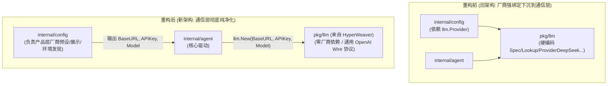
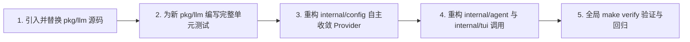

# HyperWeaver pkg/llm 引入与全系统完全重构设计方案

> **变更级别**：T3（系统底层通信库替换、去除 Provider 底层硬编码、应用层配置模型解耦）  
> **指导原则**：完全重构，不保留任何旧代码兼容层/垫片；保持零外部依赖与极简代码哲学。

---

## 一、背景与重构目标

在当前 `my-agent` (Tide) 系统中，底层通信库 `pkg/llm` 仍存留了对预设厂商（DeepSeek、Gemini、Spark、LlamaCpp）以及 `Spec/Lookup` 的隐式耦合。

而在 `HyperWeaver` 项目中，`pkg/llm` 已经被重构为一个**纯净、零第三方依赖、完全面向标准 OpenAI 兼容协议（Chat Completions + SSE）**的现代大模型通信库：
- **纯粹三要素驱动**：只需输入 `BaseURL`、`APIKey`、`Model`，直连任何兼容端点（OpenAI、DeepSeek、Moonshot、通义千问、vLLM、Ollama、LocalAI、Gemini 等）。
- **底层零厂商概念**：通信层剔除所有特定的 `Provider` 枚举和硬编码 `Spec` 注册表，纯粹由 URL 规范化处理器自适应。
- **高性能与零拷贝**：采用 `reader.ReadBytes('\n')` 和 `ssePayloadBytes` 字节切片处理，极大减少 GC 压力。
- **一体化架构**：全包收敛至 `types.go`、`llm.go`、`stream.go` 三个核心文件，零过度封装。

本次重构目标：**直接将 `HyperWeaver/pkg/llm` 作为全新底层通信库引入系统，同步重构上层应用配置与调用链，彻底移除旧代码包袱**。

---

## 二、架构演进对比

### 1. 架构关系重构前 vs 重构后



### 2. 职责边界划分

| 层次 | 模块 | 职责与变更 |
|---|---|---|
| **通信驱动层** | `pkg/llm` | **引入 HyperWeaver 版本**：包含 `types.go`, `llm.go`, `stream.go`。<br/>- 彻底删除 `provider.go`, `protocol.go`, `transport.go`, `errors.go`；<br/>- 接口入参简化为纯净 `Config{BaseURL, APIKey, Model}`；<br/>- 提供流式 `ChatStream` 与极简同步 `Chat`。 |
| **产品配置层** | `internal/config` | **重构自主接管 Provider 概念**：<br/>- `type Provider string` 迁移至 `internal/config`；<br/>- 预设厂商（DeepSeek、Gemini、Spark、LlamaCpp 等）及展示元数据归属于应用层；<br/>- 自动将激活厂商转换为对应端点与密钥，向 Agent 注入纯净三要素。 |
| **智能体内核** | `internal/agent` | **重构初始化**：<br/>- `newLLMFromConfig` 直接通过 `BaseURL`、`APIKey`、`ModelName` 创建客户端；<br/>- 单次请求支持通过 `llm.Request{Model: ...}` 动态覆盖模型。 |
| **交互展示层** | `internal/tui` | **常量引用收敛**：<br/>- 将所有引用 `llm.ProviderLlamaCpp` 统一调整为 `config.ProviderLlamaCpp`。 |

---

## 三、重构实施步骤



### 步骤 1：引入 HyperWeaver 的 `pkg/llm`
- 从 `/Users/apple/Code/Golang/HyperWeaver/pkg/llm/` 复制并替换：
  - `types.go`
  - `llm.go`
  - `stream.go`
  - `README.md`
- 彻底移除旧有的 `provider.go`、`protocol.go`、`transport.go`、`errors.go`。

### 步骤 2：为新 `pkg/llm` 补齐严密单测
- 编写 `llm_test.go`：测试构造校验、端点自适应拼接（智能处理 `/v1`、`/chat/completions`、带版本路径）、本地免密、同步 `Chat`、指数退避抖动重试等。
- 编写 `stream_test.go`：测试 SSE 零拷贝解码、增量文本/思考链合并、四条黄金不变量、工具调用多分片重组、中途断开拦截等。

### 步骤 3：重构 `internal/config`
- 将原依赖于 `llm.Provider` 的类型定义自包含于 `internal/config`：
  ```go
  type Provider string

  const (
      ProviderLlamaCpp Provider = "llamacpp"
      ProviderDeepSeek Provider = "deepseek"
      ProviderGemini   Provider = "gemini"
      ProviderSpark    Provider = "spark"
      ProviderOpenAI   Provider = "openai"
  )
  ```
- `provider_meta.go` 不再依赖 `llm.Spec`，直接自包含厂商网络默认值与展示元数据。

### 步骤 4：重构 `internal/agent` 与 `internal/tui`
- `agent/config.go`：
  ```go
  func newLLMFromConfig(cfg *config.Config) (*llm.Client, error) {
      if cfg == nil {
          return nil, fmt.Errorf("agent: configuration cannot be nil")
      }
      return llm.New(llm.Config{
          BaseURL: cfg.BaseURL,
          APIKey:  cfg.APIKey,
          Model:   cfg.ModelName,
      })
  }
  ```
- 更新 `internal/tui/config_wizard.go`、`internal/agent/agent_test.go` 等引用。

### 步骤 5：全库验证
- 执行 `make verify`：
  - `gofmt` 代码格式化核验；
  - `go vet ./...` 静态检查；
  - `go test -race -count=1 ./...` 全库竞态单测；
  - 二进制构建编译核验。

---

## 四、核心断言与不变量核对

1. **零外部依赖保留**：`pkg/llm` 仍保持纯 Go 标准库实现，可独立拷贝。
2. **三要素直通**：系统任意地方只要有 `BaseURL + APIKey + Model`，即可无障碍发起 LLM 调用，不再受限于特定厂商注册表。
3. **流式契约完整性**：终块恰好出现一次、错误判定精准、分片工具调用有序还原。
4. **不保留任何旧代码兼容垫片**：旧的 `Spec`、`Lookup`、`AuthKind` 完全删除，应用层干脆利落地完成重写。
