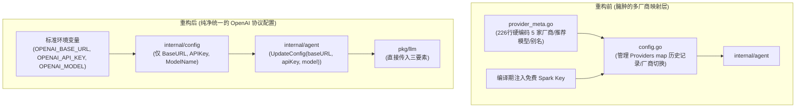

# 系统移除内置供应商与全面拥抱统一 OpenAI 协议重构设计方案

> **变更级别**：T3（核心配置模型简化、移除内置供应商与免费 Key、契约层精简）  
> **指导思想**：极简主义（KISS 原则）、零多余抽象、统一 OpenAI 协议、消除全部硬编码供应商。

---

## 一、背景与重构动机

当前系统为了“内置体验”，维护了庞大的特定厂商元数据（`DeepSeek`、`Gemini`、`Spark`、`LlamaCpp` 等）、专属别名、推荐模型列表、星火平台特殊补丁，以及内置的免费密钥与编译期注入逻辑。这导致：
1. **代码膨胀严重**：`internal/config/provider_meta.go`（226行）、`config.go`（375行）中大量逻辑仅仅是在管理“多厂商切换历史（`Providers map[string]ProviderConfig`）”与硬编码配置；
2. **底层与上层割裂**：底层 `pkg/llm` 已经升级为纯粹的通用 OpenAI 兼容协议库（只需 `BaseURL`、`APIKey`、`Model` 三要素），而应用层却依然维护着一套厚重的供应商状态机；
3. **用户心智负担重**：用户接入自定义中转或本地模型时，还要选择“最接近的厂商”或伪装厂商。

### 核心重构目标
- **彻底移除内置免费模型与内置密钥**：删除 `DefaultSparkAPIKey`，删除 Makefile 中的 `SPARK_FREE_KEY` 动态注入；
- **彻底移除内置供应商概念**：删除 `internal/config/provider_meta.go`，不再在代码中硬编码任何具体厂商；
- **全系统统一采用 OpenAI 协议三要素驱动**：全局只认 `BaseURL`、`APIKey`、`ModelName`；
- **代码大幅精简（瘦身 60%+）**：消除多厂商切换历史、别名解析、推荐模型表与特化探测。

---

## 二、架构演进对比

### 1. 架构流向对比



### 2. 配置文件 `config.json` 极简演进

**重构前（历史包袱）**：
```json
{
  "provider": "spark",
  "base_url": "https://maas-api.cn-huabei-1.xf-yun.com/v2",
  "model_name": "spark-x2.5-4b",
  "api_key": "ak-xxxx",
  "providers": {
    "deepseek": { "base_url": "...", "model_name": "...", "api_key": "..." },
    "gemini": { "base_url": "...", "model_name": "...", "api_key": "..." },
    "spark": { "base_url": "...", "model_name": "...", "api_key": "..." }
  }
}
```

**重构后（极简清晰，与大多数现代 AI CLI 工具一致）**：
```json
{
  "base_url": "https://api.openai.com/v1",
  "api_key": "sk-...",
  "model_name": "gpt-4o"
}
```
*注：本地模型（如 Ollama / vLLM）只需配置 `"base_url": "http://127.0.0.1:11434"`, `"model_name": "qwen2.5:7b"`，`api_key` 为空即可。*

---

## 三、系统各层重构设计

### 1. 配置层 [`internal/config`](file:///Users/apple/Code/Golang/my-agent/internal/config)
- **直接删除文件**：彻底删除 [provider_meta.go](file:///Users/apple/Code/Golang/my-agent/internal/config/provider_meta.go)（减少 226 行代码）。
- **极简结构体重构**：
  ```go
  type Config struct {
      BaseURL   string `json:"base_url"`             // API 基础地址（支持完整路径或自动追加 /chat/completions）
      APIKey    string `json:"api_key,omitempty"`    // API 密钥（本地模型可空）
      ModelName string `json:"model_name"`          // 默认模型名称
  }
  ```
- **环境变量读取**：优先读取 `OPENAI_BASE_URL`、`OPENAI_API_KEY`、`OPENAI_MODEL`（回退兼容 `DEEPSEEK_API_KEY`、`GEMINI_API_KEY`）。
- **默认配置 DefaultConfig()**：
  ```go
  func DefaultConfig() *Config {
      return &Config{
          BaseURL:   firstEnv("OPENAI_BASE_URL", "https://api.openai.com/v1"),
          APIKey:    firstEnv("OPENAI_API_KEY", "DEEPSEEK_API_KEY", "GEMINI_API_KEY"),
          ModelName: firstEnv("OPENAI_MODEL", "gpt-4o"),
      }
  }
  ```
- **删除内容**：删除 `DefaultSparkAPIKey`、删除 `Providers map`、删除厂商切换、删除星火特化逻辑。

---

### 2. 协议契约层 [`internal/protocol`](file:///Users/apple/Code/Golang/my-agent/internal/protocol)
- **简化 `ConfigView`**：
  ```go
  type ConfigView struct {
      BaseURL   string `json:"base_url"`
      ModelName string `json:"model_name"`
      HasAPIKey bool   `json:"has_api_key"`
  }
  ```
- **删除冗余类型**：删除 `ProviderInfo` 结构体（不再需要提供商卡片与推荐模型列表）。
- **更新 `Agent` 契约**：
  ```go
  type Agent interface {
      ...
      Config() ConfigView
      UpdateConfig(baseURL, apiKey, model string) error
      ...
  }
  ```
- **简化审计日志 `LLMRequestTrace`**：删除 `Provider` 字段，保留 `ModelName`。

---

### 3. 内核层 [`internal/agent`](file:///Users/apple/Code/Golang/my-agent/internal/agent)
- **初始化简化**：
  ```go
  func newLLMFromConfig(cfg *config.Config) (*llm.Client, error) {
      if cfg == nil {
          return nil, fmt.Errorf("agent: configuration cannot be nil")
      }
      // 只要指定了 BaseURL 和 Model 即可构建；远程缺 Key 时返回未就绪
      if !isLocalURL(cfg.BaseURL) && strings.TrimSpace(cfg.APIKey) == "" {
          return nil, nil // 保留未就绪状态，供向导输入
      }
      return llm.New(llm.Config{
          BaseURL: cfg.BaseURL,
          APIKey:  cfg.APIKey,
          Model:   cfg.ModelName,
      })
  }
  ```
- **`UpdateConfig(baseURL, apiKey, model string)`**：
  无需任何厂商猜测或别名解析，直接原子更新候选副本、落盘并热切 `llm.Client`！

---

### 4. 交互层 [`internal/tui`](file:///Users/apple/Code/Golang/my-agent/internal/tui)
- **配置向导重构**：
  - 彻底移除“第一步：选择提供商（复杂的按键选择菜单）”；
  - 统一为极简的配置表单：
    1. **API Key**（密码样式输入）
    2. **Base URL**（默认 `https://api.openai.com/v1`，可自定义）
    3. **Model Name**（如 `gpt-4o`, `deepseek-chat`, `qwen2.5:7b` 等）
  - 用户可随时通过 `/model <name>` 极速切换当前模型。
- **状态栏展示**：
  - 顶部状态栏或 dock 统一显示：`● <ModelName>`（不再拼接特定厂商名称）。

---

### 5. 构建与工程配置
- **Makefile**：
  - 删除 `SPARK_FREE_KEY ?= ...` 计算逻辑；
  - 编译参数精简为：`LDFLAGS := -s -w -X my-agent/internal/config.Version=$(VERSION)`。

---

## 四、实施计划

| 阶段 | 任务内容 | 影响文件 |
|---|---|---|
| **Phase 1: 契约与构建精简** | 1. 清理 Makefile 中的 `SPARK_FREE_KEY`<br/>2. 简化 `protocol.ConfigView` 与 `Agent.UpdateConfig` | `Makefile`<br/>`internal/protocol/protocol.go` |
| **Phase 2: 配置层彻底重构** | 1. 彻底删除 `provider_meta.go`<br/>2. 重构 `config.go`，全面统一为三要素配置模型<br/>3. 重写 `config_test.go` | `internal/config/provider_meta.go` (删除)<br/>`internal/config/config.go`<br/>`internal/config/config_test.go` |
| **Phase 3: 内核驱动层简化** | 1. 改造 `agent/config.go` 为直接接收 `baseURL, apiKey, model`<br/>2. 改造 `loop.go` 链路记录<br/>3. 更新 `agent_test.go` 与集成测试 | `internal/agent/config.go`<br/>`internal/agent/loop.go`<br/>`internal/agent/agent_test.go` |
| **Phase 4: TUI 向导与命令调整** | 1. 将配置向导重构为三要素输入<br/>2. 简化顶部/底部状态栏模型展示<br/>3. 更新 `tui_test.go` | `internal/tui/config_wizard.go`<br/>`internal/tui/chat.go`<br/>`internal/tui/tui_test.go` |
| **Phase 5: 全局验证与代码推送** | 1. 执行 `make verify` 全量验证<br/>2. 提交 commit 并推送到 GitHub | 全局 |

---

## 五、收益预期

1. **代码行数减少**：预计净删减 **500~800 行** 胶水和状态机代码。
2. **逻辑复杂度骤降**：消除了供应商多分支判定、历史保存表和特定平台特化逻辑。
3. **架构完全统一**：`pkg/llm` 与上层应用彻底对齐，真正做到统一标准 OpenAI Wire 协议驱动。
