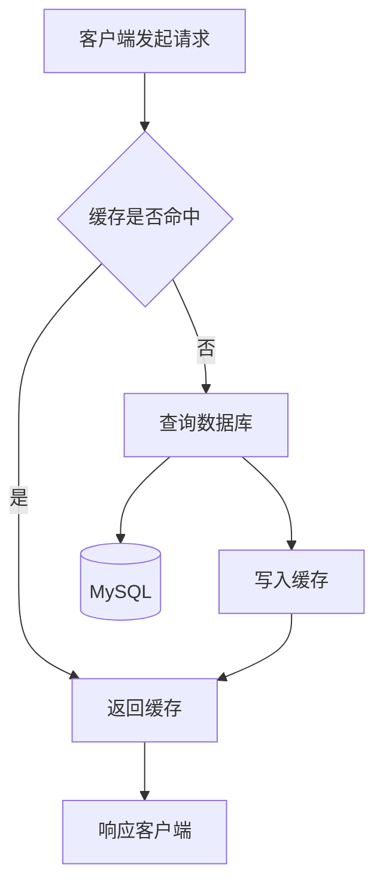

# 图解制作

用 `generate_diagram` 工具把讲解内容变成一张可看的图。
图解适合表达「关系」与「顺序」——这类信息用文字描述往往又长又难懂。

## 什么时候该画图

| 学生的问题形态 | 合适的图 |
| --- | --- |
| 一个请求经过哪些组件 | `flowchart` 自上而下 |
| 多个服务按时间先后交互 | `sequenceDiagram` |
| 一个对象有哪些状态、怎么迁移 | `stateDiagram-v2` |
| 概念之间是包含 / 并列 / 依赖 | `flowchart` 自左向右 |
| 学习路径、阶段划分 | `flowchart` 自上而下 |

**不要**为了图解而图解。单个概念、一两步操作，直接用文字说清即可。

## 构图原则

1. **一张图只讲一件事**。节点控制在 5-9 个，超过就拆成两张。
2. **节点标签是名词短语**，不是完整句子。需要解释的细节放在回答正文里。
3. **方向体现语义**：时间从左上到右下，依赖从上游到下游。
4. **入口与出口要清晰**：让学生一眼看出从哪开始、到哪结束。
5. **用边标签说明条件**，例如 `A -- 缓存命中 --> B`。

## Mermaid 写法要求

- 第一行必须是图类型声明，如 `flowchart TB`。
- 节点 ID 用简短英文或数字（`A`、`B`、`n1`），**标签用中文**。
- 标签里不要放 Markdown 语法、代码块或超长句子。
- 需要换行用 `<br/>`，一行不超过 14 个字。
- 不要写 `classDef` / `style` 配色语句，渲染器已内置统一配色。

## 示例



对应调用：

```json
{
  "title": "请求处理流程",
  "kind": "flow",
  "mermaid": "flowchart TB\n    A[客户端发起请求] --> B{缓存是否命中}\n    B -- 是 --> C[返回缓存]\n    B -- 否 --> D[查询数据库]\n    D --> E[(MySQL)]\n    D --> F[写入缓存]\n    F --> C\n    C --> G[响应客户端]"
}
```

## 生成之后

- 告诉学生图里表达的核心结论，不要只说「图已生成」。
- 如果图只覆盖了部分内容，说明剩余部分在正文中。
- 学生要求修改时，重新调用工具生成新图，不要让学生自己改。
