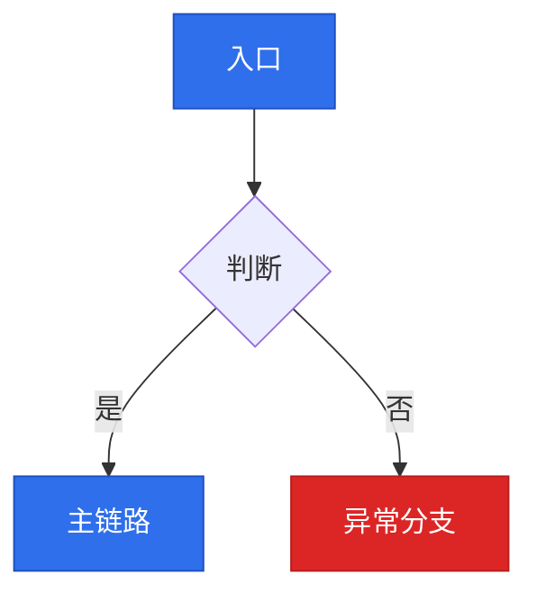
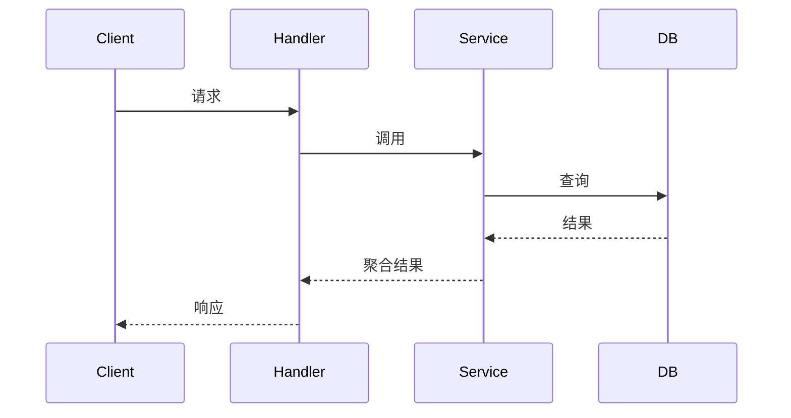

# 现代风格图表

在需要表达"多组件关系""调用时序""状态流转"时使用本技能。
默认使用 Mermaid，因为它在 Markdown 与多数渲染器中可直接显示。

## 选择图表类型

| 想表达的内容 | 用哪种图 |
| --- | --- |
| 系统由哪些部分组成、如何依赖 | `flowchart`（自上而下 `TB` 或自左向右 `LR`） |
| 一次请求经过哪些组件、先后顺序 | `sequenceDiagram` |
| 一个对象有哪些状态、如何迁移 | `stateDiagram-v2` |
| 实体与表结构的关系 | `erDiagram` |
| 时间线上的并行任务 | `gantt` |

## 配色规范

统一使用低饱和度、单一主色family，避免默认的随机彩色：

- **主色（当前焦点/主链路）**：`#2F6FEB` 蓝
- **辅助色（次要组件）**：`#6B7280` 灰
- **强调色（异常/失败路径）**：`#DC2626` 红
- **成功色（完成态）**：`#16A34A` 绿
- **背景色**：`#F9FAFB` 或纯白

在 flowchart 中用 `classDef` 统一定义样式，不要逐个节点写颜色：

## 排版规范

1. **节点文案不超过 12 个汉字**，超出就拆成两个节点或改放在边上注释。
2. **一张图只讲一件事**。若一张图出现 3 个以上独立的关注点，拆成多张。
3. **箭头一律带方向语义**，避免无意义双向箭头；双向依赖用两条单向箭头并标注。
4. **分组用 `subgraph`**，并在标题里写清边界（如 `Harness（确定性外壳）`）。
5. **自上而下优先**，只在横向流程更长时用 `LR`。
6. 关键路径加粗，可在边上用 `%%` 写注释说明设计意图（注释不渲染）。

## 时序图要点

- 参与者别名用短词，不要写完整包路径。
- 用 `alt / else / end` 表达分支，用 `opt / end` 表达可选步骤。
- 长时间操作加 `Note over` 说明，例如超时、并发控制。

## 反面示例

避免这些常见问题：

- ❌ 节点里塞整段代码或长句
- ❌ 每个节点一种颜色，看起来像调色板
- ❌ 用 `-->>` 与 `->>` 混用却不区分同步/异步
- ❌ 图中出现"等等""其他"这类无信息量的占位节点

## 输出约定

- 图表放在解释的**相关段落之后**，不要开头就甩一张大图。
- 图后补一句"这张图的关键点是什么"，帮助读者聚焦。
- 复杂系统先给一张总览图，再按需给局部细节图。
